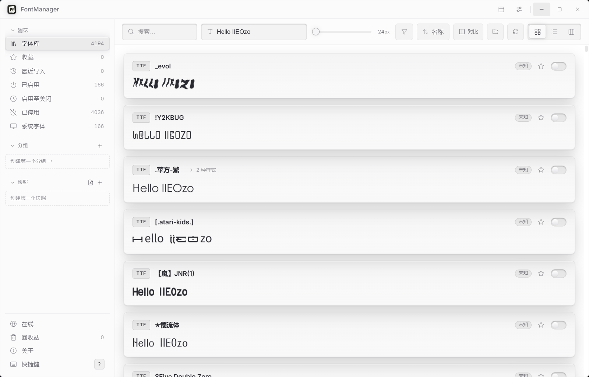
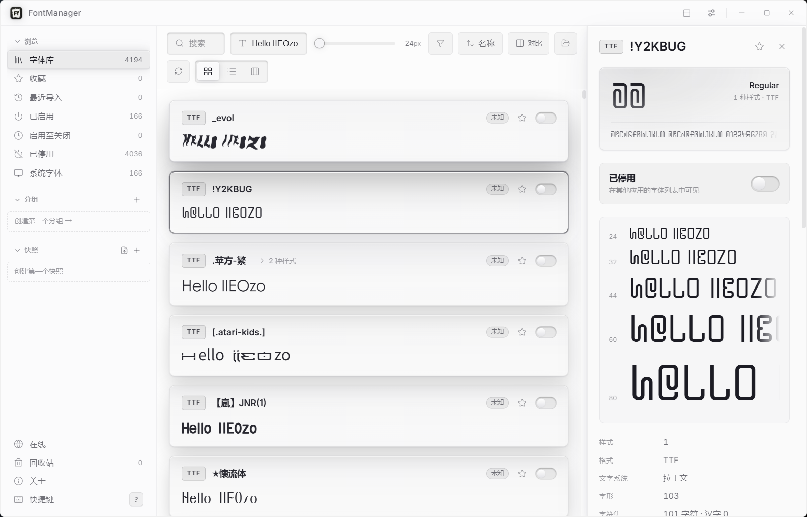
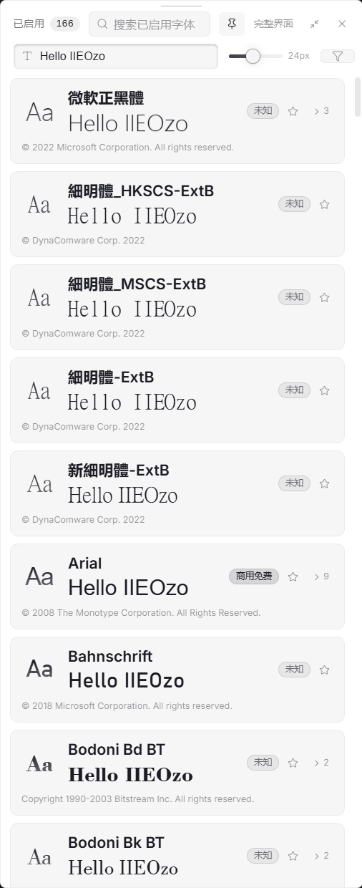

**English** | [简体中文](README.zh-CN.md)

---

<div align="center">


# FontManager

**Your whole font library, one toggle away — and it never leaves your machine.**

Preview, organize, activate and install fonts from one clean, fast app.<br>
Thousands of families stay tidy on a single machine — with plugins, a local API<br>
and MCP when you want your tools to join in.

<br>

[](LICENSE)
[](../../releases)
[](#-platform-notes)
[](#-translations)
[](https://tauri.app)

<br>

**[⬇ Download latest](../../releases/latest)** ·
**[📝 Changelog](CHANGELOG.md)** ·
**[🐛 Issues](../../issues)** ·
**[🔌 Plugins](docs/PLUGINS.md)** ·
**[🤖 MCP](mcp/README.md)**

<br>



<sub>The library: every family rendered live, one toggle away from any app's font menu.</sub>

</div>

<br>

---

## 📖 Table of contents

- [Why FontManager?](#-why-fontmanager)
- [Feature tour](#-feature-tour)
- [Plugins, local API & MCP](#-plugins-local-api--mcp)
- [Keyboard shortcuts](#️-keyboard-shortcuts)
- [Translations](#-translations)
- [Getting FontManager](#-getting-fontmanager)
- [Platform notes](#-platform-notes)
- [Privacy](#-privacy)
- [Building from source](#-building-from-source)
- [Credits](#-credits)
- [License](#-license)

---

## 💡 Why FontManager?

FontManager began life as [ZFontManager](https://github.com/TheHolyOneZ/ZFontManager) —
TheHolyOneZ's answer to the simple frustration that a proper font manager was missing on
Linux, and the good ones elsewhere cost money. **This project is that software, iterated:**
a customized line of builds that started from ZFontManager 0.8.0 and grew into its own
release track, with credit and gratitude to the original author in both directions.

What this fork adds on top of that foundation:

- **Automation, first-class.** An opt-in local HTTP API, an out-of-process plugin system
  with per-plugin permission tokens, and an MCP server — so agents and scripts can query
  fonts, toggle families and manage snapshots without touching the interface.
- **A Windows-first release track** — NSIS and MSI installers, font-library folders with
  their own identity, and interface refinements across all nine languages.

Everything that made the original good is still here: live previews everywhere,
one-click activation, and the iron rule that **your font files stay on your machine**.

> [!WARNING]
> **System fonts are protected.** Fonts your operating system needs to draw its own
> interface can't be deactivated or trashed from FontManager, so you can explore
> fearlessly. Their cards show a small **OS** lock badge instead of a toggle, with
> the reason on hover.

---

## 🎯 Feature tour

### Your whole library, rendered live


- **Three views** — cards / list / waterfall, one click in the toolbar; every card
  is previewed in the font's **own letterforms**
- **Toolbar** — search, custom preview text, an 8-step preview-size slider (8–96px),
  filter and sorting
- **Virtualized lists** — thousands of faces scroll smoothly; previews load on
  demand behind an LRU cache
- **Smart classification** — CJK families recognized by name, monospace / serif /
  sans-serif auto-sorted, variable fonts (VAR) and OpenType features surfaced

### The sidebar: everything starts on the left

- **Browse** (library · favorites · recent imports) plus four state views:
  **activated / activate-until-quit / deactivated / system fonts**
- **Collections** for structure and **tags** you can bulk-apply to a selection
- **Snapshots** capture the current activation set and can be applied,
  merged into the current state, or switched to at any time
- Bottom entries: **online fonts · trash · about · shortcuts** (press <kbd>?</kbd> any time)

### Activate & deactivate — the killer feature

The toggle on each card writes to the system: **every app's font menu updates
immediately.** Deactivated fonts disappear from other apps but stay in the
library, ready to come back instantly.

- **Activate until quit** — temporary fonts restore themselves when you exit
- **Bulk** — select many, right-click "Activate {count}"; an interrupted bulk
  run resumes with a prompt on next start
- **System fonts are protected** — they wear an OS lock badge instead of a toggle

### The detail panel: everything about a family



Click any family for live multi-size specimens, **variable-font axis sliders**,
style / format / script / glyph counts, the full copyright text and file paths —
plus activate, favorite and export right in the header. Name conflicts
(several files claiming one font identity) are called out here.

### Compare & specimens

- **Compare** up to 4 families side by side (toolbar or right-click)
- **Specimen view** exports a full-page PNG — the last look before delivery

### Installing and importing

- **Drop it on the window** — ZIP import; a ZIP mixing several families is
  **rejected as a whole** with a clear reason, so the library never fills with surprises
- **Double-click install** — the `.S-FontManager / .P-FontManager / .L-FontManager`
  container formats land straight in the library
- **Online fonts** — browse Google Fonts by category (serif / sans / handwriting /
  icons…) and Nerd Fonts releases; the **license text sits next to the download
  button** and license files come along automatically
- **Trash** — removal goes to FontManager's own trash first; restore any time,
  permanent deletion only after confirmation

### Apply fonts in Photoshop, Illustrator, CorelDRAW & Affinity

Right-click a family → "Apply in {app}…" sends it straight into your design app:

- **Photoshop / Illustrator** — driven over COM scripting, no menu hunting
- **CorelDRAW** — no scripting API? FontManager **drives CorelDRAW's COM object
  model directly**, matching Chinese fonts by their localized names
- **Affinity auto-activation** — connected to Affinity's MCP server, FontManager
  sees which fonts your open documents are missing and activates the ones your
  library has, so they're simply there when you select text

### ⚡ The QuickBar



<kbd>Alt</kbd>+<kbd>`</kbd> (hotkey is configurable) pops the main window into a
**docked panel pinned to the top of the screen**:

- Shows only **activated** fonts: real letterform previews, license badges
  (free-commercial / unknown…), copyright lines, one-click ★, expandable family
  members ("> 3")
- Top bar: activation count, search across activated fonts, preview text & size,
  a **pin** to keep it expanded, and "full window" to morph back
- **Auto-hide at the top edge** — collapses to a hairline that expands as your
  mouse approaches; drag it to other screen edges to dock
- Right-click any row for the full context menu (activate, copy names, collect, plugins…)

### Organizing and judgment, all local

- **Favorites & ratings** — one click on ★ sets one star, up to five; notes per family
- **Duplicate detection** flags redundant files claiming the same font identity
- **Automatic license detection** reads the font's own license documents and
  answers **personal-free / paid / free-commercial / unknown** with an evidence
  sentence — badges show right on cards and in the QuickBar

### Backup and move

Export the whole library as a `.ZFontManager` pack (**auto-split archives up to
2 GiB**) — font files plus collections, tags, snapshots, notes and ratings travel
together and import anywhere.

### Command palette & shortcuts

<kbd>Ctrl</kbd>+<kbd>K</kbd> opens the command palette: jump to views, toggle fonts,
compare, apply in apps, snapshot operations — hands on the keyboard.
<kbd>?</kbd> shows the full shortcut list.

### Themes & languages

Light and dark themes, optional interface sounds, and a **reduced-motion** mode
that calms every animation; nine languages out of the box, with a translation
guide for contributors.

---

## 🔌 Plugins, local API & MCP

FontManager opens its core to automation — **opt-in, local-only, permission-scoped:**

| Layer | What it does | Docs |
|---|---|---|
| **Local HTTP API** | `127.0.0.1`-only REST API: list/search fonts, activate/deactivate, snapshots, curation. Custom port, resettable token, every route permission-checked | — |
| **Plugins** | Separate processes that talk JSON over stdin/stdout plus a **restricted token** — a plugin crash can never take the app down. Plugins may ship their own interpreter (`interpreterPath`) or a self-contained `.exe` | [docs/PLUGINS.md](docs/PLUGINS.md) |
| **MCP server** | Wraps the local API as MCP tools so agents (WorkBuddy, Claude, Cursor…) can drive your library in conversation | [mcp/README.md](mcp/README.md) |

### 📥 Installing ready-made plugins

The official plugin collection lives in the **[FontManager-Plugin](https://github.com/706972745/FontManager-Plugin)**
repository — every plugin is a standalone folder that **ships its own runtime**,
so nothing needs to be installed on your machine:

1. Grab a plugin ZIP from the [plugin releases](https://github.com/706972745/FontManager-Plugin/releases/latest)
2. Unzip it (e.g. the `specimen-export` folder)
3. FontManager → **Settings → Plugins → "Open plugins folder"**, drop the folder in
4. Toggle the plugin on in **Settings → Plugins** (or hit "Rescan")
5. Right-click any family → **Plugins ›** to use it

### 🖥️ Using the local API

1. Turn on **Settings → Local API** — the address chip shows the actual base
   (e.g. `127.0.0.1:58202`); set a custom port in the field below it
2. The **token** is masked by default; click the eye to reveal, or reset it (old token dies instantly)
3. Send `Authorization: Bearer <token>` on every request
4. Try it (PowerShell):

```powershell
$cfg = Get-Content "$env:APPDATA\FontManager\api.json" | ConvertFrom-Json
curl.exe -H "Authorization: Bearer $($cfg.token)" $cfg.base/health
curl.exe -H "Authorization: Bearer $($cfg.token)" "$($cfg.base)/fonts?q=noto&limit=10"
curl.exe -X POST -H "Authorization: Bearer $($cfg.token)" -H "Content-Type: application/json" `
  -d '{"family":"Noto Sans SC"}' $cfg.base/fonts/activate
```

Handy endpoints: `GET /health` · `GET /fonts` & `GET /fonts/families` ·
`POST /fonts/activate` & `POST /fonts/deactivate` · `POST /fonts/scan` ·
`GET/POST /snapshots` & `POST /snapshots/{name}/apply` · `GET/PUT /curation*`
(notes, ratings, favorites, tags). Every route is permission-checked — a plugin's
restricted token gets a 403 the moment it steps outside its declared scope.

### 🤖 Hooking up MCP

1. Enable the local API (MCP runs on top of it)
2. Add an entry in your MCP client's config (use your own absolute path):

```json
{
  "mcpServers": {
    "fontmanager": {
      "command": "node",
      "args": ["C:\\path\\to\\mcp\\index.mjs"]
    }
  }
}
```

3. Done — the MCP server **reads `%APPDATA%\FontManager\api.json` automatically**
   for port and token, so resetting the token never breaks your config.
   WorkBuddy: connector manager → custom MCP → paste → "Trust"; Claude Desktop and
   Cursor work the same way.

Then just ask in conversation — "list my Noto fonts", "apply the work snapshot".
All 10 tools are documented in **[mcp/README.md](mcp/README.md)**.

Nothing here is enabled by default, and every layer dies the moment you switch
the local API off.

---

## ⌨️ Keyboard shortcuts

Press <kbd>?</kbd> in the app for the full, always-current list — search,
activation, snapshots, the command palette and the QuickBar are all covered.

---

## 🌍 Translations

Nine languages ship in the box: 简体中文 · 繁體中文 · English · 日本語 · Deutsch ·
Español · Français · Português (Brasil) · Русский.
Want to add one? **[docs/TRANSLATING.md](docs/TRANSLATING.md)** — no code required.

---

## 📥 Getting FontManager

Grab the latest installer from
**[Releases](../../releases/latest)**:

- `FontManager_x.y.z_x64-setup.exe` — NSIS, per-user, no admin rights needed
- `FontManager_x.y.z_x64_en-US.msi` — MSI, per-machine, into Program Files

Both are **unsigned** builds; SmartScreen may ask for confirmation. Verify the
SHA-256 in the release notes before running.

---

## 🪟 Platform notes

FontManager is built on Tauri v2 and inherits a cross-platform codebase, but
this fork **ships Windows binaries** (NSIS + MSI) and is tested on Windows.
System-font protection, activation and the trash all use Windows' own
mechanisms (registry + GDI) — never by modifying font files.

---

## 🔒 Privacy

Short version: **out of the box, nothing is sent anywhere.**

- ❌ No account, no sign-up, no telemetry, no crash reporting
- ❌ Nothing about your fonts, tags, collections or notes is ever uploaded —
  there is no feature that does this, switched on or off
- ✅ Everything lives in local files on your machine
- ✅ The only optional network feature is the **online font browser** (off by
  default), which contacts the Google Fonts catalogue and GitHub release
  assets — your IP and the fonts you download, to those hosts only, and
  nothing about your existing library

The local API listens on `127.0.0.1` only and stays disabled until you turn it on.

---

## 🛠 Building from source

```bash
pnpm install
npx vite build
npx tauri build --bundles nsis,msi
```

Rust (MSVC) 1.85+ and Node 20+ are required. Rust unit tests run with
`cargo test --lib`, interface tests with `npm test`.

---

## 🙏 Credits

FontManager is built by **IIEOzo**, iterated from
**[ZFontManager](https://github.com/TheHolyOneZ/ZFontManager) 0.8.0** by
**[TheHolyOneZ](https://github.com/TheHolyOneZ)** — none of this exists
without that foundation. Thank you.

<div align="center">

| | |
|---:|:---|
| 🧬 **Upstream project** | github.com/TheHolyOneZ/ZFontManager |
| 👤 **Original developer** | github.com/TheHolyOneZ |
| 🌐 **Original website** | zsync.eu |
| 🍴 **This fork's source** | github.com/706972745/FontManager |

</div>

Found either project useful? A ⭐ genuinely helps others discover it.

---

## 📄 License

FontManager is free software, released under the
**GNU General Public License v3.0** — same as upstream.

In human terms: you may use it, share it, and change it — and if you
distribute a changed version, it must stay just as free for the next person.

---

<div align="center">
<br>


**FontManager** · your fonts, your machine, your rules

<sub>Iterated from ZFontManager by
<a href="https://github.com/TheHolyOneZ">TheHolyOneZ</a> · fork maintained by
<a href="https://github.com/706972745">IIEOzo</a></sub>

</div>
