[English](README.md) | **简体中文**

---

<div align="center">


# FontManager

**你的全部字体，一键启停，永不离开你的电脑。**

在一个干净、快速的应用里预览、整理、启用和安装字体。<br>
几千款字族也能在一台机器上整理清楚——还带插件、本地 API<br>
和 MCP，让你的其他工具一起参与。

<br>

[](LICENSE)
[](../../releases)
[](#-平台说明)
[](#-翻译)
[](https://tauri.app)

<br>

**[⬇ 下载最新版](../../releases/latest)** ·
**[📝 更新日志](CHANGELOG.md)** ·
**[🐛 问题反馈](../../issues)** ·
**[🔌 插件开发](docs/PLUGINS.md)** ·
**[🤖 MCP 接入](mcp/README.md)**

<br>

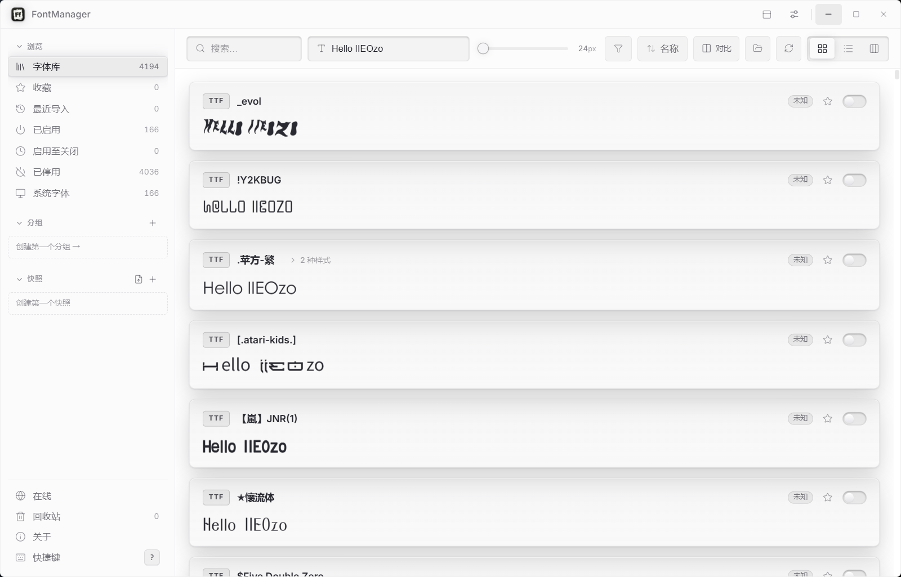

<sub>字体库：每个字族都以自己的字形实时渲染，离任何应用的字体菜单都只差一个开关。</sub>

</div>

<br>

---

## 📖 目录

- [为什么是 FontManager？](#-为什么是-fontmanager)
- [功能手册（手把手版）](#-功能手册手把手版)
- [插件、本地 API 与 MCP](#-插件本地-api-与-mcp)
- [键盘快捷键](#️-键盘快捷键)
- [翻译](#-翻译)
- [获取 FontManager](#-获取-fontmanager)
- [平台说明](#-平台说明)
- [隐私](#-隐私)
- [从源码构建](#-从源码构建)
- [致谢](#-致谢)
- [许可证](#-许可证)

---

## 💡 为什么是 FontManager？

FontManager 始于 [ZFontManager](https://github.com/TheHolyOneZ/ZFontManager)——
TheHolyOneZ 对「Linux 上没有像样的字体管理器、别家好用的还要收费」这个简单苦恼的回应。
**本项目就是这款软件的迭代版**：从 ZFontManager 0.8.0 出发的一支定制构建，
长出了自己的发版路线。对原作者的感谢，两个方向都是真诚的。

在这个地基之上，本分支加了什么：

- **自动化是一等公民。** 可选开启的本地 HTTP API、带独立权限令牌的进程外插件系统、
  以及一个 MCP 服务器——Agent 和脚本无需碰界面，就能查字体、启停字族、管理快照。
- **Windows 优先的发版路线**——NSIS 与 MSI 安装包、最多 3 个字体库地址一键切换
  （每个库都带专属文件夹图标），以及覆盖全部九种语言的界面打磨。

原版所有好的部分都还在：处处实时预览、一键启停，以及那条铁律——
**字体文件永远留在你的电脑里**。

> [!WARNING]
> **系统字体受保护。** 操作系统画自己界面要用的字体，不能从 FontManager
> 停用或删除，你可以放心探索。这些字体的卡片上是一个小小的 **OS** 锁形徽标
> （而不是开关），悬停可见原因。

---

## 🎯 功能手册（手把手版）

> 每个功能都写成「跟着点就行」的步骤。看完这节，软件里每个按钮你都知道是干嘛的。

### 1. 第一次打开：把字体装进库

1. 把**字体文件夹**或 **ZIP 包**直接拖进软件窗口（也可以：设置 → 字体库文件夹 → 「添加文件夹…」选文件夹）
2. 软件开始扫描，进度条走完，每张卡片就都用**字体本来的样子**显示出来了
3. 想加第二个库？设置 → 字体库文件夹 → 「添加文件夹…」再选一个；点某一行可改它的目录，行尾「切换」按钮换当前库（详见 [第 17 节](#17-多字体库最多-3-个库地址一键切换)）

> ZIP 里混了多个字族？会被**整包拒绝**并告诉你原因——这是故意的，防止一次灌进一堆乱七八糟的字体。

### 2. 认识主界面


**左侧栏**（从上到下）：

| 项 | 点它看什么 |
|---|---|
| 浏览 → 字体库 | 全部字体（数字 = 字族总数） |
| 浏览 → 收藏 | 你点过 ★ 的字族 |
| 浏览 → 最近导入 | 刚装进来的 |
| 已启用 | 当前开着开关的 |
| 启用至关闭 | 临时启用的（退出软件自动还原） |
| 已停用 | 关着开关的 |
| 系统字体 | Windows 自带字体（带锁，动不了） |
| 分组 | 你自己建的组（点 + 新建） |
| 快照 | 启用状态的存档（见第 8 节） |
| 在线 / 回收站 / 关于 / 快捷键 | 在线下载 · 删除暂存 · 关于页 · 快捷键表 |

**顶栏**：搜索框 · 预览文字框（改成任何字，全库预览跟着变）· 字号滑杆（8–96px 八档）· 筛选 · 排序 · 对比 · 刷新 · **三个视图按钮（卡片 / 列表 / 样张）**。

**一张字体卡片上有什么**：左上格式徽标（TTF / OTF / VAR=变量字体）· 字族名 ·
实时预览行 · 右侧**版权徽标**（商用免费 / 个人免费 / 未知…）· **★ 收藏** · **开关（启停）**。

### 3. 启用 / 停用：三步搞定

1. 找到字族（搜索或翻列表）
2. 点卡片右侧的**开关**——立刻写入系统
3. 打开任何软件的字体菜单，**它已经在那里了**；关掉开关就从所有应用消失（库里的文件不动）

- 想「临时用一下」？右键 → **启用至关闭**：退出软件时自动还原到之前的状态
- 想**批量**？按住 Ctrl/Shift 多选卡片 → 右键 → 「启用 N 个 / 停用 N 个」；批量没跑完就关了软件？下次启动会问你要不要**接着跑**
- 系统字体带 OS 锁徽标，不能停用不能删——Windows 画自己界面要用的，谁都不能动

### 4. 三种视图：卡片 / 列表 / 样张

顶栏右边三个小图标切换：

- **卡片**（默认）：每族一张卡，实时预览

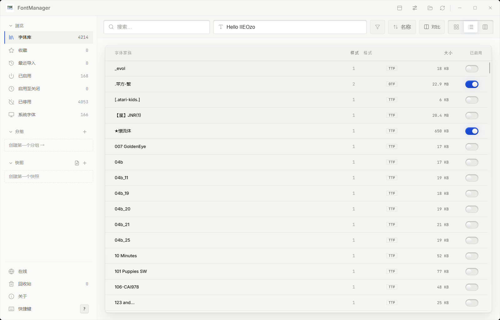

- **列表**：紧凑表格，一列看全库——字族 / 样式数 / 格式 / 大小 / 开关，适合大批量浏览

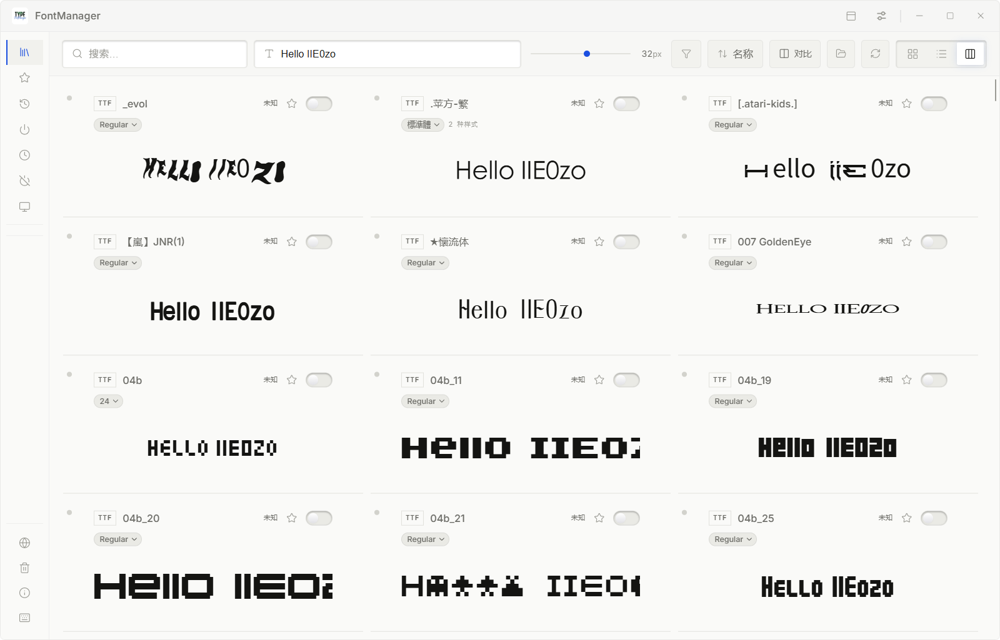

- **样张**：整库**多列样张墙**——每格保留卡片头部全部信息（格式 / 族名 / 版权 / 收藏 / 开关），
  下面用当前字号把示例文字**大字铺开**；每格可单独选字重（记住选择）；字号独立可调——挑字体气质时最好用

### 5. 详情面板：点开一个字族看全部

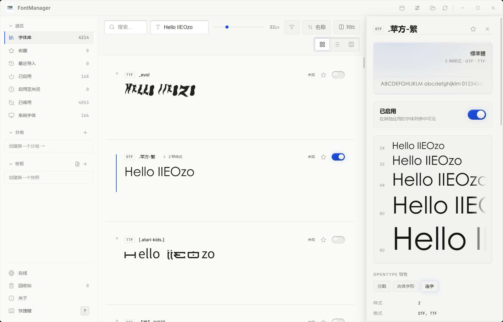

点任意卡片，右侧展开：

- **多字号实时样张**（大字 Aa → 小字，全部用真字体渲染）；变量字体有**轴滑杆**（字重等）
- 元数据：样式数 · 格式 · 分类 · 文字系统 · **字符集真实数字**（共 N 字符 · 汉字 M——「有没有中文」不再是猜）
- **版权信息全文** + 自动判定状态；有名称冲突（多个文件声明同一字体）会在这里红字警告
- 右上角：启停开关 · ★ · **全部导出**（把这个字族**整个文件夹**打成 zip，连同作者的
  授权书 / 说明文档一起发走；字体直接放在库根目录时只打包本字族）；面板左边缘可拖宽，双击恢复

### 6. 收藏与评分

1. 点卡片上的 **★**：收藏这个字族，同时记 **一星**（再点取消）
2. 想打 2–5 星：打开详情面板，点星级控件选几星
3. 速览条里的 ★ 同款；侧栏「收藏」一键过滤所有点过星的
4. 评分只是帮你标记「常用的 / 备用的」，软件不做任何限制

### 7. 整理：分组、标签、备注

- **建分组**：侧栏「分组」旁点 + → 起名 → 把卡片**拖进去**（或右键 → 分组 → 加入）
- **打标签**：多选卡片 → 右键 → 添加标签；标签会显示在卡片和详情上
- **写备注**：详情面板里直接写（比如「客户 A 品牌字体，授权到 2027」）；插件也能帮你写（见字体统计插件）

### 8. 快照：给「启用了哪些字体」拍张照

1. 侧栏「快照」旁点 **+** → 起名 → 当前启用集合被存档
2. 之后随便折腾字体，想回去：点快照 → **应用**（恢复原样）/ **合并到当前**（叠加）/ **切换**
3. **导出快照**：右键快照 → 导出 → 存成 `.S-FontManager` 文件——发给同事，他**双击就导入**
4. 右键 → 清除快照内所有字体 / 删除快照

### 9. 安装新字体：四种方式

| 方式 | 怎么做 |
|---|---|
| 拖 ZIP | 把 ZIP 拖进窗口，自动解包导入 |
| 双击安装 | 双击 `.S-FontManager / .P-FontManager / .L-FontManager` 文件，自动打开软件并导入（安装时已注册文件关联） |
| 在线面板 | 见下图 |

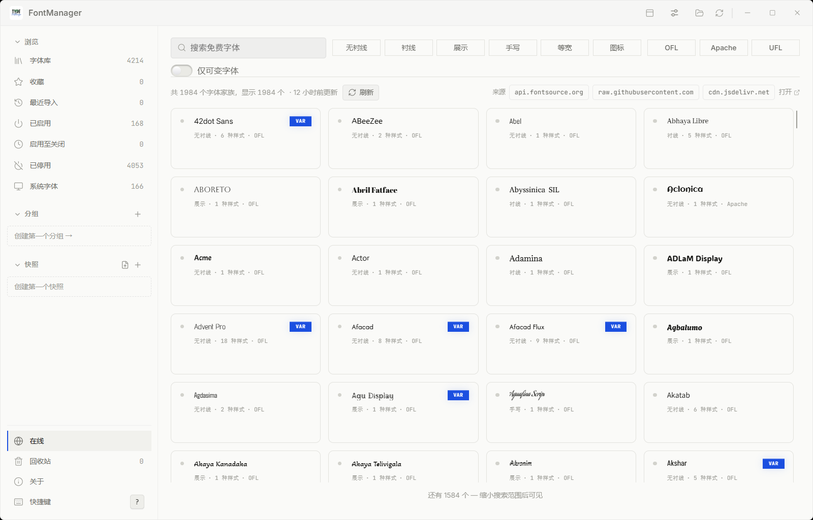

在线面板怎么用：侧栏「在线」→ 顶部按**分类**（无衬线 / 衬线 / 展示 / 手写 / 等宽 / 图标）
和**许可**（OFL / Apache / UFL）筛选，或直接搜；卡片上写明风格 · 样式数 · 许可证
（VAR 徽标 = 变量字体）；点卡片进详情，**添加到字体库**一键下载——授权文本就在
下载按钮旁边，版权文件一起带下来。数据来自 Google Fonts 目录，1984 个家族。
| 本地 API / MCP | 自动化导入（见下节） |

### 10. 导出：所有出口都在这

| 你想导出什么 | 入口 |
|---|---|
| 单个字重（.ttf/.otf 文件） | 右键字面 → 导出字体文件 |
| 整个字族 / 多个字族 | 右键 → 导出字体家族… / 导出 N 个字体家族…（选个文件夹） |
| 字体清单（纯元数据） | 右键 → 导出字体清单… |
| 样张图（PNG） | 右键 → 导出字体样张…；或样张视图 |
| **快照** | 右键快照 → 导出（`.S-FontManager`，可再双击导入） |
| 整理数据（标签/分组/收藏/备注/手动版权/到期日） | 设置 → **导出库数据**（换电脑可合并进来） |
| **整包**（整理数据 + 全部字体） | 设置 → 勾「同时导出字体文件」→ 导出整包 → `.P-FontManager`（超 2GB 自动分卷，导入时任选一卷） |

**导入**一律是：双击文件，或拖进窗口。导入按**文件内容**识别，不看后缀。

FontManager 的专属文件都有**贴纸风格图标**，资源管理器里一眼认出：
软件图标 **.Z** · 快照导出 **.S** · 导出-含字体 **.P** · 导出-仅数据 **.L** · 文件库文件夹 **.F**（灰底 + 抽出的纸 + 黑字母）：

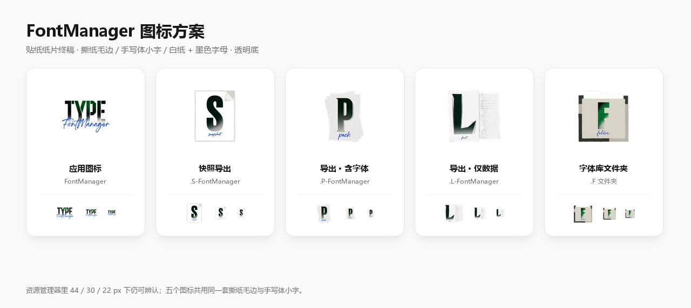

### 11. 回收站：删错了能后悔

1. 右键字族 → 移到回收站（批量同理）——从系统卸载但文件先收着
2. 侧栏「回收站」→ 可**还原**（原样回库）或**永久删除**（二次确认）

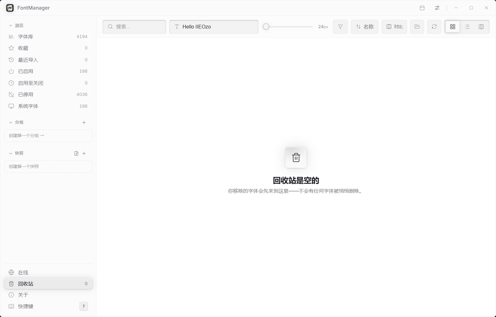

### 12. 版权与查重：不用开浏览器

- 每个字族自动给出**版权结论**：个人免费 / 收费 / 免费商用 / 未知，并附**证据句**（读了哪些授权文档）
- 徽标挂在卡片、速览条上；全文在详情面板
- **绝不自动生成版权文件**：目录里**本来就有**授权文件就读它；没有就不动你的文件夹，
  改看**字体文件自带的版权信息**（详情面板「版权文件」一行会如实显示）；同目录两份矛盾授权 → 判「未知」让你自己看
- 判错了？详情面板里可**手动改判**并记录
- **查重**：同一个字体标识有多个文件时自动标出，详情面板里处理

### 13. 在 Photoshop / Illustrator / CorelDRAW / Affinity 中应用

右键字族 → 「在 {app} 中应用…」：

- **Photoshop / Illustrator**：脚本直送，不用翻菜单
- **CorelDRAW**：直接驱动它的 COM 对象模型（中文按中文名匹配）
- **Affinity**：开启自动激活后，打开的文档缺什么字体、库里有的自动补上

### 14. ⚡ 速览条：任何应用里 1 秒切字体

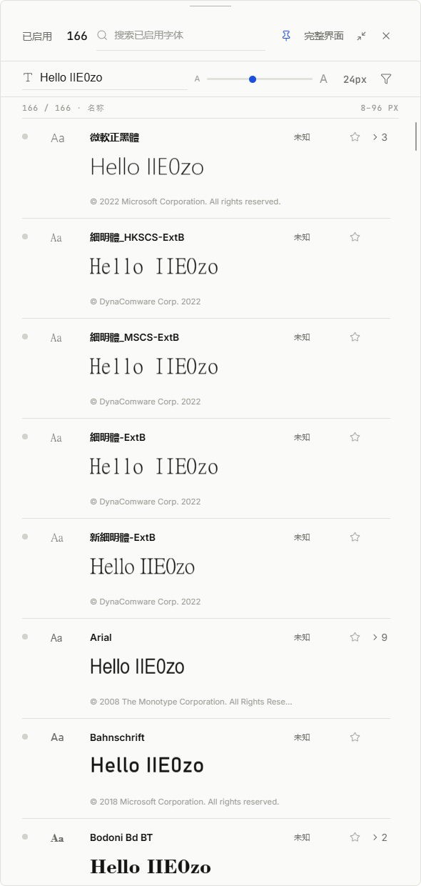

1. 任何界面按 <kbd>Alt</kbd>+<kbd>`</kbd>——主窗口收成**贴顶速览面板**
   （热键在 设置 → 系统 → 「速览快捷键」里改，见下图）
2. 只显示**已启用**的字体：点名字复制、★ 收藏、开关直接启停、"> 3" 展开同族字重、右键出全套菜单
   （右键菜单里**直接打字**就能搜字体：默认搜已启用的，<kbd>Tab</kbd> 切换全部——见第 16 节）
3. 顶部：搜索已启用字体 · 改预览文字和字号 · **图钉**固定 · 「完整界面」回主窗口
4. 不用了：拖回屏幕顶它自己收成一条细线，鼠标靠近再展开；或按 <kbd>Alt</kbd>+<kbd>`</kbd> 收回

### 15. 对比

1. 点工具栏「**对比**」进入挑选模式（或多选后右键 → 对比 N 个）
2. 挑 2–4 个字族
3. 并排看同样文字在不同字体下的效果，随时移除重挑

### 16. 键盘党：命令面板与快捷键

- <kbd>Ctrl</kbd>+<kbd>K</kbd>：命令面板——输入即达（跳视图、启停、对比、在应用中应用、快照…）

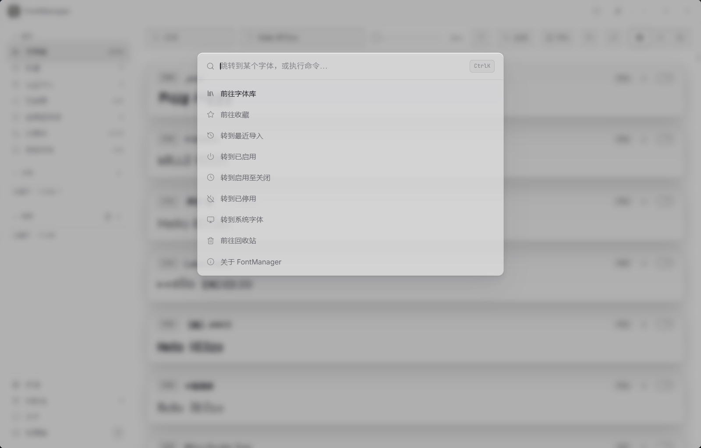

- **右键菜单打字即搜**：任何右键菜单（卡片 / 列表 / 样张 / 速览 / 详情面板）出现后**直接打字**，
  顶部立刻出现搜索框，全库字体实时过滤——<kbd>↑</kbd><kbd>↓</kbd> 选择、<kbd>Enter</kbd> 或点击选中，
  自动跳到对应视图并滚动到该字体位置；<kbd>Esc</kbd> 先清空搜索、再按一次关菜单
- **Tab 切搜索范围**：搜索时按 <kbd>Tab</kbd>（或点搜索框旁的徽章）在「已启用 ↔ 全部字体」间切换——
  速览默认只搜已启用字体（选中就在速览内定位；选中未启用的会自动退回完整界面并定位），完整界面默认全部
- <kbd>?</kbd>（或侧栏「快捷键」）：完整快捷键表——导航 / 选择 / 对选中操作 / 快照全都在

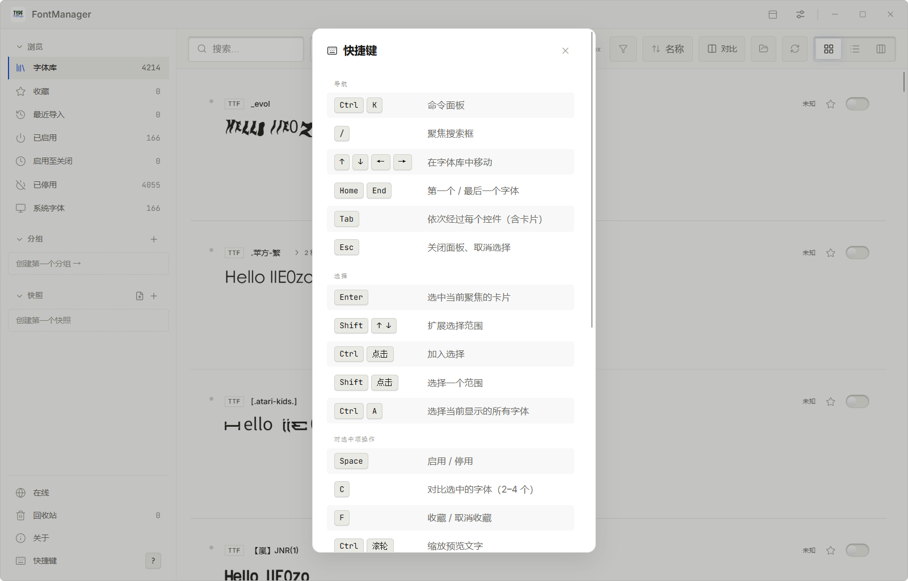

### 17. 多字体库：最多 3 个库地址，一键切换

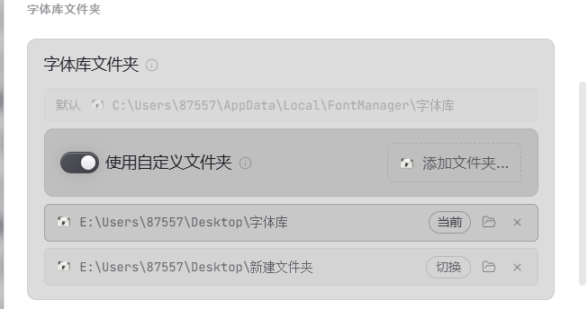

字体不放在一个地方？设置 → **字体库文件夹**：

1. 默认库是安装目录旁的「字体库」文件夹；打开「**使用自定义文件夹**」就能加自己的
2. 点「**添加文件夹…**」最多加 3 个库地址，每个库都挂上 FontManager 的**专属文件夹图标**，资源管理器里一眼认出
3. 行尾「**切换**」按钮换当前库，扫描结果实时跟着换；「📁」直接打开这个文件夹，「✕」移除
4. 库的列表跟着软件走——换电脑导出数据也一起带过去

### 18. 外观与语言

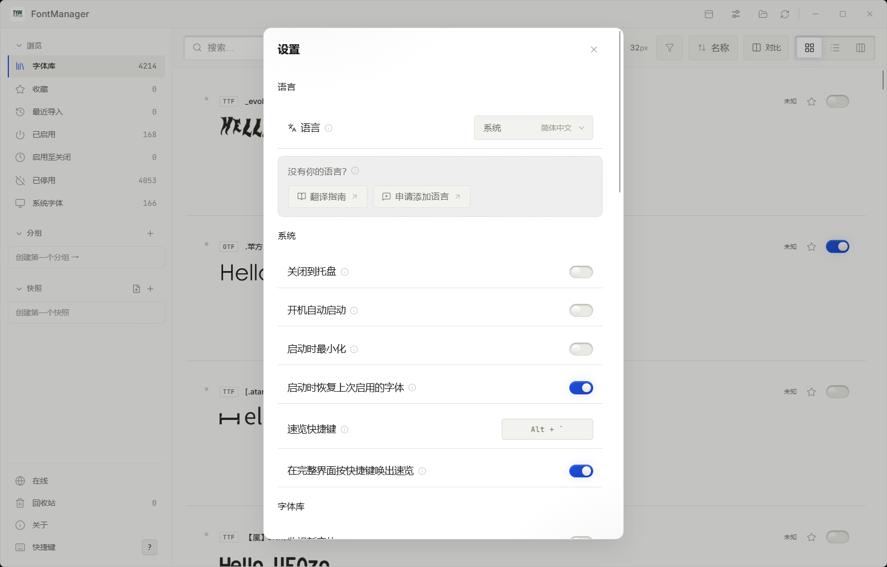

设置里可换：浅色 / 深色主题 · 界面音效开/关 · **减弱动效**（动画收敛、降透明度）·
九种界面语言（简体中文 · 繁體中文 · English · 日本語 · Deutsch · Español · Français · Português (Brasil) · Русский）。

### 19. 再进一步：插件 / API / MCP

想让它**自己干活**？看下一节。

---

## 🔌 插件、本地 API 与 MCP

FontManager 把核心能力开放给自动化——**默认关闭、仅限本机、按权限放行：**

| 层 | 做什么 | 文档 |
|---|---|---|
| **本地 HTTP API** | 只监听 `127.0.0.1` 的 REST API：查字体、启停、快照、整理数据。端口可设、令牌可重置、每条路由都有权限检查 | — |
| **插件** | 独立进程，通过 stdin/stdout 的 JSON + **受限令牌**通信——插件崩溃绝不会带走主程序。插件可以自带解释器（`interpreterPath`），也可以直接是自包含的 `.exe` | [docs/PLUGINS.md](docs/PLUGINS.md) |
| **MCP 服务器** | 把本地 API 包装成 MCP 工具，让 Agent（WorkBuddy、Claude、Cursor…）在对话里驱动你的字体库 | [mcp/README.md](mcp/README.md) |

### 📥 安装现成插件

官方插件集中在 **[FontManager-Plugin](https://github.com/706972745/FontManager-Plugin)** 仓库。
1.4.4 起两种装法：

- **拖拽安装**：把插件 ZIP 拖进软件窗口任意位置——主程序按 `plugin.json` 自动识别
  并安装（普通字体 ZIP 包仍然按字体导入，两者不会混淆）；
- **按钮安装**：**设置 → 插件 → 「从 ZIP 安装」**。

手工装法（任何版本都行）：解压出插件文件夹，放进插件目录
（**设置 → 插件 → 「打开插件目录」**），回软件里打开开关即可。

**关于解释器**：安装包自带一份**共享 Python 运行时**（Python 3.13 + Pillow +
fontTools，位于软件目录 `python-runtime/`）——**机器上没装 Python 也能直接跑
标准库插件**，什么都不用装。解释器解析顺序：插件自带（`interpreterPath`）→
主程序内置运行时 → 系统 Python。重依赖插件仍可自带 `runtime/`；
完整说明与排障见 [docs/PLUGINS.md](docs/PLUGINS.md)。

手工安装步骤（任何版本都行）：

1. 到 [插件库 Releases](https://github.com/706972745/FontManager-Plugin/releases/latest) 下载想要的插件 ZIP
2. 解压出插件文件夹（如 `specimen-export`）
3. FontManager → **设置 → 插件 → 「打开插件目录」**，把文件夹放进去
4. **设置 → 插件** 里打开插件开关（或点「重新扫描」）
5. 在任意字族上**右键 → 插件 ›** 使用；**设置 → 插件** 里那一行本身也是入口：
   行尾**齿轮**打开插件自己的设置面板（插件声明了才有），在**行上右键**能看到不需要
   选中字体的那些功能（打开导出目录、改保存位置…）

### 🖥️ 使用本地 API

1. **设置 → 本地 API** 打开开关——地址牌显示实际地址（如 `127.0.0.1:58202`），端口可在下面输入框自定义
2. **令牌**默认打码隐藏，点眼睛显示；泄露了就点「重置令牌」（旧的立即失效）
3. 所有请求都要带请求头：`Authorization: Bearer <令牌>`
4. 试试看（PowerShell / curl）：

```powershell
$cfg = Get-Content "$env:APPDATA\FontManager\api.json" | ConvertFrom-Json
# 健康检查
curl.exe -H "Authorization: Bearer $($cfg.token)" $cfg.base/health
# 搜字体
curl.exe -H "Authorization: Bearer $($cfg.token)" "$($cfg.base)/fonts?q=思源&limit=10"
# 启用一个字族（写入系统，任何应用的字体菜单立刻可用）
curl.exe -X POST -H "Authorization: Bearer $($cfg.token)" -H "Content-Type: application/json" `
  -d '{"family":"Noto Sans SC"}' $cfg.base/fonts/activate
```

常用端点速查：

| 端点 | 作用 |
|---|---|
| `GET /health` | 健康检查 + 字体总数 |
| `GET /fonts` `GET /fonts/families` | 列出 / 搜索字体（q、limit、offset） |
| `POST /fonts/activate` `POST /fonts/deactivate` | 启用 / 停用字族 |
| `POST /fonts/scan` | 触发一次库扫描 |
| `GET/POST /snapshots` `POST /snapshots/{name}/apply` | 快照：列表 / 创建 / 应用 |
| `GET/PUT /curation*` | 备注、评分、收藏、标签 |

#### 权限：403 是怎么回事

每条路由都有一道**权限闸门**。插件拿到的是**受限令牌**，只含它 `plugin.json` 里
`permissions` 申报过的那几项，越权直接 **403**（正文会写明缺哪一项）。

| 权限 | 能做什么 |
|---|---|
| `read:fonts` | 读字体 / 字族清单、启用状态 |
| `write:fonts` | **启用 / 停用 / 重扫**——改的是系统级状态，最该盯紧的一项 |
| `read:snapshot` / `write:snapshot` | 看 / 建 / 删 / 应用方案快照 |
| `read:curation` / `write:curation` | 读 / 改你写的标签、备注、评分、收藏 |
| `export` / `import` | 触发打包导出、查进度 / 导入字体包 |

请求的判定顺序是 **401（没令牌）→ 403（没这项权限）→ 422（请求体格式错）**：
权限检查在解析 body **之前**就跑完了，所以「缺权限」永远不会表现成 422。

少了权限，改**插件自己**的 `plugin.json` 把权限加进 `permissions`，再「重新扫描」即可
（令牌是启用时签发的，不重启不会变）——**不用改 FontManager**。想确认自己手里到底有什么，
读 `GET /health` 的 `permissions` 字段（`allPermissions` 才是全部可用权限）。

> 完整权限表、加新接口的规矩（`routes()` + `perm_for()` 必须同时改，否则**默认放行**）、
> 以及 `perm_for` 里 `match` 顺序的坑，见 [docs/PLUGINS.md](docs/PLUGINS.md#权限403-到底是谁拦的)。

### 🤖 接入 MCP（让 Agent 驱动你的字体库）

1. 设置 → 本地 API 开关打开（MCP 靠它工作）
2. 在 MCP 客户端配置里加一项（路径换成自己的绝对路径）：

```json
{
  "mcpServers": {
    "fontmanager": {
      "command": "node",
      "args": ["C:\\path\\to\\mcp\\index.mjs"]
    }
  }
}
```

3. 完事。MCP 服务器**自动读** `%APPDATA%\FontManager\api.json` 拿端口和令牌，
   重置令牌也不用改配置。WorkBuddy：连接器管理 → 自定义 MCP → 粘贴配置 → 点「信任」；
   Claude Desktop / Cursor 同理。

之后就可以在对话里说「列出我的思源字体」「应用快照 上班配置」——
10 个工具详见 **[mcp/README.md](mcp/README.md)**。

#### Agent + 字体库能玩出什么？

MCP 只交给 Agent 一套「查、启、停、记」的动词，剩下的想象力是 Agent 的。
几个真实可行的玩法：

- **以图搜字**：把一张海报、logo 或聊天截图丢进对话，让 Agent 看图里字形的特点
  （衬线、字重、笔画收尾……），再翻库里的字体逐个比对——
  「我库里有没有和这张图一样的字体？叫什么名字？」
  Agent 能通过 `font_detail` 拿到字体文件路径，直接打开字体文件渲染样张核对后再下结论，
  不靠猜
- **缺字自愈**：把设计稿或文档要用的字体清单发给 Agent——库里缺的它告诉你，
  库里有的直接帮你启用，省去一个个翻字体菜单
- **规模化整理**：「给上周导入的字体全部打上“待审”标签」「把评分低于 3 星的字族都停用」
  这类几十次点击的活，一句话的事
- **定时巡检**：给 Agent 排个定时任务，每天扫一遍新字体、套用指定快照、把库的状态汇报给你

> 以图搜字这类玩法需要 MCP 客户端本身支持发图（WorkBuddy、Claude Desktop 都可以）。

这些默认都没有开启；把本地 API 关掉，所有层同时失效。

---

## ⌨️ 键盘快捷键

在应用里按 <kbd>?</kbd> 查看完整且始终最新的列表——搜索、启停、快照、
命令面板与速览条都在里面。

---

## 🌍 翻译

开箱即用九种语言：简体中文 · 繁體中文 · English · 日本語 · Deutsch ·
Español · Français · Português (Brasil) · Русский。
想添加你的语言？看 **[docs/TRANSLATING.md](docs/TRANSLATING.md)**——不需要写代码。

---

## 📥 获取 FontManager

到 **[Releases](../../releases/latest)** 下载最新安装包：

- `FontManager_x.y.z_x64-setup.exe` — NSIS，按用户安装，无需管理员权限
- `FontManager_x.y.z_x64_en-US.msi` — MSI，按机器安装，装入 Program Files

两个安装包都**未做代码签名**，SmartScreen 可能会请求确认。运行前请先核对
Release 说明中的 SHA-256。

---

## 🪟 平台说明

FontManager 基于 Tauri v2 构建，继承了跨平台代码底子，但本分支**只发布
Windows 二进制**（NSIS + MSI）并在 Windows 上测试。系统字体保护、启停与
回收站都走 Windows 自己的机制（注册表 + GDI）——从不修改字体文件本身。

---

## 🔒 隐私

简短版：**开箱状态，什么都不外发。**

- ❌ 无账号、无注册、无遥测、无崩溃上报
- ❌ 你的字体、标签、分组、备注永远不会被上传——不存在这个功能，开或关都没有
- ✅ 一切都在你电脑上的本地文件里
- ✅ 唯一可联网的可选功能是**在线字体面板**（默认关闭），它只联系 Google Fonts
  目录与 GitHub 发布资源——传出去的只有你的 IP 和你选择下载的字体，
  与你已有的库无关

本地 API 只监听 `127.0.0.1`，在你打开之前一直处于关闭状态。

---

## 🛠 从源码构建

```bash
pnpm install
npx vite build
npx tauri build --bundles nsis,msi
```

需要 Rust（MSVC）1.85+ 与 Node 20+。Rust 单元测试用 `cargo test --lib`，
界面测试用 `npm test`。

---

## 🙏 致谢

FontManager 由 **IIEOzo** 构建，迭代自
**[TheHolyOneZ](https://github.com/TheHolyOneZ)** 的
**[ZFontManager](https://github.com/TheHolyOneZ/ZFontManager) 0.8.0**——
没有那个地基，就没有这里的一切。谢谢。

<div align="center">

| | |
|---:|:---|
| 🧬 **上游项目** | github.com/TheHolyOneZ/ZFontManager |
| 👤 **原作者** | github.com/TheHolyOneZ |
| 🌐 **原作者网站** | zsync.eu |
| 🍴 **本分支源码** | github.com/706972745/FontManager |

</div>

觉得哪个项目有用？一个 ⭐ 都能实实在在帮到后来的人。

---

## 📄 许可证

FontManager 是自由软件，遵循 **GNU General Public License v3.0**——与上游一致。

用人话说：你可以使用、分享和修改它；但如果你分发修改后的版本，
必须让下一个人获得同样的自由。

---

<div align="center">
<br>


**FontManager** · 你的字体，你的电脑，你说了算

<sub>迭代自 <a href="https://github.com/TheHolyOneZ">TheHolyOneZ</a> 的 ZFontManager ·
由 <a href="https://github.com/706972745">IIEOzo</a> 维护</sub>

</div>
