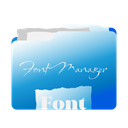

# 应用图标规范 · 拼贴纸片风

一套「撕纸毛边 / 叠纸层次 / 渐变蓝字标 / 手写体小字」的蓝白图标。
软件本体、四种导出文件、字体库文件夹全部共用这一套母版，保证在资源管理器里
一眼能认出「这几个东西是一家的」。

> 设计原稿（浏览器打开）：[`docs/icons/交付板-图标规范.html`](icons/交付板-图标规范.html)
> 视觉预览：[规范化透明版](icons/preview-规范化透明版.png) ·
> [小尺寸可读性](icons/preview-小尺寸可读性.png)
> 重跑产物：`python tools/make-icons.py --sheet`（见第 4 节）

---

## 1. 五套图标

| 图标 | 用途 | 母版 | 落位 |
|---|---|---|---|
|  | **软件图标**（exe / 任务栏 / 托盘 / 开始菜单 / 关于页 / 标题栏 / 启动页） | `icons/main/main.ico` | `src-tauri/icons/*`、`public/icon*.png`、`public/favicon.png`、`public/splash-icon.png` |
|  | **快照导出**（`.S-FontManager`，`SF` / Snapshot） | `icons/snapshot/snapshot.ico` | `src-tauri/assets/snapshot-icon.ico`、`public/icons/icon-snapshot.png` |
|  | **导出包 · 含字体**（`.P-FontManager`，`PF` / Pack） | `icons/pack/pack.ico` | `src-tauri/assets/pack-icon.ico`、`public/icons/icon-export-pack.png` |
|  | **导出 · 仅数据**（`.D-FontManager`，`DF` / Data） | `icons/library/library.ico` | `src-tauri/assets/data-icon.ico`、`public/icons/icon-export-data.png` |
|  | **字体库文件夹**（资源管理器里的库图标） | `icons/folder/folder.ico` | `src-tauri/icons/library-folder.ico`、`public/icons/icon-folder.png` |

四枚文件/文件夹图标共用同一套语言：**撕边白纸片 + 渐变蓝字母标 + 页脚手写体小字**
（Snapshot / Pack / Data / Font）。字母标是「大写主字母 + 上标 F」的两字组合，
手写小字只用来说明这个文件是干什么的，16px 下看不出来属于正常。

主图标另外自带**白色圆角底板**（桌面上像一张卡片），左上角一行手写体小字
`Font Manager`、下沿 `IIEOzo`，是设计的一部分，**裁图时不许裁掉**。
其余四枚是**透明底**（贴在文件/文件夹上）。

每套都含 `.ico`（16 / 24 / 32 / 48 / 64 / 128 / 256 七帧，每帧 PNG 压缩、32bpp）
与同尺寸 `.png`。

> `docs/icons/library/` 这个目录名是历史约定（这枚旧称「字体库数据」），
> 现在装的是「导出 · 仅数据」。**目录名不要改**，否则本文与交付板里的图片链接全断。

## 2. 工程落位明细

| 源文件 | 目标 | 说明 |
|---|---|---|
| `main/main.ico` | `src-tauri/icons/icon.ico` | exe 内嵌图标、安装包/卸载包图标（`tauri.conf.json` 的 `bundle.icon` / `installerIcon`） |
| `main/main_32/64/128/256.png` | `src-tauri/icons/32x32.png`、`64x64.png`、`128x128.png`、`128x128@2x.png` | Tauri 的 PNG 图标档 |
| `main/master(1024)` | `src-tauri/icons/icon.png`（512）、`public/icon-512.png`（512） | 从 1024 master 降采样到 512（母版够大，不是拿 256 硬放大），供 Linux / 关于页用 |
| `main/main_128/256.png` | `src-tauri/icons/icon.icns` | macOS 打包用，`ic07/ic08/ic09` 三帧 |
| `main/main_*` | `src-tauri/icons/Square*Logo.png`、`StoreLogo.png` | UWP/appx 尺寸档（桌面安装包不读，保持一致） |
| `main/main_64.png` | `public/icon.png` | 标题栏品牌标（21px）、引导浮层（36px） |
| `main/main_32.png` | `public/favicon.png` | 设置面板页脚（13px）、浏览器标签页 |
| `main/main_256.png` | `public/splash-icon.png` | 启动页 `splash.html` 的 120px 可视图标 |
| `snapshot/snapshot.ico` | `src-tauri/assets/snapshot-icon.ico` | `file_assoc.rs` 用 `include_bytes!` 内嵌，启动时写到 exe 同目录 |
| `pack/pack.ico` | `src-tauri/assets/pack-icon.ico` | 同上 |
| `library/library.ico` | `src-tauri/assets/data-icon.ico` | 同上；`.D-FontManager` 与兼容读的旧后缀 `.L-FontManager` 共用这一枚 |
| `folder/folder.ico` | `src-tauri/icons/library-folder.ico` | `library_marker.rs` 内嵌，写进字体库根目录的 `.zfm-folder.ico` |
| `*-64.png` | `public/icons/icon-*.png` | 界面内 ArtIcon（导出/选库按钮、空态插图） |

## 3. 换图标时要注意

1. **`.ico` 必须是七帧**（16/24/32/48/64/128/256）、每帧 PNG —— `src-tauri/src/file_assoc.rs`
   与 `library_marker.rs` 的单测按帧数断言，少一帧直接挂测试。
2. **构图口径**：除主图标外，先按 alpha 裁掉透明边，再等比缩放让**长边 = 0.82 ×
   画布**，最后居中贴到正方形透明画布。这条决定图标在资源管理器里看起来的大小，
   和旧版差异过大会显得「这一家的图标忽大忽小」。主图标自带底板，满版直接缩放，不裁。
3. **16 / 24 / 32 三档单独处理**：这三档由无头 Edge 按目标像素**原生栅格化**
   （矢量直接落在小尺寸上比从 1024 降采样更锐），脚本会打印两种做法的锐度分数。
   换设计稿后要重新看一遍 `preview-小尺寸可读性.png`，别只看 256。
4. **图标文件换内容后要通知资源管理器**：注册表里的路径没变，Explorer 会继续拿缓存
   画旧图标。`ensure_associations()` 现在只要图标字节变了就发 `SHCNE_ASSOCCHANGED`；
   字体库文件夹那边由 `library_marker::apply()` 发 `SHCNE_UPDATEDIR`。
5. 位图母版最大只有 256 的档来自 1024 master 降采样；要出 512 以上（例如商店大图），
   得让设计补更大的原图，不要拿 256 硬放大。

## 4. 怎么重跑

设计稿是 Illustrator 导出的 5 个 SVG（`资源 2、3、4、5、16.svg`），落位点**不要手改**：

```bash
python tools/make-icons.py --src "E:/Users/87557/Desktop/工作快捷目录/SVG" --sheet
```

脚本会依次做：无头 Edge 渲染 1024 master（透明底）→ 构图归一化 → 出七档 PNG 与
七帧 ICO → 拷到 `src-tauri/`、`public/` 的全部落位 → 重出两张预览图 →
自检 5 个 ICO 的帧数/尺寸/PNG/alpha。产物全部可丢弃重生成，仓库里只保留结果。
