# 应用图标规范 · 拼贴纸片风

一套「撕纸毛边 / 叠纸层次 / 半透明胶带 / 手写首字母」的黑白灰图标。
软件本体、四种导出文件、字体库文件夹全部共用这一套母版，保证在资源管理器里
一眼能认出「这几个东西是一家的」。

> 设计原稿（浏览器打开）：[`docs/icons/交付板-图标规范.html`](icons/交付板-图标规范.html)
> 视觉预览：[规范化透明版](icons/preview-规范化透明版.png) ·
> [小尺寸可读性](icons/preview-小尺寸可读性.png)

---

## 1. 五套图标

| 图标 | 用途 | 母版 | 落位 |
|---|---|---|---|
|  | **软件图标**（exe / 任务栏 / 托盘 / 开始菜单 / 关于页 / 标题栏） | `icons/main/main.ico` | `src-tauri/icons/*`、`public/icon*.png`、`public/favicon.png` |
|  | **快照导出**（`.S-FontManager`） | `icons/snapshot/snapshot.ico` | `src-tauri/assets/snapshot-icon.ico`、`public/icons/icon-snapshot.png` |
|  | **导出包 · 含字体**（`.P-FontManager`） | `icons/pack/pack.ico` | `src-tauri/assets/pack-icon.ico`、`public/icons/icon-export-pack.png` |
|  | **导出 · 仅数据**（`.L-FontManager`，json） | `icons/library/library.ico` | `src-tauri/assets/data-icon.ico`、`public/icons/icon-export-data.png` |
|  | **字体库文件夹**（资源管理器里的库图标） | `icons/folder/folder.ico` | `src-tauri/icons/library-folder.ico`、`public/icons/icon-folder.png` |

每套都含 `.ico`（16 / 24 / 32 / 48 / 64 / 128 / 256 七帧）与同尺寸 `.png`。
主图标是**白底板**（桌面上像一张纸），其余四套**透明底**（贴在文件/文件夹上）。

## 2. 工程落位明细

| 源文件 | 目标 | 说明 |
|---|---|---|
| `main/main.ico` | `src-tauri/icons/icon.ico` | exe 内嵌图标、安装包/卸载包图标（`tauri.conf.json` 的 `bundle.icon` / `installerIcon`） |
| `main/main_32/64/128/256.png` | `src-tauri/icons/32x32.png`、`64x64.png`、`128x128.png`、`128x128@2x.png` | Tauri 的 PNG 图标档 |
| `main/main_256.png` | `src-tauri/icons/icon.png`（512）、`public/icon-512.png`（512） | 放大到 512，供 Linux / 关于页用 |
| `main/main_128/256.png` | `src-tauri/icons/icon.icns` | macOS 打包用，`ic07/ic08/ic09` 三帧 |
| `main/main_32/48/64/128/256.png` | `src-tauri/icons/Square*Logo.png`、`StoreLogo.png` | UWP/appx 尺寸档（桌面安装包不读，保持一致） |
| `main/main_64.png` | `public/icon.png` | 标题栏品牌标（21px）、引导浮层（36px） |
| `main/main_32.png` | `public/favicon.png` | 设置面板页脚（13px）、浏览器标签页 |
| `snapshot/snapshot.ico` | `src-tauri/assets/snapshot-icon.ico` | `file_assoc.rs` 用 `include_bytes!` 内嵌，启动时写到 exe 同目录 |
| `pack/pack.ico` | `src-tauri/assets/pack-icon.ico` | 同上 |
| `library/library.ico` | `src-tauri/assets/data-icon.ico` | 同上 |
| `folder/folder.ico` | `src-tauri/icons/library-folder.ico` | `library_marker.rs` 内嵌，写进字体库根目录的 `.zfm-folder.ico` |
| `*-64.png` | `public/icons/icon-*.png` | 界面内 ArtIcon（导出/选库按钮、空态插图） |

## 3. 换图标时要注意

1. **`.ico` 必须是七帧**（16/24/32/48/64/128/256）——`src-tauri/src/file_assoc.rs`
   的单测会按这个数断言，少一帧直接挂测试。
2. **图标文件换内容后要通知资源管理器**：注册表里的路径没变，Explorer 会继续拿缓存
   画旧图标。`ensure_associations()` 现在只要图标字节变了就发 `SHCNE_ASSOCCHANGED`；
   字体库文件夹那边由 `library_marker::apply()` 发 `SHCNE_UPDATEDIR`。
3. **小尺寸要单独看**（16/24px）：拼贴风的纸纹和手写字在 16px 下会糊成一团，
   交给设计时一定要放进 16/24 档确认能认出来。
4. 位图母版最大只有 256，`512` 的档是 Lanczos 放大出来的；如果要出 512 以上
   （例如商店大图），得让设计补 512/1024 的原图。
