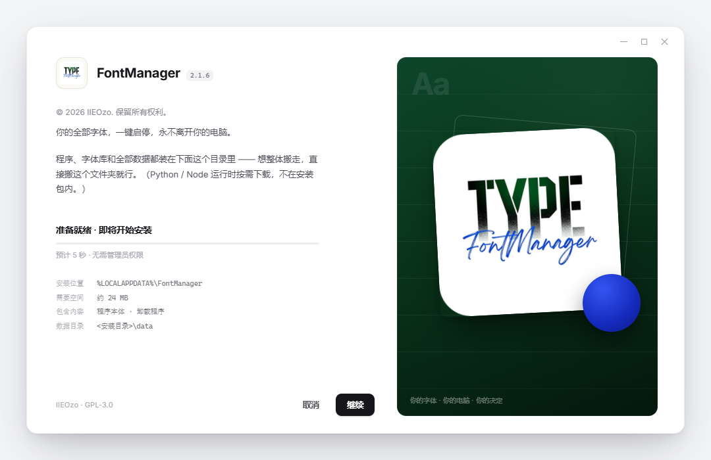
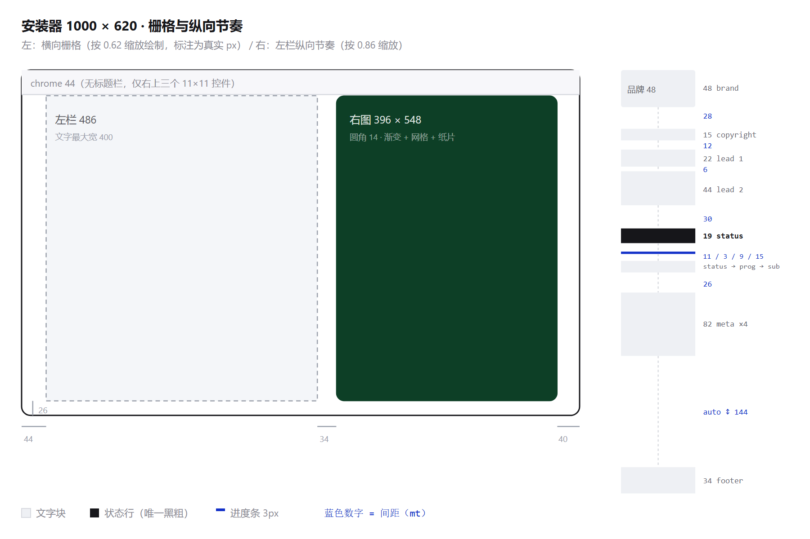
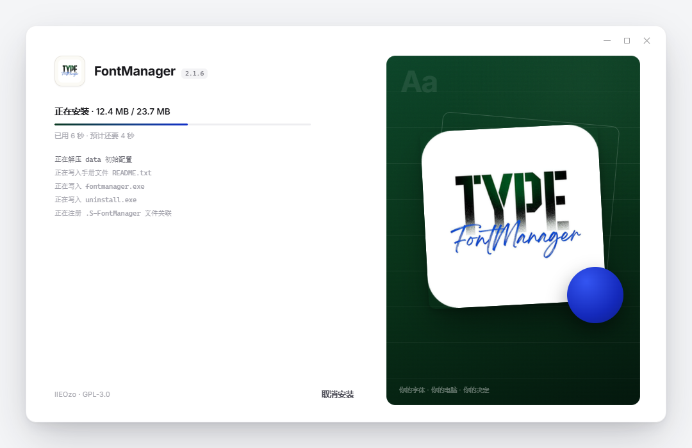
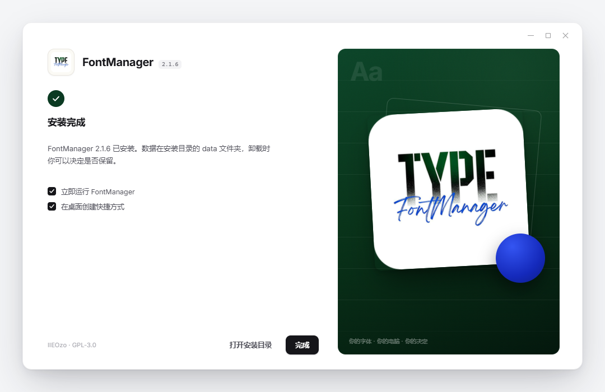
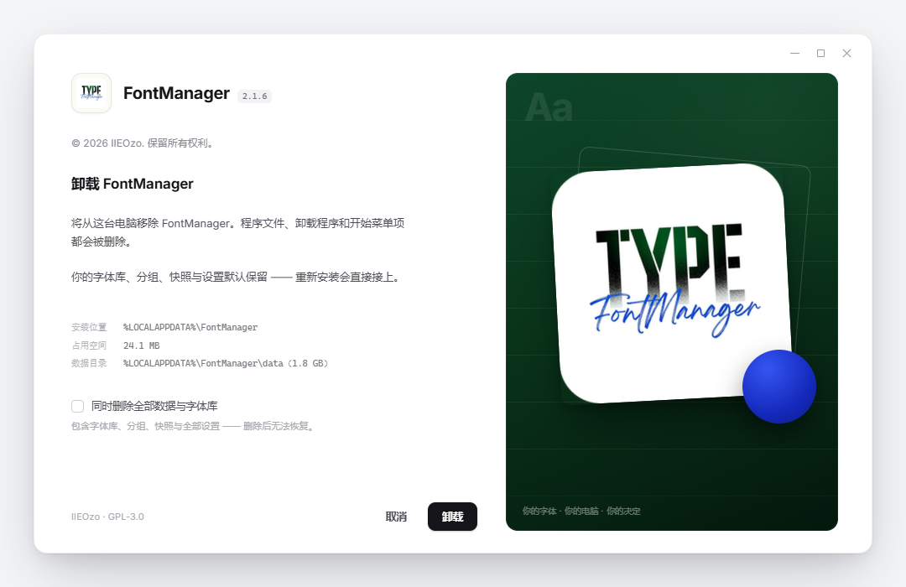
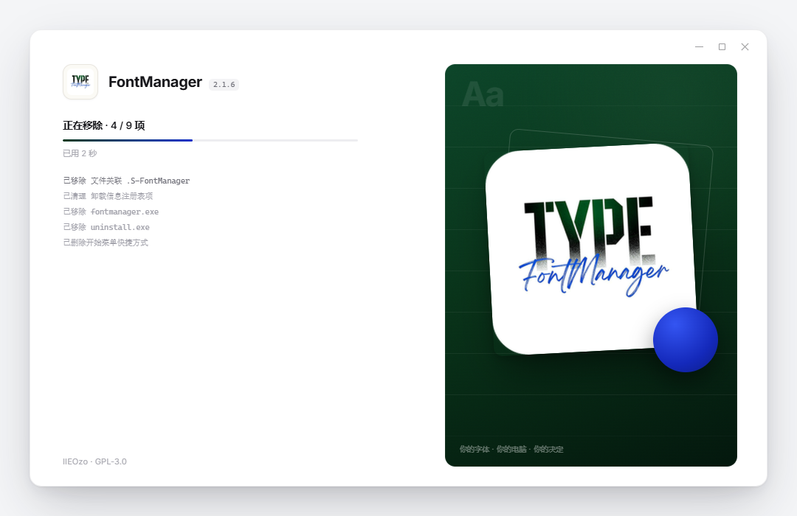
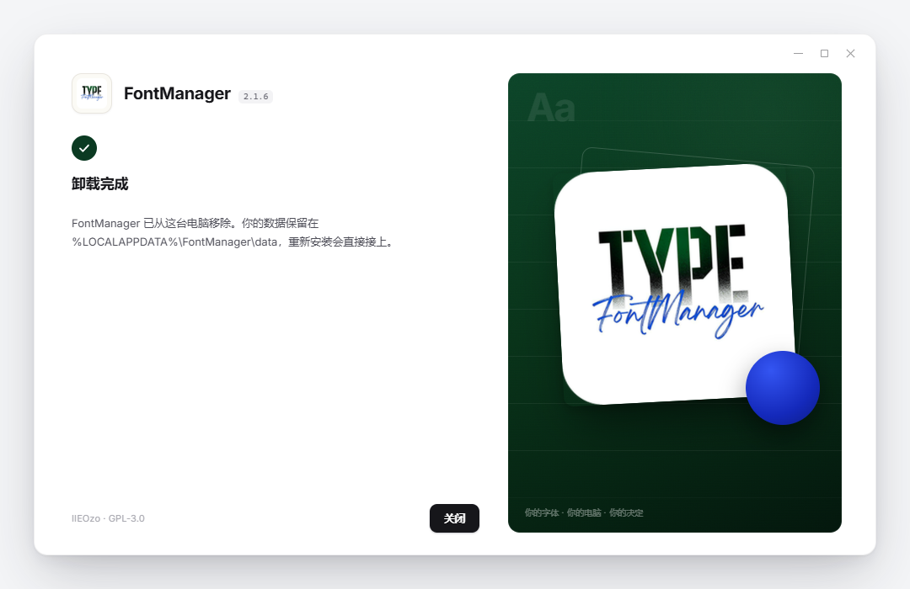
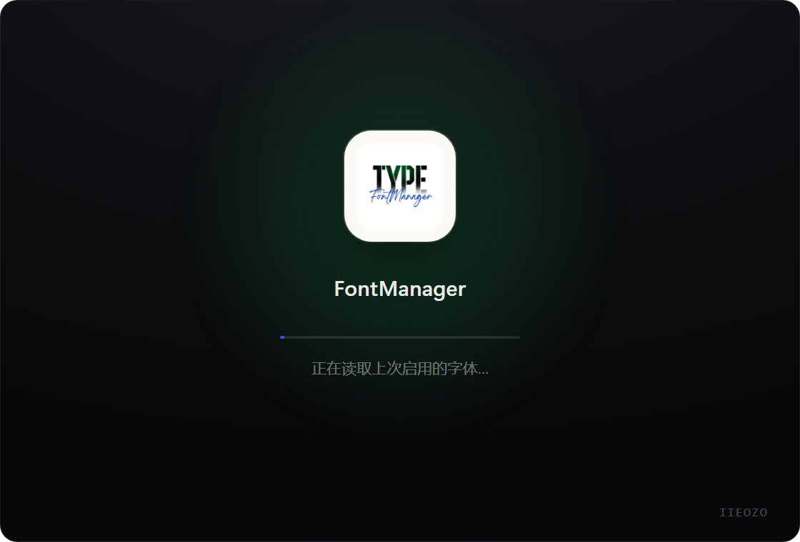
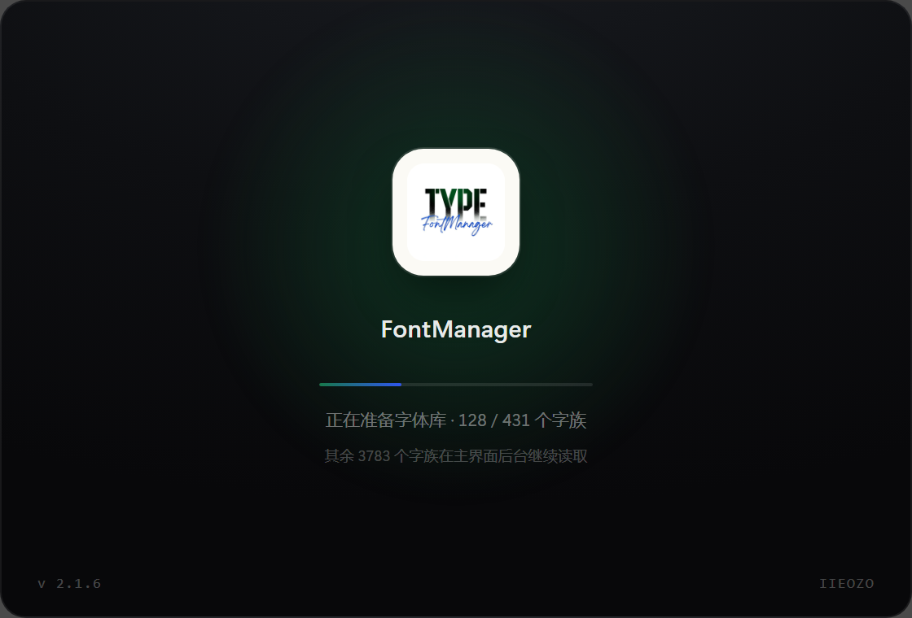
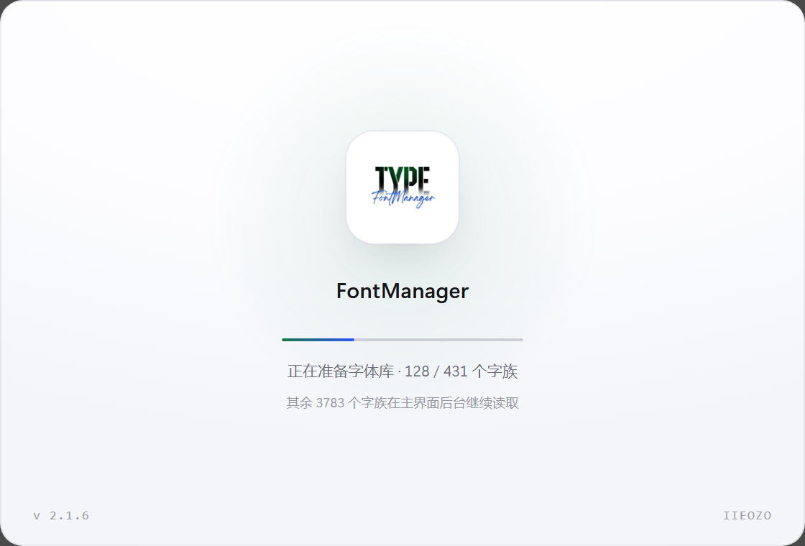

# FontManager 安装器 & 启动页 UI 交付规格书

> **这份文档是给实现的人看的，不是提案。**
> 每个尺寸、色值、字号、间距都能在原型 `docs/installer-splash-ui-demo.html` 里量到；
> 原型与本文冲突时，**以原型为准**，并把本文改对。
>
> 适用版本 **2.1.6**（基于 2.1.5） · 覆盖 **安装器 4 屏**（欢迎 / 位置 / 安装中 / 完成）与 **启动页 1 屏**
> 另附 **NSIS 紧凑版**，它是**备选 / 降级方案，能不用就不用**（见 §1.1、§8.0）
> 单位 **逻辑像素（CSS px）**，即 100% 缩放下的 1:1 尺寸；NSIS 专有单位 `u` 在 §8 换算
> 语言 **中英双语**；文案键沿用 `zfm-strings.nsh` 与 `src/locales/*.json` 的命名习惯

---

## 0. 交付物清单

| 文件 | 是什么 | 怎么用 |
|---|---|---|
| `docs/安装器与启动页-UI交付规格书.md` | 本文，唯一事实来源 | 改设计先改这里 |
| `docs/安装器与启动页-UI交付规格书.html` | 由 `make-spec-html.py installer` 生成的渲染版 | 直接发给同事 / 打印成 PDF |
| `docs/installer-splash-ui-demo.html` | **可点原型**（安装器 4 屏 + 启动页；另含备选的紧凑版） | 浏览器打开，底部工具条切屏 |
| `docs/shots-installer/01..04.png` | 安装器四屏 1:1 截图（1080×700 = 1000×620 + 40 边距） | 贴进 PR、对照验收 |
| `docs/shots-installer/10..13.png` | **卸载器**三屏 + 1 张"数据已删除"变体（同尺寸） | 对照 §4A 验收 |
| `docs/shots-installer/05..07.png` | 启动页 + NSIS 紧凑版 + 栅格标注图 | 备查 |
| `docs/shots-installer/08..09.png` | **实现产物**：启动页深色 / 浅色各一张，**已是 1120×760 原始窗口尺寸**（2.1.7 重拍） | 对照 §5.4 验收 |
| `docs/shots-installer/14-blocked-modal.png` | **2.1.7**：「FontManager 正在运行」遮罩对话框（原型 `?view=installer&step=1&blocked=1&clean=1`） | 对照 §4.9 |
| `docs/shots-installer/15-splash-1120.png` | **2.1.7**：放大一倍后的启动页（1120×760 实现产物，深色） | 对照 §5.1 |
| `docs/shots-installer/16-cancel-confirm.png` | **2.1.7**：屏 3「取消安装」的二次确认卡（真实运行截图，1250×775 = 1000×620 @125%） | 对照 §4.7 |

原型的三个视图与 URL 参数（方便截图与评审，不用手点）：

| 想看什么 | 地址后缀 |
|---|---|
| 安装器第 1 屏（欢迎） | `?step=0` |
| 安装器第 2 屏（位置） | `?step=1` |
| 安装器第 3 屏（安装中） | `?step=2` |
| 安装器第 4 屏（完成） | `?step=3` |
| 紧凑版（备选，能不用就不用） | `?view=compact` |
| 卸载器第 1 屏（确认） | `?view=uninstaller&step=0` |
| 卸载器第 2 屏（卸载中） | `?view=uninstaller&step=1` |
| 卸载器第 3 屏（完成 · 数据保留） | `?view=uninstaller&step=2` |
| 卸载器第 3 屏（完成 · 数据已删） | 再加 `&purged=1` |
| 启动页 | `?view=splash` |
| 出干净截图（去工具条、按 1:1） | 再加 `&clean=1` |

---

## 1. 先说结论：两条路线，先选再动手

这个设计（1000×620 的白卡 + 右侧整块品牌图 + 圆角）**不是 NSIS 能长出来的形状**。NSIS 的自绘页只有一块固定 662×416 的客户区，控件全是矩形，位图不带 alpha。所以要么缩，要么换壳：

| | 路线 A：NSIS 紧凑版（**降级方案，能不用就不用**） | 路线 B：Tauri 独立安装器 |
|---|---|---|
| 保真度 | **约 75%**：布局对，尺寸缩到 662×416，按钮是系统灰，窗口没有圆角 | **100%**：与原型 1:1 |
| 工期 | **1.5–2 天** | **5–7 天** |
| 安装逻辑 | **完全复用**现有 `installer.nsi`（数据迁移、文件关联、清理白名单、静默 `/S` `/P` 全在） | 要在 Rust 里**重写**：解包、注册表、快捷方式、卸载项、数据迁移、提权 |
| 风险 | 低（只动页面，不动内核） | 中高（卸载清理白名单最容易做漏，做漏就是"删了用户的字体"） |
| 维护 | 两套外观（完整版设计只能活在稿子里） | 一套外观，以后改 UI 只改 HTML |

### 1.1 结论：优先做 B；A 只是降级方案，**能不用就不用**

**为什么 A 能不用就不用**（不是因为它难，而是因为它是一笔一次性的债）：

1. **它做不出这个设计。** 窗口被 NSIS 锁死在 662×416，可画的只有 662×264：右图缩到 234×216、按钮变系统灰、圆角全丢。做出来是"像"，不是"是"，用户拿原型一比就会发现没做完。
2. **它注定变成第二套外观。** 同一份设计要维护两套数值表，改一处忘一处，两个版本之后必然漂移 —— 这正是 2.1.5 把欢迎页从 MUI 改成自绘时想避免的事。
3. **我们没有必须用 A 的理由。** 项目已经在 Tauri 2 上，原型就是 HTML/CSS，路线 B 的 UI 部分几乎是把原型接上 IPC。A 省下的 4 天，会在"以后每次改 UI 都要改两遍"上加倍还回去。

**什么情况下才允许用 A**：这一版必须按日发版 **且** 没人有 5 天写安装内核。此时按 §8 落地，验收标准相应降到"布局正确、文案正确、能用"，不要求像素级还原。

**建议排期**：主界面与启动页照常走；安装器排 **B**。若 B 赶不上发版窗口，2.1.6 **先不改安装器外观**（保持现状），把 B 完整放到 2.1.7 —— 好过先上 A 再推倒重来。

启动页**与安装器无关**，它是主程序自己的窗口，直接按 §5 做，两条路线都适用。

> 需要产品拍板的三件事：①走 A 还是 B；②右图用"真图标白板"还是"字形满版海报"；③文案是否加一句"无账号 · 无遥测"。

---

## 2. 设计依据

### 2.1 参考稿结构

参考稿（Adobe 安装-初始化窗口）的价值不在"Adobe 的样子"，在三件事：

1. **左右分栏**：左边信息密度高（版权 / 说明 / 状态 / 密集小字），右边一整块高饱和图像做情绪出口；
2. **左边只有一个主角**：状态行（"正在初始化工具…"）加粗、其余全部降到次级灰，视线只会落在"现在在干什么"；
3. **留白靠边距，分隔靠 1px 线**：没有卡片堆叠、没有描边框，全靠一条发丝线和一个大标题分层。

这三点被完整继承，只是把 Adobe 的蓝+荧光换成 FontManager 自己的**深林绿 + 宝蓝**。

### 2.2 品牌色从哪来

不是配色网站选的，是从 `src-tauri/icons/icon.png` 逐像素采样出来的：

| 采样对象 | 色值 | 用在哪 |
|---|---|---|
| TYPE 字标的绿（"Y" 的填充） | `#0b3a22` ~ `#0d4429` | 右图底色、完成徽标、进度条起点 |
| FontManager 手写体的蓝 | `#1230c8`（亮部 `#3455f2`） | 圆点、进度条终点 —— 全局第二强调 |
| 字标的墨黑 | `#16161a` | 主文字、主按钮底色 |
| 纸白 | `#fbfaf5` | 图标板底、启动页图标块 |

> **口径修正（2.1.7）**：上表的"深林绿"是 2.1.6 及以前的取色。用户 2.1.7 要求品牌色统一到图标里的宝蓝，因此**绿色全部退出**：右图底色换成宝蓝暗调、完成徽标与进度条中段用 `--brand #1b36c4`。真正生效的令牌以 §3.1 为准，本节只解释来历。

### 2.3 三条硬规则

1. **一屏只有一个强调色**（宝蓝），且只出现在"进度"和"圆点"上；其余全是灰阶。
2. **中文不描边、不加投影**：白底上只靠字号与字重分层。
3. **右图不承载信息**：它只是情绪与品牌，删掉它功能不受影响 —— 所以它可以被替换成任何海报。

---

## 3. 设计令牌

### 3.1 颜色

| 令牌 | 值 | 用途 |
|---|---|---|
| `--ink` | `#16161a` | 主文字 · 主按钮底 · 复选框选中 |
| `--ink-2` | `#4e4e58` | 正文 |
| `--ink-3` | `#8a8a93` | 版权行、次要说明 |
| `--ink-4` | `#a8a8b0` | 页脚小字、"预计 5 秒" |
| `--line` | `#ececef` | 发丝线（分段、输入框） |
| `--brand` | `#1b36c4` | 品牌宝蓝（完成徽标、进度条中段）。**2.1.7 之前叫 `--green` = `#0b3a22` 深林绿，已废弃**，变量名别再改回去 |
| `--blue` | `#1230c8` | 宝蓝深端（进度条终点、浅色启动页进度条） |
| `--paper` | `#fbfaf5` | 图标板底 |
| 右图底色 | `linear-gradient(158deg,#1e2a63 0%,#131a3f 48%,#08090f 100%)` + 右上角 `radial(96% 76% at 79% 6%, rgba(104,132,232,.17), transparent 64%)` | 右图最底层（2026-11-14 调淡，见 §4.4） |
| 进度条填充 | `linear-gradient(90deg,#0c1b6b 0%,#1b36c4 62%,#2c63ff 100%)` | 唯一渐变，别扩散到别处 |

右图是深色场景，用半透明白分层：`12%`（描边）/ `8.5%`（水印字）/ `5.5%`（网格线）/ `38%`（右下角小字）/ `17%`（虚描边）。

启动页**两套都有**（§5.4）：深色那套沿用同一套半透明白；浅色那套换成 §3.1 的墨色梯度（`--ink` / `--ink-3` / `--ink-4`），因为纸白底上不能再靠白色分层。

### 3.2 字体与字号

| 层级 | 完整版 | 紧凑版（NSIS） | 字重 | 用在哪 |
|---|---|---|---|---|
| 品牌名 | 20px | 14px | 700 | `FontManager` |
| 二级标题 | 17px | — | 650 | "选择安装位置""安装完成" |
| 状态行 | 13.5px | 12px | 550 / 600 | "正在安装 · 12.4 MB / 23.7 MB" |
| 正文 | 13px | 11.5px | 400 | 说明段落，行高 **1.72 / 1.6** |
| 版权 | 12px | 10.5px | 400 | "© 2026 IIEOzo…" |
| 按钮 | 12.5px | 11.5px | 550 | — |
| 元信息 | 10.5px **等宽** | 9.5px | 400 | 安装路径、空间、数据目录 |
| 微字 | 11px / 9.5px | 9.5px | 400 | 页脚、右图小字 |

- **完整版 UI 字体**：`Inter Variable`（仓库已有 `@fontsource-variable/inter`）→ 中文回落 `Microsoft YaHei` / `PingFang SC`。
- **紧凑版不要试图装 Inter**：NSIS 只能用系统 UI 字体 `$(^Font)`，硬写字体族会让英文系统 fallback 成别的字形。紧凑版的"像"靠**字重 + 间距 + 颜色**，不靠字体。
- **等宽**：`JetBrains Mono` / `Consolas`。所有数字（文件数、尺寸、路径）都用它，并且 `font-variant-numeric: tabular-nums` —— 否则 9→10 时右侧会横向抖一下。

### 3.3 圆角 / 阴影 / 间距

| 令牌 | 值 |
|---|---|
| 窗口圆角 | 16（紧凑版无，NSIS 窗口是方的） |
| 右图圆角 | 14（紧凑版 10） |
| 图标板 | 12（48×48）/ 19（主界面 78）/ 38（启动页 156，2.1.7 放大一倍后） |
| 按钮 / 输入框 | 9 |
| 胶囊 / 进度条 | 99 |
| 复选框 | 4 |

| 元素 | 阴影 |
|---|---|
| 安装器窗口 | `0 1px 2px rgba(20,20,32,.06), 0 26px 64px -12px rgba(20,20,32,.24), 0 8px 20px -6px rgba(20,20,32,.10)` |
| 右侧白板（sheet） | `0 28px 52px -14px rgba(0,0,0,.55), 0 4px 10px rgba(0,0,0,.18)` |
| 宝蓝圆点 | `0 14px 30px rgba(0,0,0,.42)` |
| 启动页窗口 | `inset 0 1px 0 rgba(255,255,255,.06), 0 1px 2px rgba(0,0,0,.4), 0 28px 60px -14px rgba(15,18,24,.5)` |
| 主按钮 | `0 1px 2px rgba(20,20,32,.22)` |

**间距节奏**：4 的倍数。左栏纵向只用 `6 / 9 / 11 / 12 / 20 / 26 / 28 / 30` 这几个值，不要临时加 17、23 这种数。

### 3.4 动效

| 场景 | 时长 / 曲线 |
|---|---|
| 切屏（左栏内容） | 340ms `cubic-bezier(.2,.8,.2,1)`，`opacity 0→1` + `translateY 6→0` |
| 进度条增长 | 900ms `cubic-bezier(.2,.8,.2,1)` |
| 按钮 hover | 150ms |
| 启动页进度 | 见 §5.3（由真实进度驱动，不是定时器） |
| **减弱动效** | 用户在设置里开启「减弱动效」时：裁掉位移，只保留 opacity，时长 ×0.6 |

---

## 4. 安装器 · 完整版（1000 × 620）



### 4.1 窗口

| 项 | 值 |
|---|---|
| 客户区 | **1000 × 620** |
| 圆角 | 16（窗口本身圆角；Windows 下需 `DwmSetWindowAttribute(DWMWA_WINDOW_CORNER_PREFERENCE)` 或干脆用无边框窗口自绘） |
| 边框 | 1px `rgba(20,20,32,.07)` |
| 标题栏 | **没有**。只有 44px 高的透明条，右上角三个细线控件 |
| 控件 | 11×11，间距 20，右内边距 24，默认不透明度 42%，hover 85% |
| 背景 | `#ffffff`（整窗纯白，不允许铺灰） |

> 为什么不要标题栏：参考稿的观感一大半来自"没有重标题栏"。窗口标题由任务栏与 Alt+Tab 提供，安装器不需要再写一遍。

### 4.2 栅格



| 项 | 值 |
|---|---|
| 内容区 padding | 上 **2** / 右 **40** / 下 **26** / 左 **44** |
| 列 | `1fr 396px`，gap **34** |
| 左栏实宽 | **486**（= 1000 − 44 − 40 − 396 − 34） |
| 文字最大宽度 | **400**（不要撑满 486，长行更难读） |
| 左栏纵向节奏 | 48 · **28** · 15 · **12** · 22 · **6** · 44 · **30** · 19 · **11** · 3 · **9** · 15 · **26** · 82 · auto · 34（粗体是间距，其余是元素高） |

### 4.3 左栏逐元素

自上而下，`mt` = 与上一个元素的上边距。

| # | 元素 | 内容 | 字号/字重 | 颜色 | mt | 其他 |
|---|---|---|---|---|---|---|
| 1 | 品牌行 | 图标板 48×48 + `FontManager` + 版本胶囊 | 20/700 | `--ink` | — | 图标板 `48` 圆角 `12` 内边距 `5` 底 `--paper` 边框 `1px #e9e6df`；版本胶囊等宽 10px `#6b6b74` 底 `#f3f3f5` 圆角 5 内边距 `3 6` |
| 2 | 版权 | `© 2026 IIEOzo. 保留所有权利。` | 12/400 | `--ink-3` | 28 | — |
| 3 | 主句 | `你的全部字体，一键启停，永不离开你的电脑。` | 13/400 | `--ink-2` | 12 | 行高 1.72 |
| 4 | 说明 | `程序、字体库和全部数据都装在下面这个目录里 —— 想整体搬走，直接搬这个文件夹就行。`（末尾追加披露：`（Python / Node 运行时按需下载，不在安装包内。）`） | 13/400 | `--ink-2` | 6 | 与主句同段组，间距小于组间 |
| 5 | 状态行 | `准备就绪 · 即将开始安装` | 13.5/550 | `--ink` | 30 | **整屏唯一的黑粗行**，视线锚点。不再显示文件数（包内只有 2 个文件，"将写入 2 个文件"会让用户以为漏装了） |
| 6 | 进度条 | 3px 高，圆角 99，轨道 `#ededf0`，填充见 §3.1 | — | — | 11 | 宽度 400 |
| 7 | 副状态 | `预计 5 秒 · 无需管理员权限` | 11/400 | `--ink-4` | 9 | — |
| 8 | 元信息 | 4 行键值：安装位置 / 需要空间 / 包含内容 / 数据目录 | 等宽 10.5/400 行高 1.95 | 键 `#b3b3ba` 值 `#77777f` | 26 | 两列 grid，列间距 20，最大宽 420 |
| 9 | 页脚 | 左 `IIEOzo · GPL-3.0`，右按钮组 | 11/400 | `--ink-4` | auto | `margin-top:auto` + `padding-top:20`，永远贴底 |

### 4.4 右栏品牌图（图层）

从下到上：

| z | 图层 | 参数 |
|---|---|---|
| 0 | 底 | `linear-gradient(158deg,#1e2a63 0%,#131a3f 48%,#08090f 100%)` + 右上角 `radial(96% 76% at 79% 6%, rgba(104,132,232,.17), transparent 64%)` |
| 1 | 网格 | `repeating-linear-gradient` 每 **56px** 一条 `rgba(255,255,255,.055)` 1px 线；上下各 18% 用 mask 渐隐 |
| 1 | `Aa` 水印 | 46/700，`letter-spacing:-.04em`，`rgba(255,255,255,.085)`，位置 `left:22 top:12` |
| 2 | 噪点 | SVG feTurbulence，`opacity .09`，`mix-blend-mode: overlay` |
| 2 | 虚描边卡 | 宽 70%，正方形，`rotate(5deg)`，`translate(-44%,-55%)`，`1px rgba(255,255,255,.17)`，圆角 12 |
| 3 | 白板（真图标） | 宽 70%，`top:46%`，`translate(-50%,-50%) rotate(-3deg)`，圆角 11，阴影见 §3.3 |
| 4 | 宝蓝圆点 | 88×88，`right:26`，`bottom:128`，`radial-gradient(circle at 34% 26%,#6b83e0 0%,#3f4ea6 62%,#2b3378 100%)`，阴影 `0 14px 30px rgba(0,0,0,.34)` |
| 5 | 角标 | `你的字体 · 你的电脑 · 你的决定`，9.5px，`rgba(255,255,255,.38)`，`left:20 bottom:18` |

**要点**：白板是"贴在蓝色墙上的纸"，所以必须有**旋转 + 投影**；虚描边卡是"另一张没对齐的纸"，作用是让白板不孤立。圆点**压在纸角上**（不是飘在角落），它把两块白连成一个整体。

> **2026-11-14 右图调淡（用户："蓝色浅一些，太抢眼了，不要影响用户看左边的内容" + "不要看起来太脏"）**：
> 底 `#0a1550/#060e3a`（L≈18%）→ `#1e2a63/#131a3f`（L≈25%，S 保持 52%）；光斑 `rgba(22,44,150,.55)` 半径 60% → `rgba(104,132,232,.17)` 半径 64%；圆点 `#3455f2` 系 → `#6b83e0` 系；噪点 `.13` → `.09`（底变亮后同一层颗粒会显脏）。
> **降的是音量（面积 × alpha），不是纯度**——把饱和度压到 42% 实测发灰，跟浅色主题那次"太暗太脏"是同一个病。右图是情绪背景，本屏唯一的强调位留给左栏状态行（§2.3 硬规则 1）。

### 4.5 四屏内容

#### 屏 1 · 欢迎（`?step=0`）

- 左栏：§4.3 全部 9 项
- 元信息四行：`安装位置 %LOCALAPPDATA%\FontManager` · `需要空间 约 24 MB` · `包含内容 程序本体 · 卸载程序` · `数据目录 <安装目录>\data`
  > 2026-11-14 按实测定稿：包内只有 **2 个文件**（程序本体 + 卸载程序，23,706,438 B），字体库目录安装器不建、Python/Node 运行时按需下载不在包内。原稿的「148 个文件 / 约 420 MB / 含运行时」是设计占位值，**已废弃，任何地方都不许再硬编码**。容量写"约 24 MB"而非"23.7 MB"：元信息给的是容量预期，一位小数会被误读成精确值。
- 按钮：`取消`（幽灵）/ `继续`（主）
- 进度条：**0%**（空轨道也要画出来，它是"即将开始"的承诺）

#### 屏 2 · 选择位置（`?step=1`）


- 二级标题 `选择安装位置`（17/650，mt 30）
- 说明 `换一个盘，字体库、缓存和全部数据都跟着走。`
- 路径框：宽 400，高 **38**，圆角 9，边框 `#e4e4e8`，底 `#fcfcfd`，内边距 `0 6 0 12`；等宽 10.5 显示路径，右侧内嵌 `浏览…` 小按钮（高 28 / 内边距 11 / 圆角 7 / 11.5px）
- 副状态 `这个位置当前用户可写 · 剩余 128 GB`（11px `--ink-4`）
- 元信息三行：`需要空间` / `完成后` / `卸载时`
- 按钮：`返回`（幽灵）/ `安装`（主）

> 路径框是**只读展示**，点击/回车才弹目录选择器；不要在框里允许手打（用户手打相对路径会炸）。

#### 屏 3 · 安装中（`?step=2`）



- 状态行 `正在安装 · 12.4 MB / 23.7 MB`（数字用 `tabular-nums`，不要抖动）
- 进度条：**按已写入字节推进**，不按文件数。包内只有 2 个文件，按文件计数只有 `0%→50%→100%` 两跳，中间十几秒不动，用户会判定卡死。分母用归档内各 entry 的**解压后字节数之和**（用压缩包大小会让进度在后段突然加速）。
  - 事件粒度 ≤256 KB 一次；任意 300ms 窗口内**单调不减**、相邻跳变 ≤20%、**无 ≥1.5s 停滞**（验收条款见 PRD §9.5 T2-AC1～AC7）
  - 取消/失败时进度条**停在当前值**，不回退到 0（回退会被理解成"把已装的删了"）
- 副状态 `已用 6 秒 · 预计还要 14 秒`（超过 60 秒后只显示"已用 X 秒"，因为估时不准反而添乱）
- 日志区：等宽 10.5，行高 2，最多 **5 行**，新行从上方插入、最老的一行淡出；首行颜色加深（`#6f6f78`），其余 `#a2a2ab`
- 按钮：只有 `取消安装`（幽灵），主按钮**不出现**（不能给"下一步"的错觉）

> **实现口径（2026-11-14 实测后落定，别再按上面那句"按字节推进"理解）**：安装引擎是 NSIS 的
> `setup.exe /S`，它不回报进度，界面只能**盯落盘事实**推步：`fontmanager.exe` 出现 ≈ 解压完（62%）、
> `uninstall.exe` 的 mtime 变新 ≈ 写注册表/快捷方式（88%），进程退出才是 100%。
> 真机上这两步之间能空 **40 秒上下**（24 MB 解压 + 杀软扫描），期间没有任何事件 ——
> 所以屏 3 必须有"我还活着"的证据，2.1.8 补了两条：
> ① **`已用 N 秒` 自己走字**（前端 1s 计时，超 20 秒追加"正在写入，请勿关闭窗口"）。
> 早先它只在跳步时刷新，卡在 `已用 0 秒` 一动不动，用户原话「等太久，我还以为卡了」。
> ② **填充条呼吸**（`.prog i.running` 明暗 1.6s，减动效时关闭）——只动亮度，不动宽度和百分比。
> ③ 覆盖安装时**不再拿"文件存在"当进度**：两个文件开局就在，否则界面会在第 0.1 秒跳到 88%
> 然后冻 40 秒。现在主程序只在"开局不存在"时算一步；卸载程序用 **mtime 变新**判（`WriteUninstaller`
> 是现写，mtime 一定新）；主程序 `File` 保留源文件 mtime，比对识别不出重写，只能放弃这条信号。
> "预计还要 N 秒"**没有实现**，也不会实现：估时不准比没有更让人怀疑卡住。

> 日志文案要"人话"，写 `正在解压 python-runtime\python313.dll`，不要写 `extracting file 137`。

#### 屏 4 · 完成（`?step=3`）



- 完成徽标：30×30 圆，底 `--green`，白色对勾 14×14，描边 1.9
- 标题 `安装完成`（17/650，mt 16）
- 正文 `FontManager 2.1.5 已安装。数据在安装目录的 data 文件夹，卸载时你可以决定是否保留。`
- 复选框 ×2（默认**都勾上**）：
  - `立即运行 FontManager`
  - `在桌面创建快捷方式`
- 复选框：15×15，圆角 4，未选边框 `1.4px #cfcfd6`，选中底 `--ink` + 白勾；标签 12.5px `--ink-2`，与框间距 9，两项间距 11
- 按钮：`打开安装目录`（幽灵）/ `完成`（主）

### 4.6 状态机与按钮规则

```
屏1 欢迎 ──继续──▶ 屏2 位置 ──安装──▶ 屏3 安装中 ──完成──▶ 屏4 完成
  │ 取消              │ 返回                │ 取消安装（需确认）  │ 完成
  ▼                   ▼                     ▼                   ▼
退出                回屏1            回滚已写入 → 回屏1        关窗 + 启动
```

- **主按钮全窗口只有一个**，且永远在按钮组最右。
- 屏 3 期间主按钮隐藏；`取消安装` 需要二次确认（卡片文案：`要取消安装吗？` / `已经写进安装目录的文件会被删除；如果这个目录是本次安装才新建的，目录本身也会一并清掉。` / 附注 `你的字体库和已有数据不受影响。`）。按钮组 `取消安装`（幽灵）在左、`继续安装`（主）在右 —— **安全默认高亮的是"继续"**；<kbd>Enter</kbd> 与 <kbd>Esc</kbd> 在确认卡上都等于「继续安装」，想真取消必须正面点一次。**2.1.7 之前这里没有确认**，手滑一次就废掉四十多秒的安装。
- **取消后回到屏 1，不是直接退出窗口**（2.1.7 改）：回滚完把界面退到欢迎屏，用户可以换个目录立刻重试；要离开再点一次「取消」。早先状态机图写的是"回滚 → 退出"，实现与规格都按"回屏 1"统一了 —— 取消就闪退容易被当成崩溃。
- 屏 4 的 `完成` 是唯一会启动主程序的按钮；勾选框只影响启动参数，不影响安装结果。
- 全流程支持 <kbd>Enter</kbd> 触发主按钮、<kbd>Esc</kbd> 触发取消（屏 3 除外：Esc 打开的是那张确认卡，不直接取消）。


### 4.7 必须实现的异常态

设计稿只画了顺利路径。以下 6 种必须实现，**样式复用同级元素，不新造组件**：

| 场景 | 显示位置 | 文案 | 交互 |
|---|---|---|---|
| 无写入权限 | 屏 2 路径框下方 | `这个位置当前用户没有写入权限。请换一个位置，或以管理员身份重新运行。` | 主按钮禁用，改红字（`#e5484d`，全局唯一的红） |
| 空间不足 | 屏 2 副状态位 | `需要 24 MB，这个位置只剩 8 MB` | 主按钮禁用 |
| 安装失败 | 屏 3 状态行 | `fontmanager.exe 写入失败：拒绝访问` | 主按钮变 `重试`，日志保留 |
| 已安装（升级） | 屏 1 状态行上方 | `检测到已安装 2.1.4，将直接覆盖安装（推荐），数据与字体库保留。` | 多一个 `先卸载再装` 的链接 |
| **FontManager 正在运行** | **全窗遮罩对话框**（§4.9） | 见 §4.9 | `取消` / `关闭软件并继续` |
| 静默/被动模式 | — | 不画任何界面 | `/S` 全静默；`/P` 保留进度条但跳过自绘欢迎页 |

### 4.8 不要在安装器里做的事

- ❌ 不要加"安装向导第 1/4 步"的步骤条 —— 4 屏本来就能一眼走完，加步骤条只会让它像 2008 年的安装包。
- ❌ 不要放"许可协议"整页滚动框（GPL 全文没人读）。协议放在 `关于` 与安装目录 `LICENSE` 里，屏 2 底部一句 `安装即表示同意 GPL-3.0` 足够。
- ❌ 不要在右图放交互按钮或链接。

### 4.9 程序还在运行 · 确认对话框（2.1.7 新增，用户要求）

安装要**替换** `fontmanager.exe`、卸载要**删除**它。文件被占用时 NSIS 的 `File`
写不进去 / 只能挂到重启后清理，用户看到的是「装完了版本没变」「卸完了文件还在」——
这两种现象比直接失败难查得多。所以动手之前必须先查一次，查到就**停下来问用户**。

| 项 | 规格 |
|---|---|
| 触发时机 | ① 首屏渲染后查一次（只在状态行提示，不弹窗）；② 点 `安装` / `卸载` 时查一次，有就弹；③ Rust 侧 `setup_install` 启动前**再查一次**（竞态兜底，回 `setup:blocked` 事件） |
| 判定 | 进程名等于 `fontmanager.exe`（不区分大小写），**排除当前进程**（安装/卸载界面自己也叫这个名字） |
| 遮罩 | `inset:0`，`rgba(16,16,22,.3)`，盖住整个窗口（含标题条），模态期间不许再点到底下的按钮 |
| 卡片 | 396 宽，`padding 22/24/18`，圆角 **12**，白底，`1px rgba(20,20,32,.09)`，阴影 `0 24px 60px -24px rgba(20,20,32,.42)`，入场 `opacity+translateY(6px) 160ms`（`prefers-reduced-motion` 下只留透明度） |
| 标题 | `FontManager 正在运行`，15/650，`--ink` |
| 正文 | 12.5px / 1.72，`--ink-2`。安装：`检测到 N 个 FontManager 进程正在运行。安装需要替换程序文件，得先把它们关掉 —— 否则文件被占用，会出现「装完了版本还是旧的」。` 卸载：`…卸载需要删除程序文件，得先把它们关掉 —— 否则文件删不掉，只能留到下次开机再清理。` |
| 附注 | 11.5px，`--ink-3`。安装 `关闭时，正在进行的操作会丢失。` / 卸载 `关闭软件不会动你的字体库与设置。` |
| 图标 | 22×22 警告三角（描边 1.3，`#b4322c`），在标题上方，间距 12 |
| 按钮 | 右下角，间距 10：`取消`（ghost）/ `关闭软件并继续`（墨黑主按钮，默认焦点） |
| 键盘 | `Enter` = 关闭并继续，`Esc` = 取消；**遮罩开着时 Enter/Esc 不许穿透到底层屏** |
| 关不掉时 | 不关对话框，正文换成 `还有 N 个 FontManager 进程没能关闭（可能以管理员身份运行）。请手动退出 FontManager 后再试。` |
| 取消后 | 回到能再按一次的那一屏（安装 → 位置屏；卸载 → 确认屏），不算失败、日志不记为 error |
| 绝不做 | ❌ 不自动关闭对话框；❌ 不自动杀进程；❌ 不用红字报错（这不是错误，是需要用户做个决定） |

> 落点：`setup.html#runModal` + `src/setup/main.ts::blockedByRunning / openRunModal`
> + `src-tauri/src/setup_ui.rs::running_instances / setup_running / setup_close_running`。

---

## 4A. 卸载器（与安装器同一套版式）



> **产品口径（PRD §3.4 / G1）**：卸载器**不新做视觉体系**，就是安装器换掉左栏内容：
> 同 1000×620 窗口、同无标题栏、同圆角 16、同左栏栅格、同右图。**并排截图不许看出是两个产品。**
> 右图按 PRD Q6 默认**复用同一张**（"你的字体 · 你的电脑 · 你的决定"在卸载语境下同样成立：
> 删不删数据是你的决定）。真要换主题图，需另出一版资产，不在本版范围。

### 4A.1 与安装器共用的部分（照抄，不许改数值）

| 项 | 值 | 出处 |
|---|---|---|
| 窗口 / 圆角 / 边框 / 阴影 / 控件条 | 1000×620 · 16 · `1px rgba(20,20,32,.07)` · §3.3 | §4.1 |
| 内容区 padding | 上 2 / 右 40 / 下 26 / 左 44 | §4.2 |
| 列 | `1fr 396px`，gap 34；左栏实宽 486；文字最大宽 400 | §4.2 |
| 品牌行 | 图标板 48 + `FontManager`(20/700) + 版本胶囊 | §4.3 #1 |
| 页脚 | 左 `IIEOzo · GPL-3.0`，右按钮组，`margin-top:auto` + `padding-top:20` | §4.3 #9 |
| 右图 | 整套图层（底/网格/Aa/噪点/虚描边/白板/圆点/角标） | §4.4 |
| 切屏动效 | 340ms `cubic-bezier(.2,.8,.2,1)`，`opacity 0→1` + `translateY 6→0` | §3.4 |
| 减弱动效 | 裁位移、只留 opacity、时长 ×0.6 | §3.4 |

### 4A.2 屏 1 · 确认



> 上图是屏 2。屏 1 见本节开头那张。两屏左栏内容不同、版式同。

| # | 元素 | 内容 | 字号/字重 | 颜色 | mt | 其他 |
|---|---|---|---|---|---|---|
| 1 | 品牌行 | 同 §4.3 #1 | 20/700 | `--ink` | — | 版本胶囊显示**本机已安装版本**，不是包版本 |
| 2 | 版权 | `© 2026 IIEOzo. 保留所有权利。` | 12/400 | `--ink-3` | 28 | 与安装器屏 1 同位置，**必须有**（缺了它左栏会显得头重脚轻） |
| 3 | 标题 | `卸载 FontManager` | 17/650 | `--ink` | 30 | 用 `.h2`，不是品牌行的大字 |
| 4 | 正文一 | `将从这台电脑移除 FontManager。程序文件、卸载程序和开始菜单项都会被删除。` | 13/400 行高 1.72 | `--ink-2` | 12 | 把"删什么"说全：程序 / 卸载程序 / 快捷方式 |
| 5 | 正文二 | `你的字体库、分组、快照与设置默认保留 —— 重新安装会直接接上。` | 13/400 | `--ink-2` | 6 | 与正文一同段组；"默认保留"是这一句存在的唯一理由，别删 |
| 6 | 元信息 | `安装位置` / `占用空间` / `数据目录` 三行 | 等宽 10.5/400 行高 1.95 | 键 `#b3b3ba` 值 `#77777f` | 26 | 两列 grid 列间距 20，最大宽 420；`占用空间` 只算程序本体（不含 data） |
| 7 | 复选框 | `同时删除全部数据与字体库` | 12.5/400 | `--ink-2` | 26 | 15×15 圆角 4，**默认不勾**（PRD G2）；文案沿用既有 `$(deleteAppData)` 措辞 |
| 8 | 危险说明 | `包含字体库、分组、快照与全部设置 —— 删除后无法恢复。` | 11/400 | `--ink-4` | 9 | 挂在复选框下方、左对齐；**不换红字**（红是全局错误色，§4.7） |
| 9 | 页脚 | 左 `IIEOzo · GPL-3.0`，右 `取消`（幽灵）/ `卸载`（主） | 11 / 12.5-550 | — | auto | 主按钮**用墨黑，不用红**；红只给"出错" |

### 4A.3 屏 2 · 卸载中

- 状态行 `正在移除 · 4 / 9 项`（13.5/550，`--ink`，**mt 26** —— 比安装屏 3 的 30 少 4，因为上面没有品牌行以外的留白可借）
- 进度条：同 §4.3 #6（3px / 圆角 99 / 同一渐变），宽度 400
- 副状态 `已用 2 秒`（11/400 `--ink-4`，mt 9）；**不显示"预计还要"** —— 卸载是删文件，估时误差比安装更大，给了反而让人怀疑卡住
- 日志区：与安装屏 3 **同一个组件**（等宽 10.5 / 行高 2 / 最多 5 行 / 最新在上 / 首行加深 `#6f6f78` 其余 `#a2a2ab`）
- 页脚：**只有左侧落款，右侧留空**。卸载**不提供取消**（PRD §3.4：白名单删除不可逆，给"取消"等于给"东西已经少了一半"的按钮）
- 文案要写人话：`已移除 fontmanager.exe`、`已移除 文件关联 .S-FontManager`，不要写 `DeleteRegKey HKCR\...`

### 4A.4 屏 3 · 完成（两种变体）




| 变体 | 正文 | 何时出现 |
|---|---|---|
| 保留（默认） | `FontManager 已从这台电脑移除。你的数据保留在 %LOCALAPPDATA%\FontManager\data，重新安装会直接接上。` | 复选框**未勾**（默认） |
| 清空 | `FontManager 已从这台电脑移除，你的数据与字体库也已全部删除。` | 复选框**已勾** |

- 完成徽标同 §4.5 屏 4（30×30 圆 + 白勾 14×14 / 描边 1.9，mt 26）；标题 `卸载完成`（17/650，mt 16）
- 页脚：右 `关闭`（主），左落款。**不提供"打开安装目录"** —— 那个目录此刻已经没了
- 保留变体里的路径**必须是真实路径**（读注册表 `InstallLocation`，不是常量拼接）

### 4A.5 状态机与按钮规则

```
屏1 确认 ──卸载──▶ 屏2 卸载中 ──完成──▶ 屏3 完成 ──关闭──▶ 退出（0）
  │ 取消                                        │
  ▼                                             ▼
退出（0）                                  关窗 + 退出（0）
```

- 屏 2 **不可返回、不可取消**（理由见 4A.3）。
- 只有"卸载流程正常走完"才返回 0：用户取消返回 0（什么都没做，不算失败）；中途失败返回非 0（PRD §3.3 退出码口径）。
- 键盘：屏 1 <kbd>Enter</kbd> = `卸载`、<kbd>Esc</kbd> = `取消`；屏 3 <kbd>Enter</kbd>/<kbd>Esc</kbd> = `关闭`。
- `/S` 静默**完全不建窗口**；`/P` 跳过屏 1 直接屏 2；`/UPDATE` 不进卸载器（安装器内部调用，直接走静默清理）。

### 4A.6 必须实现的异常态

| 场景 | 显示位置 | 文案 | 交互 |
|---|---|---|---|
| **WebView2 不可用** | 不画 UI | 原生确认框：`无法加载卸载界面。是否继续卸载 FontManager？` | 确定 → 原生静默清理；取消 → 退出。**宁可难看，不许卸不掉**（PRD G6） |
| **FontManager 正在运行** | **全窗遮罩对话框**（§4.9） | 见 §4.9 | `取消` / `关闭软件并继续` |
| 无权限（`%APPDATA%` 被改权限） | 屏 2 状态行 | `<路径> 无法删除：拒绝访问` | `重试` / `以管理员身份重新运行` |
| 删除部分成功 | 屏 3 | `已完成卸载，有 3 个文件未能删除（可能被占用）。` | `关闭`，并写日志到 `%TEMP%\FontManager-uninstall.log` |

### 4A.7 不要在卸载器里做的事

- ❌ 不要写"确定要离开我们吗""很遗憾"这类情绪文案 —— 卸载不需要挽留，也不需要道歉。
- ❌ 不要在屏 1 默认勾选删数据（误删字体库是不可逆事故）。
- ❌ 不要显示"将删除 N 个字体"之类的数字 —— 数字会让你以为它真去数过，实际是按白名单整目录处理。
- ❌ 不要给屏 2 加取消，也不要让进度条回退。

---

## 5. 启动页（1120 × 760）



> 上面这张是 2.1.7 的实现产物（1120×760 原始像素）。`05-splash.png` 是 2.1.5 时代
> 560×380 的旧渲染图，只作历史对照，**不要拿它量尺寸**。

### 5.1 窗口

**2.1.7 变更（用户要求「启动页扩大一倍」）**：整张卡从 560×380 **等比放大一倍**到
1120×760，下表所有长度/字号/间距都已按 ×2 写死。唯一不按比例走的是**圆角 16 → 24**：
窗口圆角属于"窗口外壳"而不是画面内容，等比成 32 会让四角圆得不像 Windows 窗口
（主窗口 1280×820 用的也是小圆角）。图标位图是 `public/splash-icon.png`（256×256），
放大后可视区 120px，仍然清晰。

| 项 | 值 |
|---|---|
| 大小 | **1120 × 760** |
| 圆角 | **24**（不按 ×2 走，见上），**无标题栏**（`decorations:false`） |
| 背景 | 深色 `radial-gradient(120% 100% at 50% -18%, #191c21 0%, #0e0f12 52%, #08080a 100%)`；浅色见 §5.4 |
| 描边 | 深色 `1px rgba(255,255,255,.07)`；浅色 `1px rgba(20,20,32,.08)` |
| 光晕 | 640×640 圆，`radial(circle, rgba(100,136,255,.26), transparent 72%)`，`filter:blur(12px)`，在图标块背后（浅色用 `rgba(27,54,196,.12)/60%`） |

### 5.2 元素

| 元素 | 参数 |
|---|---|
| 图标块 | 156×156，圆角 38，底 `--paper`，内边距 18，阴影 `0 28px 60px -16px rgba(0,0,0,.62)` + `0 0 0 2px rgba(255,255,255,.14)` |
| 名称 | `FontManager`，30/600，`rgba(255,255,255,.93)`，距图标 44 |
| 进度条 | **336 × 4**，圆角 99，轨道 `rgba(255,255,255,.1)`，填充 `linear-gradient(90deg,#17784a,#2f56ef)`，距名称 48 |
| 状态行 | 21px，`rgba(255,255,255,.42)`，距进度条 26，`tabular-nums` |
| 副状态 | 18px，`rgba(255,255,255,.26)`，距状态行 14 |
| 页脚 | 左 `v 2.1.5`，右 `IIEOZO`，等宽 18px，`rgba(255,255,255,.26)`，`bottom:30`，左右 44 |

> 上表是**深色**那一套。启动页要跟随主界面的主题（用户 2026-11-13 要求），浅色那一套见 §5.4。

---

### 5.3 ⚠️ 进度条的语义（**这块最容易做错，务必按这里实现**）

**这条进度条只反映「种子集合」的装载进度，不代表全库字体。**

#### 分子 / 分母是什么

| | 含义 |
|---|---|
| **分母** | 种子集合的**字族数**（不是文件数，不是全库 4214） |
| **种子集合** | 上次已启用 ∪ 全部系统字体 ∪ 所有分组内 ∪ 所有快照内，**按路径去重**（PRD 2.1.4 §3.1） |
| **分子** | 已完成元数据装载 + 已确认激活状态的种子字族数 |

参考量级（4214 族库 / 已启用 169 / 系统 166）：**种子约 400 个，全库 4214 个**。也就是说进度条跑完时，**全库还剩 90% 没读** —— 这是设计意图，不是 bug。

#### 为什么可以这样

种子集合覆盖了"用户此刻真正要用"的全部字体：上次启用的、系统自带的、分组里的、快照里的。这批就绪后，**预览、启停、快照应用、套用到设计软件、分组筛选全部可用**，用户可以立刻干活。剩下 3800 多个未启用字体只是"待浏览的库存"，晚几百毫秒读到不影响任何操作。

#### 因此这三条必须遵守

1. **种子就绪 = 立刻开主界面**。进度条到 100% 后，`show 主窗口` → 关闭启动页。**绝不等全量读取**。
2. **全量读取不许把进度回传到启动页**。一旦进了主界面，启动页就永久销毁；剩余进度改由主界面底部的细进度条承载（PRD 2.1.4 R-06），两者是**两段互不重叠的进度**，不要合并成一条。
3. **分母不许用全库总数**。用全库做分母会让进度条爬到 9% 就长时间不动，用户会以为卡死 —— 这是最典型的"假进度"事故。

#### 三个边界态

| 情况 | 表现 |
|---|---|
| **分母未知**（台账还没读完） | 不显示百分比：状态行写 `正在读取上次启用的字体…`，进度条切**不确定态**（一段 30% 宽的亮块左右滑动，2.4s 循环）。拿到总数后立刻切确定态，不倒退 |
| **超过 3 秒没跑完** | 强制 `show 主窗口` 并关闭启动页。种子没读完的部分退化成"主界面后台继续"，用户至少能看见界面 |
| **种子装载失败** | 不弹错、不在启动页写红字。直接进主界面，由主界面按 R-10/R-15 回退到骨架屏 + 可重试提示 |

#### 时序

```
进程启动
  └─ 建 splash 窗口（256ms 内可见，先 show 再 load 前端，避免白屏）
       ├─ 并行：读台账 / 注册表探测 / font-cache.json 命中
       ├─ 逐步：种子元数据装载 → 状态行滚动数字
       └─ 种子就绪（或 3s 超时 / 失败）
            ├─ show 主窗口（此时主界面首帧已渲染，不要再闪一次骨架屏）
            └─ splash 关闭（淡出 120ms）
                  └─ 主界面后台继续全量 → 底部细进度 → 完成后一次性刷新列表
```

**最短显示时长**：**1500ms**，且**每次打开软件都要显示**（用户 2026-11-14 要求）。

> 时间线：420ms → 600ms（2026-11-13）→ **1500ms（2026-11-14）**。
> 600ms 在热缓存下仍然像"闪一下"，用户明确要求「字体少也不许一闪就没」。

**实现口径（2.1.7 改过，别按老文档写）**：最短显示**只在原生侧判**，起点是
**启动页真正 show 出来的那一刻**（`lib.rs::SplashState::shown_at`），不是进程启动、
也不是前端 `performance.now()`。理由：

- splash 窗口比主窗口的 JS 晚建 200~400ms，按前端原点补 1.5 秒实际只亮 1.1 秒；
- 热缓存下种子只要 3ms 就绪，前端的 `splash_done` 甚至可能比 splash 窗口还早到。
  所以 `splash_done` 里会**先等启动页出现（最多 2 秒）**，拿到 `shown_at` 才补足
  剩余时长，然后置 `finished` → 前端淡出 120ms → 关启动页 → 再 show 主界面。

前端 `App.tsx` 里已经**没有** `SPLASH_MIN_MS` 了（改成 0 会把这段逻辑分裂成两份，
两个原点必然对不上）。要调时长只改 `lib.rs` 的 `SPLASH_MIN_SHOW`。

**哪些情况不显示启动页**（都是"用户看不见窗口"的场景，不是偷懒）：

- 「启动时最小化到托盘」/ 开机自启：那一秒里不该有任何窗口闪一下；
- 托盘里点「显示」把主界面叫出来：这是已有进程的窗口还原，不是启动；
- 已经开着再点一次桌面图标：走 `app://activate`，还原那个窗口。

**不要做的事**：不要给启动页加"跳过"按钮、不要加版本更新检查、不要在启动页显示全库字体总数。

### 5.4 明暗两套配色（跟随软件主题）




启动页不是"永远是深色"：它跟随主界面的主题设置（`prefs.themePref` = `system` / `light` / `dark`），`system` 时用 `prefers-color-scheme` 判，判据与 `src/lib/theme.ts` 完全一致（用户 2026-11-13 要求）。

几何尺寸、字号、间距**两套完全一致**，只有颜色令牌不同：

| 令牌 | 深色（默认） | 浅色 |
|---|---|---|
| 背景 | `radial(120% 100% at 50% -18%, #191c21, #0e0f12 52%, #08080a)` | `radial(120% 100% at 50% -18%, #ffffff, #fdfdff 55%, #f3f5f9)` |
| 描边 | `rgba(255,255,255,.07)` | `rgba(20,20,32,.07)` |
| 光晕 | `rgba(100,136,255,.26)` → transparent 72% | `rgba(27,54,196,.12)` → transparent 60%（只护住图标，不铺到状态行） |
| 图标块底 | `--paper #fbfaf5` | `#ffffff` |
| 图标块外环 + 投影 | `0 0 0 1px rgba(255,255,255,.14)` + 投影 `.62` | `0 0 0 1px #e7eaf0` + 投影 `rgba(20,20,32,.13)`（底变白后投影必须减淡，重了发脏） |
| 名称 | `rgba(255,255,255,.93)` | `--ink #16161a` |
| 进度条轨道 | `rgba(255,255,255,.1)` | `#cdcfd8` |
| 状态行 | `rgba(255,255,255,.42)` | `#6f6f7a` |
| 副状态 | `rgba(255,255,255,.26)` | `#97979f` |
| 页脚 | `rgba(255,255,255,.26)` | `#9a9aa4` |
| 进度条填充 | `linear-gradient(90deg,#3f5be0,#6f8cff)`（淡蓝） | `linear-gradient(90deg,#1230c8,#2f6bff)`（**不同左**：纸上淡蓝会糊成灰） |

**实现约束（踩过的坑，别绕开）**：

1. 颜色全部走 CSS 变量，级联顺序必须是 `:root`（深色默认）→ `@media (prefers-color-scheme: light)`（浅色）→ `:root[data-theme="dark"]` → `:root[data-theme="light"]`。属性选择器排在媒体查询**之后**，用户强制才会压过系统。
2. **不要用内联 `<script>` 提前写 `data-theme`**：CSP 是 `default-src 'self'`，内联脚本会被拦，页面直接白屏。首帧靠媒体查询（同步、与 Windows 应用模式一致），`get_prefs` 回来若发现用户强制了主题再设 `data-theme` 覆盖。
3. 语言与主题复用**同一次** `get_prefs`，不要为它多打一次 IPC（启动这一瞬间扫描线程正拿着 store 锁）。
4. `prefers-reduced-motion: reduce` 时，不确定态的滑动块改成一条半透明满幅静止条，不要继续闪。
5. **浅色不要用暖纸白**：`#fbfaf5 / #f0efe9` 是给"纸面"设计的暖调，叠上绿色光晕后整块卡面会发灰绿（用户 2026-11-14 原话"太暗太脏"）。浅色底固定用中性偏冷的 `#ffffff → #fdfdff 55% → #f3f5f9`，光晕同时压到 `.10` / `60%`。
6. **浅色轨道不能照搬 `--line #ececef`**：那套发丝线是为分割线设计的，2px 轨道压在浅底上只有 1.13:1，肉眼等于没有轨道，进度条看着像一根孤立的短线。现值 `#cdcfd8`（对底两端 1.53:1 / **1.42:1**，1.42 是验收下限，别再往上调淡）。页脚 `#9a9aa4`（2.74:1 / **2.55:1**）。
7. **浅色令牌在 `splash.html` 里写了两遍**（`@media (prefers-color-scheme: light)` 与 `:root[data-theme="light"]`），必须同改。而且这两个选择器的字面串也出现在文件顶部注释里 —— 任何用 `indexOf` 找选择器做"两处是否一致"自动校验的脚本，会先命中注释、把深色块当浅色块比对，**给出假绿灯**。校验前先剥注释。

---

## 6. 文案表（中 / 英）

安装器文案放 `src-tauri/windows/zfm-strings.nsh`（`LangString ZM_*`），启动页文案放 `src/locales/*.json`（键名沿用现有 9 语言结构）。新增键建议这样命名：

> **实现口径（2026-11-13 落地时确定）**：启动页文案**没有**进 `src/locales/*.json`，而是作为 `src/splash.ts` 里的 `COPY_ZH` / `COPY_EN` 两份常量。理由：启动页是独立入口，为了两句话去拉整个 i18n 模块（9 语言 JSON）与它的首帧开销不成比例；中文以外的 7 种语言回退英文，与 §6 的"中英双语"口径一致。主界面动效/首字延迟以后再考虑接 i18n。

| 键 | 中文 | 英文 |
|---|---|---|
| `ZM_W_BRAND_TAG` | 你的全部字体，一键启停，永不离开你的电脑。 | All your fonts, one switch each, never leaving your computer. |
| `ZM_W_BODY` | 程序、字体库和全部数据都装在下面这个目录里 —— 想整体搬走，直接搬这个文件夹就行。 | The app, your font library and all data live in this folder — to move FontManager, just move the folder. |
| `ZM_W_READY` | 准备就绪 · 即将开始安装 | Ready · starting the installation |
| `ZM_W_ETA` | 预计 {s} 秒 · 无需管理员权限 | About {s} seconds · no admin rights needed |
| `ZM_M_LOCATION` | 安装位置 | Install location |
| `ZM_M_SPACE` | 需要空间 | Space needed |
| `ZM_M_INCLUDES` | 包含内容 | Includes |
| `ZM_M_DATA` | 数据目录 | Data folder |
| `ZM_DIR_TITLE` | 选择安装位置 | Choose where to install |
| `ZM_DIR_LEAD` | 换一个盘，字体库、缓存和全部数据都跟着走。 | Pick another drive and the library, caches and all data move with it. |
| `ZM_DIR_BROWSE` | 浏览… | Browse… |
| `ZM_DIR_OK` | 这个位置当前用户可写 · 剩余 {g} | This folder is writable · {g} free |
| `ZM_INST_WRITING` | 正在安装 · {d} / {t} | Installing · {d} / {t} |
| `ZM_INST_ELAPSED` | 已用 {s} 秒 · 预计还要 {r} 秒 | {s}s elapsed · about {r}s left |
| `ZM_INST_CANCEL` | 取消安装 | Cancel installation |
| `ZM_DONE_TITLE` | 安装完成 | Installation complete |
| `ZM_DONE_BODY` | FontManager {v} 已安装。数据在安装目录的 data 文件夹，卸载时你可以决定是否保留。 | FontManager {v} is installed. Your data lives in the data folder next to the app; you decide on uninstall whether to keep it. |
| `ZM_DONE_RUN` | 立即运行 FontManager | Launch FontManager now |
| `ZM_DONE_DESKTOP` | 在桌面创建快捷方式 | Create a desktop shortcut |
| `ZM_DONE_OPEN` | 打开安装目录 | Open install folder |
| `ZM_BTN_NEXT` | 继续 | Continue |
| `ZM_BTN_BACK` | 返回 | Back |
| `ZM_BTN_INSTALL` | 安装 | Install |
| `ZM_BTN_FINISH` | 完成 | Finish |
| `ZM_FOOT` | IIEOzo · GPL-3.0 | IIEOzo · GPL-3.0 |
| `ZM_ART_TAG` | 你的字体 · 你的电脑 · 你的决定 | Your fonts. Your machine. Your call. |
| `SPLASH_LOADING` | 正在装载字体 · {i} / {n} | Loading fonts · {i} / {n} |
| `SPLASH_LOADING_INDET` | 正在读取上次启用的字体… | Reading your last active fonts… |
| `SPLASH_REST` | 其余 {n} 个字族在主界面后台继续读取 | The other {n} families keep loading in the background |
| `SPLASH_OPENING` | 正在打开主界面… | Opening FontManager… |

卸载器（`ZM_U_*`，同样放 `zfm-strings.nsh`；屏 2/3 的进度与路径由运行时替换）：

| 键 | 中文 | 英文 |
|---|---|---|
| `ZM_U_TITLE` | 卸载 FontManager | Uninstall FontManager |
| `ZM_U_LEAD1` | 将从这台电脑移除 FontManager。程序文件、卸载程序和开始菜单项都会被删除。 | This will remove FontManager from this computer. The app, its uninstaller and the Start menu entries will be deleted. |
| `ZM_U_LEAD2` | 你的字体库、分组、快照与设置默认保留 —— 重新安装会直接接上。 | Your library, groups, snapshots and settings are kept by default — reinstalling picks them up right away. |
| `ZM_U_SPACE` | 占用空间 | Space used |
| `ZM_U_DELDATA` | 同时删除全部数据与字体库 | Also delete all data and the font library |
| `ZM_U_DELDATA_NOTE` | 包含字体库、分组、快照与全部设置 —— 删除后无法恢复。 | Includes your library, groups, snapshots and all settings — this cannot be undone. |
| `ZM_U_REMOVING` | 正在移除 · {i} / {n} 项 | Removing · {i} / {n} |
| `ZM_U_ELAPSED` | 已用 {s} 秒 | {s}s elapsed |
| `ZM_U_DONE` | 卸载完成 | Uninstallation complete |
| `ZM_U_DONE_KEEP` | FontManager 已从这台电脑移除。你的数据保留在 {p}，重新安装会直接接上。 | FontManager has been removed. Your data stays at {p}; reinstalling picks it up right away. |
| `ZM_U_DONE_PURGED` | FontManager 已从这台电脑移除，你的数据与字体库也已全部删除。 | FontManager has been removed, along with all your data and the font library. |
| `ZM_U_FAIL_FILES` | 已完成卸载，有 {n} 个文件未能删除（可能被占用）。 | Uninstalled, but {n} files could not be deleted (they may be in use). |
| `ZM_U_NOWEBVIEW` | 无法加载卸载界面。是否继续卸载 FontManager？ | The uninstall screen could not be loaded. Continue uninstalling FontManager? |
| `ZM_U_BTN_UNINSTALL` | 卸载 | Uninstall |
| `ZM_U_BTN_CLOSE` | 关闭 | Close |

> 英文版注意：`{n}` 千分位用逗号（`1,028`），中文版用空格（`1 028`）—— 这是 `tabular-nums` 之外唯一需要本地化的数字格式。
>
> 2026-11-14 文案口径变更（与 PRD §9.5 同步）：`ZM_W_READY` **不再带 `{n}`**（包内只有 2 个文件，数字会让用户以为漏装）；`ZM_INST_WRITING` 的 `{i}/{n}` 改为 **`{d}/{t}` = 已写 MB / 总 MB**（一位小数，如 `12.4 / 23.7`），原因是按文件计数进度条只有两次跳变、中段看似卡死；`ZM_W_ETA` 的 `{s}` 屏 1 实填 **5**（原设计稿写 20，是全库时代的估时）。

---

## 7. 资源与导出

| 资源 | 来源 | 规格 |
|---|---|---|
| 应用图标 | `src-tauri/icons/icon.png` | 512×512 RGBA，**白板 + 圆角是图的一部分**，别自己在 UI 里再套一层圆角 |
| 右图（完整版） | 由图标 + CSS 分层在运行时合成 | 不需要导出 |
| 右图（紧凑版） | **必须预渲染** | 见 §8.4 |
| Inter 字体 | `@fontsource-variable/inter` | 已在依赖里，`@font-face` 指向 `node_modules` 的 woff2 |
| 对勾 / 关闭等图标 | 内联 SVG | 不引图标库，安装器不该为 3 个图标背一个包 |

---

## 8. 路线 A：NSIS 紧凑版（备选方案 · **能不用就不用**）


> **⚠️ 先读这段，再决定要不要往下做。**
> 本节存在的前提是"万一必须用 NSIS"。**默认不要选它**：它只能做到本设计的 **75%**（窗口方角、按钮系统灰、右图缩到 234×216、左栏文字压到 9.5–12px）；而且它是一次性投入 —— 做完这一版，安装界面就有了两套数值表，往后每次改设计都要改两遍。
>
> 只有在这两个条件同时成立时才按本节做：**① 这一版必须按日发版；② 没人有 5 天写安装内核。**
> 否则**宁可这一版不改安装器外观**，也不要先上紧凑版再推倒重来。真正的目标是 §9。

### 8.0 它和完整版的差距（写在前面，免得验收扯皮）

| 项 | 完整版 | 紧凑版 | 差距能不能补 |
|---|---|---|---|
| 窗口尺寸 | 1000×620 | 662×416（客户区，另加 30 系统标题栏） | ❌ NSIS 锁死 |
| 窗口圆角 | 16 | 0 | ❌ 要自写窗口过程 |
| 右图 | 396×550，CSS 合成 | 234×216，预渲染 BMP | ⚠️ 只能静态、不能含噪点/网格渐隐 |
| 主按钮 | 墨黑 `#16161a` | 系统灰 | ❌ 按钮不可改色 |
| 字号 | 13 / 10.5 / 20 | 11.5 / 9.5 / 14 | ⚠️ 已是可读下限 |
| 元信息行数 | 4 行 | 3 行（砍掉「包含内容」） | ✅ |
| 切屏动效 | 340ms 淡入 | 无 | ❌ nsDialogs 不支持 |

**验收口径**：紧凑版只验"布局正确、文案正确、能用"，**不要求**与原型像素级一致。

### 8.1 为什么是这个尺寸

NSIS 的 MUI 客户区固定 **662 × 416**，其中：

| 区域 | 像素（100% DPI） | 说明 |
|---|---|---|
| 客户区 | 662 × 416 | 不含系统标题栏（高 30） |
| 头部条 | 0 … 84 | MUI 的 header 区，自绘页改不动它 |
| **内页（可自绘）** | **84 … 348**，高 **264** | `nsDialogs::Create 1018` 拿到的就是这块 |
| 按钮条 | 348 … 416，高 68 | MUI 画的系统按钮，**颜色不可改** |

也就是说：**能画的只有 662 × 264**。1000×620 的设计必须缩成这个框 —— 这就是"紧凑版"存在的原因，不是偷懒。

`u` 与像素：**1u ≈ 1.88px**（100% DPI，实测）。所有坐标用 `u`，不要写 px，否则 125%/150% 下全错位。

### 8.2 紧凑版版面（内页坐标，原点 = 内页左上角）

| 元素 | x | y | w | h | 字号 | 备注 |
|---|---|---|---|---|---|---|
| 左内边距 | 18px（10u） | — | — | — | — | 与头部条的品牌行对齐 |
| 右图 | 404 | 16 | 234 | 216 | — | 圆角 10 **烘焙在位图里** |
| 版权行 | 18 | 15 | 356 | 15 | 10.5px | `#8a8a93` |
| 说明段 | 18 | 36 | 356 | 37 | 11.5 / 1.6 | 两行，超两行就删字，别缩字号 |
| 状态行 | 18 | 86 | 356 | 17 | 12/600 | `#16161a` |
| 进度条 | 18 | 108 | 356 | 3 | — | `msctls_progress32` |
| 副状态 | 18 | 118 | 356 | 13 | 9.5px | `#a8a8b0` |
| 元信息 3 行 | 18 | 145 | 356 | 55 | 9.5 等宽 / 1.95 | 键列宽约 52，值列起于 78 |

按钮条（MUI 自绘，375…）：`取消` + `安装`（默认）。

### 8.3 控件怎么建

| 元素 | NSIS 写法 |
|---|---|
| 文字 | `${NSD_CreateLabel} x y w h "文案"` + `CreateFont $h "$(^Font)" "<pt>" "<weight>"` |
| 位图 | `${NSD_CreateBitmap}` 或 `nsDialogs::CreateControl STATIC ${WS_VISIBLE}\|${SS_BITMAP} …`，再用 `SendMessage ${STM_SETIMAGE}` |
| 进度条 | `${NSD_CreateProgressBar}`（类 `msctls_progress32`），`PBM_SETRANGE32` 设 `0..100` |
| 页面背景 | `SetCtlColors $pageDlg "0x241C1C" "0xFFFFFF"` |

**磅值换算**：`pt = px × 0.75`。10.5px → 8pt，11.5px → 8.6pt（`CreateFont` 收整数，写 9），12px → 9pt，14px → 10.5pt。

### 8.4 五个必须知道的坑

1. **颜色是 BGR 不是 RGB**。`#1c1c24` → `"241C1C"`。写反了是"看着像黑但偏红"，极难发现。
2. **进度条上色要先关主题**。有视觉样式时 `PBM_SETBARCOLOR` 无效，必须 `SetWindowTheme(hProgress, "", "")` 关掉主题，才能拿到 `#0b3a22`。代价：进度条变成 90 年代平面条 —— 这是取舍，验收时要跟设计对齐（备选：保持系统绿/蓝渐变，不改色）。
3. **位图没有 alpha**。右图的圆角与投影必须**烘焙在 `#FFFFFF` 底色上**，否则会露出黑角。生成脚本照 `windows/gen-nsis-images.py` 的路子（纯标准库写 BMP，24bit）。
4. **高 DPI 要两套图**。同一张图在 150% 下会被拉伸变糊：出 1×（234×216）与 2×（468×432），启动时按 DPI 选（`GetDeviceCaps(LOGPIXELSX)`）。
5. **按钮不可改色**。MUI 的按钮是系统的，`取消/安装` 永远是系统灰。**不要**为了让主按钮变黑去 owner-draw —— 那是 800 行 `nsDialogs`，与"只改 UI、可维护性优先"直接冲突（这条结论 2.1.5 已经踩过，见 `installer.nsi` 第 177–190 行注释）。

### 8.5 代码骨架

```nsis
; 只列改动点，其余沿用现有 installer.nsi
Page custom ZfmWelcome          ; 屏 1（保留既有入口，不新建页面）

Function ZfmWelcome
  ${If} $PassiveMode = 1
    Abort                        ; /P 必须跳过自绘页
  ${EndIf}

  !insertmacro MUI_HEADER_TEXT "" ""   ; 标题由内页自己画，避免出现两遍
  nsDialogs::Create 1018
  Pop $0
  ${If} $0 == error
    Abort
  ${EndIf}
  SetCtlColors $0 "0x241C1C" "0xFFFFFF"

  ; 右图（先建，压在最底层）
  ${NSD_CreateBitmap} 404u 16u 234u 216u ""
  Pop $1
  ${If} ${FileExists} "$PLUGINSDIR\hero.bmp"
    SendMessage $1 ${STM_SETIMAGE} ${IMAGE_BITMAP} $hHeroBmp
  ${EndIf}

  ; 版权 / 说明 / 状态
  ${NSD_CreateLabel} 18u 15u 356u 15u "$(ZM_COPYRIGHT)"
  ; … 依 §8.2 表格逐条
  nsDialogs::Show
FunctionEnd
```

> 分隔线仍用"实心背景的 STATIC"模拟（NSIS 没有 Line 控件），1u 高，`SetCtlColors $h "0xEFEFEF" "0xEFEFEF"`。

### 8.6 路线 A 明确不做的

- 不做窗口圆角（要改窗口区域，等于自己写窗口过程）。
- 不做暗色主题（系统控件是亮色，暗底会贴出一排惨白按钮）。
- 不做右侧图里的动画/噪点（静态 BMP，一次画死）。

---

## 9. 路线 B：Tauri 独立安装器（1:1 还原）

### 9.1 结构

```
installer/                      新增独立 crate（不并进主程序）
├─ Cargo.toml
├─ tauri.conf.json              productName "FontManager Setup"
├─ src/main.rs                  安装内核：解包 / 注册表 / 快捷方式 / 卸载项
└─ ui/
   ├─ index.html                直接复用原型：installer-splash-ui-demo.html 的安装器部分
   └─ assets/                   Inter、icon.png、hero 合成图
```

### 9.2 窗口配置

```json
{
  "label": "installer",
  "width": 1000, "height": 620,
  "resizable": false, "maximizable": false,
  "decorations": false, "transparent": true, "shadow": false,
  "center": true, "visible": false
}
```

`transparent: true` 是圆角的前提；配合 `DwmSetWindowAttribute(DWMWA_WINDOW_CORNER_PREFERENCE, 2)` 在 Win11 上更稳，Win10 走 CSS 圆角 + 透明。

### 9.3 前端要实现的

- 4 个 `.state` 的显隐（原型里已经是这个结构，`data-step` 驱动）；
- 进度事件：`install://progress {written, total, currentFile}`；
- 取消：`invoke('cancel_install')` + 二次确认；
- 完成：`invoke('finish', {run, desktopShortcut})`。

### 9.4 Rust 侧必须自己实现（**这是路线 B 的真实成本**）

| 模块 | 要做什么 | 风险 |
|---|---|---|
| 解包 | 把 payload（zip/内嵌资源）写到目标目录，逐文件回调进度 | 低 |
| 注册表 | 文件关联 `.S/.P/.L-FontManager`、卸载项 `Uninstall\FontManager`、Win10+ 的 `AppModel` 无需 | 中 |
| 快捷方式 | 开始菜单 + 桌面（`.lnk`，用 `windows` crate 的 IShellLink） | 中 |
| 提权 | `requireAdministrator` manifest；**但当前是按用户安装，不需要提权** —— 别为了"看起来专业"加 UAC | 中 |
| 卸载 | 白名单清理（`data` / `字体库` / `plugins` / `python-runtime` / `node-runtime` / 三处注册表） | **高**：漏一项 = 残留，多一项 = 删用户字体 |
| 数据迁移 | 2.1.4 → 2.1.5 的 `data_root` 搬迁逻辑 | **高**：写错会丢台账 |
| 静默安装 | `/S` 与 `/P` 的行为对齐 | 中 |

> 结论：**路线 B 的钱不在 UI，在"把 NSIS 已经调通的 7 件事重写一遍还不能出错"**。如果 2.1.6 就要发版，走 A。

### 9.5 路线 C：复用主程序二进制（**≈0 体积的 1:1 还原**，2026-11-14 用户要求后新增）

用户原话：**「尽量 0 体积占用的 1:1 还原」**。

先把三条路的体积账摆平 —— 这张表就是结论：

| 方案 | UI 保真 | 安装包体积增量 | 为什么 |
|---|---|---|---|
| A · NSIS 紧凑版 | **75%** | +0.3 ~ 0.5 MB | 得烘一张 792×1100 的 hero PNG（位图无 alpha，圆角与阴影只能压进白底） |
| B · 独立 Tauri 安装器 | 100% | **+5 MB 左右** | 门面自己带一套 ~4.5 MB 的 WebView 资源（图标/字体/HTML），再加内核 |
| **C · 复用主程序 exe** | **100%** | **+620 B（实测）** | UI 代码进主程序，**不新增任何二进制**；品牌图运行时 CSS 合成，**不存位图** |

> 口径说明（2026-11-14 实测修订）：**路线 C 的净增量 = 安装包 +620 B** —— 关开关 6,594,594 B，开开关 6,595,214 B，同一份源码、同一台机器。
> 原先估的 +0.4~0.7 MB 高估了：前端只有 **7.7 KB**（不是 33 KB，那是含 HTML+CSS 的总量），Rust 侧新增的机器码本来就要编进主程序，
> 而主程序无论走哪条路都在包里 —— 所以对**安装包**而言，路线 C 几乎不花钱。
>
> 两个别拿来对比的数字：① 记忆里的 23,706,438 B 是**含 python/node runtime 的老包**，2.1.6 之后 runtime 改成按需下载
> （`bundle.resources` 为空），本地构建现在是 6.29 MiB，口径不同；② 主程序 `fontmanager.exe` 现在 24,064,000 B，
> 比 2.1.6 发布版的 23,810,560 B 多 247 KB —— 这是整个 2.1.7 开发周期的增量（含 capability、日志、修复），**不是路线 C 单项的**。

**怎么做**（NSIS 不再消失，只是从"画界面的人"变成"把人扶上马的人"）：

1. **安装器**：`Section Install` 先把 `fontmanager.exe` 落到 `$INSTDIR`，然后
   `ExecWait '"$INSTDIRontmanager.exe" --installer-ui'` → 四屏由主程序画，装完把退出码回给 NSIS。
   NSIS 仍负责**它只能负责的部分**：WebView2 检测（§4.7 E7）、提权判定、取消矩阵（PRD §3.3）。
2. **卸载器**：`uninstall.exe` 仍是 `WriteUninstaller` 生成的那份（**≈100 KB，体积零增量**），
   `un.onInit` 里 `ExecWait '"$INSTDIRontmanager.exe" --uninstall-ui'` → 三屏与白名单清理都在主程序里，
   界面收尾后 `uninstall.exe` 删自己。
3. **回退**：WebView2 缺失 / 主程序起不来 / 被安全软件拦 → 走现有 MUI 原生页。
   **现有页面一行都不删**，它就是 PRD E7 与 G6 要求的那条降级路径。

**三条"不许花体积"的硬约束**（做不到就不是 C 方案，是伪装的 B）：

| # | 约束 | 怎么判 |
|---|---|---|
| C1 | 安装器/卸载器前端做成**独立入口**（vite 多入口），不并进主界面 bundle | 构建后安装器 entry **≤ 80 KB 未压缩**；主入口的 chunk 列表里不出现它。参照：本文原型把 7 屏 UI + 全部样式脚本装在一个文件里是 **43 KB（gzip 10.2 KB）** |
| C2 | **不新增图片资产**：右图靠 §4.4 那套 CSS 分层合成，不烘 PNG/BMP | 包内不存在 `hero*.png/bmp`；右图在 125%/150% 下仍清晰（矢量 + 文字） |
| C3 | **不新增字体**：Inter 用包里已有的 `@fontsource-variable/inter` | 包里 `.ttf/.woff2` 数量与 2.1.6 一致 |

**与路线 B 的差异只有"谁承载 WebView"**：B 新开一个 crate 与窗口，C 复用主程序。
所以 B 的 §9.4 那张"必须自己实现"的表（解包/注册表/快捷方式/卸载白名单/迁移/静默）**一条都不少**，
省下的只是重复的门面与第二套窗口栈 —— 这也是为什么 C 能把 +5 MB 压到 +0.7 MB。

**代价（写清楚，别只报喜）**：

- 主程序多一个入口（`--installer-ui` / `--uninstall-ui`），启动路径要能在**未安装状态**下跑（临时目录、独立 WebView2 数据目录、不抢单实例互斥体）。
- 卸载时要先让正在运行的主程序退出，再拉 UI（与 `CheckIfAppIsRunning` 同源）。
- 安装中途取消 → 已落盘的 `fontmanager.exe` 要按 PRD §3.3 的取消矩阵倒序删除，不能留半装目录。

**验收**：§10 全部条目不变（含 G 组三屏与 W1–W12 白名单门槛），另加三条：

- [x] 安装包体积增量 **≤ 1 MB** —— 实测 **+620 B**（2026-11-14）
- [x] 包内无新增位图/字体（C2/C3）—— 右图纯 CSS 合成，字体用包里已有的 Inter
- [ ] 拆掉 WebView2 后，安装与卸载都能走原生回退且完成（C 的回退面比 B 大，必须逐条验）

### 9.5.1 落地形态（v0，2026-11-14）

已按本节实现，代码位置与分工如下 —— **改之前先认这张表**：

| 件 | 位置 | 说明 |
|---|---|---|
| 入口 | `src-tauri/src/setup_ui.rs::dispatch()` | 识别 `--installer-ui` / `--uninstall-ui`（也认 `--setup-ui=install\|uninstall`）。**没有这两个参数时只扫一遍 argv 就返回**，主程序启动路径零改动 |
| 窗口 | `setup_ui::run_window()` | 1000×620、无标题栏、透明、圆角 16 由 CSS 画；WebView2 数据目录固定在 `%TEMP%\FontManager-setup-webview`（用完即弃，卸载结束时 `RMDir /r`） |
| 界面 | `setup.html` + `src/setup/{main.ts,setup.css}` | **vanilla TS，不引 React**。vite 独立入口 `setup`，产物 **33 KB**（html 11.9 + css 14.6 + js 6.9，gzip 后约 12 KB）。主入口 bundle 里搜不到任何一句安装器文案，也不引用 `setup-*.js`（C1 达标，门槛 80 KB） |
| 引擎 | 还是 NSIS | UI **不重写**解包/注册表/快捷方式/白名单：点"安装"时它拉起 `setup.exe /S /D=<目录>`，点"卸载"时拉起 `uninstall.exe /S [/PURGE=1]`，然后**核对结果**（`fontmanager.exe`、`uninstall.exe`、注册表 `DisplayVersion` 三样都在才算成功） |
| 引导 | `installer.nsi` 的 `.onInit` / `un.onInit` | GUI 路径下只做三件事：把主程序解到 `$PLUGINSDIR`（卸载是先拷到 `%TEMP%\FontManager-setup-ui`）、`ExecWait` 界面、按退出码收尾（0 = 装好，10 = 用户取消，其他 = 退回原生 MUI 页） |

**开关是 `installer.nsi` 里的一行宏定义**。**2.1.7 起的发版状态是「开启」**：CI 用 `--assert-on`
钉住它，关掉就红。只有想量「路线 C 让包大了多少」时才临时 `off` 一次：

```
node tools/route-c.mjs status         # on / off
node tools/route-c.mjs off            # 只用于 A/B 对比老路径的体积，量完记得 on 回来
node tools/route-c.mjs on             # 发版状态（仓库里就该是这一行）
node tools/route-c.mjs --assert-on    # CI 用：谁把开关关掉提交，当场失败
```

> 2.1.7 之前约定相反（默认注释掉 + `--assert-off`），因为那会儿路线 C 还在跟原生页面并排比。
> 现在安装时的「正在运行」检测只存在于路线 C 里 —— 保持关闭等于这个能力发不出去，所以翻了默认值。

> ⚠️ **别再改回「标记文件 + `!if /FileExists`」**。tauri 打包前会把本模板**渲染到
> `rust-target/release/nsis/x64/installer.nsi`** 再交给 makensis，那时 `${__FILEDIR__}` 指向的是
> 那个临时目录 —— 标记文件永远探测不到，开关恒为假。2026-11-14 实测：开与关打出来的包**字节完全相同**
> （6,583,851 B），一度以为"路线 C 没用"。宏定义是纯文本，渲染后原样保留，放哪编译都有效。

**"演练模式"**：`fontmanager.exe --installer-ui` 直接跑、没带 `--setup-exe=` 时，界面照常走完四屏，但**一个字节都不写**（不建目录、不写注册表），状态行会明写"演练模式"。这是给人看设计用的，也是打包前自检 UI 的最快方式。

> 卸载侧的"演练"判据不同：卸载的引擎是安装目录里的 `uninstall.exe`，不是 `--setup-exe`。所以
> `Env.demo` 在卸载模式看的是**注册表安装项 + `uninstall.exe` 是否存在**。（2026-11-14 之前这里
> 一律看 `setup_exe`，导致每次正常卸载都打 `demo=true`，日志一直在骗人。）

**对主程序的影响（逐条核过）**：

| 关注点 | 结论 |
|---|---|
| 启动耗时 | 没有 flag 时只多一次 `argv` 扫描（微秒级）。`store::load`、`activation::reconcile`、watcher、插件、本地 API、单实例互斥体**全都没进 setup 路径** |
| 内存/线程 | setup 模式下不起任何后台线程（除了安装/卸载那一根 worker） |
| 二进制体积 | **实测（2026-11-14，同一份源码只切开关）**：安装包 关闭 **6,594,594 B** → 路线 C **6,595,214 B**，**净增 620 B**。UI 代码本来就在主程序里，**没有第二个 exe、没有第二套 WebView 资源、没有新增字体和位图**；setup 前端 chunk 仅 **7.7 KB** |
| 用户数据 | setup 模式不读也不写 `state.json`；WebView2 数据目录在 `%TEMP%`，与 `%LOCALAPPDATA%\com.iieozo.fontmanager` 完全隔离 |
| 正常运行功能 | 安装完成后主程序行为不变 —— NSIS 仍然是那个 NSIS，注册表 13 个值、快捷方式、文件关联一个都没换实现 |

**已知未做（2.1.7 后续）**：

- 界面里的"取消安装"只做**尽力而为**（kill 引擎 + 回滚新建目录）；引擎已经写了一半注册表时不做逐项回滚，靠重装覆盖。
- 桌面快捷方式没勾选时走 `/NS`（引擎不建）；"勾了却没建出来"目前只记日志，不在界面上报错。
- 卸载后"还有 N 个文件未能删除"只显示在状态行，没有做重试按钮（§4A.6 表里那条）。
- 安装包体积增量需要真打一次包量（本版未打）。

---

## 10. 验收清单

### 安装器（完整版 / 路线 B）

- [ ] 窗口 1000×620（或紧凑版 662×416），四个角都是圆的，没有系统标题栏
- [ ] 右图在 100%/125%/150%/200% 缩放下都不糊、不变形、不露出黑角
- [ ] 左栏文字在 150% 缩放下不重叠、不溢出（重点看屏 1 的元信息四行）
- [ ] 屏 1→2→3→4 每屏切换有 340ms 淡入，不闪白
- [ ] 进度条数字变化时右侧不横向抖动（`tabular-nums`）
- [x] 屏 3 期间主按钮消失；`取消安装` 有二次确认（2026-11-14 补齐，截图 `16-cancel-confirm.png`；确认后目录真的被删掉、退出码 10）
- [ ] 屏 4 两个复选框默认勾选，取消勾选后行为正确（不启动 / 不建快捷方式）
- [ ] 键盘：<kbd>Tab</kbd> 焦点顺序 = 阅读顺序；<kbd>Enter</kbd> 触发主按钮
- [ ] 六种异常态（§4.7）逐条能复现，且都没有新造组件
- [ ] `/S` 静默安装不弹任何界面；`/P` 不卡在自绘页

> 若最终走的是**紧凑版**（备选），上面前四条按 §8.0 的降级口径验：方角、系统灰按钮、无切屏动效都算通过，但"字不重叠、文案无误、四个状态都能走完"必须成立。

### 卸载器（路线 B / 2.1.7）

- [ ] 与安装器**并排截图看不出是两个产品**：同 1000×620、同圆角、同左栏栅格、同右图、同页脚位置
- [ ] 屏 1 的「同时删除全部数据与字体库」**默认不勾**；勾与不勾分别跑到屏 3，两种完成文案都对
- [ ] 屏 1 显示的本机版本号 = 注册表 `DisplayVersion`，不是包版本
- [ ] 屏 2 **没有取消按钮**，也没有返回路径；进度条不回退
- [ ] 屏 2 日志最新一行在最上、最多 5 行、首行颜色更深
- [ ] 屏 3 保留变体里的路径是**真实安装路径**（从注册表读），不是常量
- [ ] 四个入口（控制面板 / 设置→应用 / 开始菜单 / 直接跑 `UninstallString`）**全部**进新界面
- [ ] 卸载 WebView2 后再跑，仍能完成卸载（原生确认框 + 静默清理），完成后无残留
- [ ] `/S` 无窗口且退出码正确；`/P` 跳过确认屏；`/UPDATE` 一个文件都不删
- [ ] 键盘：屏 1 <kbd>Enter</kbd>=卸载 <kbd>Esc</kbd>=取消；焦点顺序 = 阅读顺序

### 程序还在运行（§4.9，2.1.7）

- [x] 主程序开着时点 `安装` → 弹出遮罩对话框，两个按钮可点（2026-11-14 真机）
- [x] 选「关闭软件并继续」→ 进程被结束、安装继续完成（日志：`结束运行中的实例 pid=… 关闭结果：请求 1 个，仍剩 0 个`）
- [x] 卸载路径同样会问（日志：`setup_uninstall … force=true`）
- [x] 首屏状态行提前提示「FontManager 正在运行 · 安装前会请你先关闭」
- [ ] 进程以管理员身份运行时关不掉 → 卡片正文换成"请手动退出"（未构造该场景）

### 启动页

- [x] 窗口 1120×760，无标题栏，圆角 24，居中（2026-11-14 出图 15-splash-1120.png）
- [ ] **进度条分母 = 种子集合字族数**，不是全库（断点验证：分母 ≈ 400 而非 4214）
- [x] 进度到 100% 后 **≤200ms** 内主界面可见、启动页消失（2.1.7 改为严格串行：淡出 190ms → 关启动页 → 立刻 show 主界面；日志 `[splash] 启动页已关闭，主界面随后显示`)
- [ ] 主界面出现时，种子涵盖的字体已经可预览、可启停、可应用到 PS/AI
- [ ] 进入主界面后，**启动页不再出现**；剩余字体进度只在主界面底部细进度里
- [ ] 分母未知时是不确定态（滑动块），拿到总数后切确定态且**不倒退**
- [x] 种子 80ms 就绪时，启动页仍显示 ≥1500ms（不闪；2026-11-14 真机两次启动日志都是 `最短显示已满（1500ms）`）
- [ ] 3s 超时能强开主界面
- [ ] 种子装载失败：不弹错、进主界面、有可重试提示
- [ ] 状态数字用空格千分位（`1 028`），英文用逗号
- [ ] 主题：`themePref=light` 出浅色那套（§5.4），`dark` 出深色，`system` 跟随系统；两套下文字都清晰可读、图标块不与背景糊在一起
- [ ] **浅色下轨道看得见**：进度停在 50% 左右时，右侧未填充的那半条轨道仍能看出长度（对底两端 ≥1.4:1，实测 1.42），不是一根孤立的短线
- [ ] 浅色卡面干净：不能出现灰绿/米黄的"脏"调（底不用暖纸白、光晕只护住图标）
- [ ] `prefers-reduced-motion: reduce` 时不确定态不再左右滑动

---

## 11. 附录

### A. 原型怎么用

1. 浏览器打开 `docs/installer-splash-ui-demo.html`；
2. 底部工具条：`安装器` / `紧凑版` / `启动页` 三个视图，`1 欢迎 … 4 完成` 切步骤；
3. <kbd>←</kbd> <kbd>→</kbd> 翻步骤，`重播` 重置动画；
4. 出干净截图：地址后加 `?clean=1&step=2`（去工具条、按 1:1 渲染）。

### B. 数值来源

本文所有数值来自原型 CSS 的实际声明；`u` 换算来自 `installer.nsi` 第 277–290 行的实测记录（内页高约 141u、1u ≈ 1.88px）。**换 MUI 版本或换 DPI 后要重新量一次**，别信记忆。

### C. 变更记录

| 日期 | 变更 |
|---|---|
| 2026-11-13 | 初版：安装器 4 屏 + 启动页 + NSIS 紧凑版；明确启动页进度条语义为「种子集合装载」，种子就绪即进主界面（用户 2026-11-13 明确要求） |
| 2026-11-13 | 启动页最短显示 420ms → **600ms**；新增 §5.4 明暗两套配色（跟随 `themePref`，`system` 走 `prefers-color-scheme`）；§10 验收清单同步（用户 2026-11-13 追加要求：太快看不到、要白色背景的启动页） |
| 2026-11-14 | 启动页**整体放大一倍**（560×380 → 1120×760，§5 全部数值 ×2，圆角刻意只到 24）；新增 **§4.9 程序还在运行确认对话框**（安装/卸载前检测 `fontmanager.exe`，让用户选关闭继续或取消）；§4.7 / §4A.6 的「文件被占用」从「失败后重试」改为「事前询问」 |
| 2026-11-14 | 启动页最短显示 600ms → **1500ms**，且判据移到原生侧（从启动页 show 那一刻算，先等窗口出现再补足）；明确「每次打开软件都先显示启动页」，含安装器点「完成」后启动的那一次（§5.3） |
| 2026-11-13 | 复验修补：浅色轨道 `#ececef`→**`#d0d0d8`**（1.13:1 → 1.47:1，原值等于看不见轨道）、浅色页脚 `#b3b3ba`→**`#a8a8b0`**（1.99:1 → 2.26:1）；§5.4 表与实现约束第 5 条、§10 清单同步；`08/09` 实现截图按新值重出 |
| 2026-11-14 | **浅色整体提亮**（用户："白色太暗太脏了，调亮点可以改点颜色"）：底 `#fbfaf5/#f0efe9`（暖纸白）→ `#fdfdff/#f3f5f9`（中性冷白）；光晕 `.16/68%` → `.10/60%`；图标块投影 `.22`→`.13`、外环 `#e9e6df`→`#e7eaf0`；轨道 `#d0d0d8`→`#cdcfd8`（1.42:1，保住可见度下限）；小字反向下压求清晰：状态行 `#6f6f7a`(4.55:1)、副状态 `#97979f`、页脚 `#9a9aa4`(2.55:1)。§5.4 表、实现约束 5–7、§10 清单、`08/09` 截图同步 |
| 2026-11-14 | **路线 C 真包装真装卸实测（§9.5.1）**：体积 **+620 B**；安装 46~53 s / 卸载 1.0 s，两者退出码均 0，注册表与程序文件全清、`data` 按设计保留；升级（覆盖安装）同验。过程中修掉 6 个只在真机才暴露的 bug：`SetSilent` 抑制页面导致"没人点却自动装完"、`listen` 失败阻断启动导致白屏、setup 窗口缺 capability 导致拖拽/事件被 ACL 拒、Enter 双触发导致卸载被调两次、NSIS 卸载器父进程秒退导致误报残留、卸载日志 `demo` 恒真。开关从"标记文件"改成"一行宏定义 + `tools/route-c.mjs`"（`${__FILEDIR__}` 在 tauri 渲染后失效）。未做项记 `待办清单.md` §18.2 |
| 2026-11-14 | **路线 C 落地 v0（§9.5.1）**：`--installer-ui` / `--uninstall-ui` 入口 + 独立 setup 前端入口（33 KB）+ NSIS 标记文件开关；引擎仍是 NSIS（UI 驱动并核对），主程序启动路径零改动 |
| 2026-11-14 | **新增 §9.5 路线 C（复用主程序二进制）**：按用户「尽量 0 体积占用的 1:1 还原」要求，把 1:1 的实现从"独立 Tauri 安装器"改到"主程序多两个入口"，体积增量 +5 MB → **+0.4~0.7 MB**，UI 保真不变；补 C1–C3 三条不花体积的硬约束与体积验收 |
| 2026-11-14 | **新增卸载器（§4A）**：三屏确认/进度/完成 + 「数据已删除」变体，版式与安装器同一套（PRD §3.4 / G1）；补 `ZM_U_*` 文案键、§10 卸载器验收清单；原型工具条加「卸载器」视图（`?view=uninstaller&step=0..2`，`&purged=1` 出清空变体）；`01..04` 按定稿文案重出，新增 `10..13`（用户 2026-11-14 要求"卸载界面也需要和安装界面一样的界面设计"） |
| 2026-11-14 | **安装器文案按实测定稿**（与 PRD §9.5 同步）：包内只有 2 个文件 23,706,438 B，「148 个文件 / 420 MB / 含运行时」全部废弃；屏 1 状态行去数字、副状态 20 秒→5 秒、元信息改「约 24 MB / 程序本体 · 卸载程序」并追加运行时按需下载披露；屏 3 进度由「按文件」改**按字节**（`{d}/{t}` MB），补单调不减/无 1.5s 停滞的验收口径 |
| 2026-11-14 | **屏 3 的"等太久以为卡了"修复**（用户实测截图：卡在 `正在登记卸载信息` + `已用 0 秒`）：① `已用 N 秒` 改前端 1s 自走，超 20 秒追加"正在写入，请勿关闭窗口"；② `.prog i.running` 呼吸动画；③ 覆盖安装不再用"文件存在"推步（开局就在 → 第 0.1 秒假跳 88%），卸载程序改用 mtime 判。见 §4.5 屏 3 实现口径 |
| 2026-11-14 | **蓝调整体压音量**（用户："安装/卸载界面这里的蓝色浅一些，太抢眼了，不要影响用户看左边的内容""启动页深色主题的蓝色也太深了，淡淡的蓝色就好" + "不要看起来太脏"）。右图：底 `#0a1550/#060e3a` → `#1e2a63/#131a3f`、光斑 `.55` → `rgba(104,132,232,.17)`、圆点 `#3455f2` → `#6b83e0`、噪点 `.13` → `.09`（§3.1 / §4.4）；启动页深色：光晕 `rgba(27,54,196,.55)/68%` → `rgba(100,136,255,.26)/72%`，进度条新增 `--sp-bar` 令牌（深色淡蓝 `#3f5be0→#6f8cff`，浅色不变，§5.4）。**口径：降音量不降纯度**，饱和度压到 42% 会发灰发脏（与浅色主题"太暗太脏"同病） |
