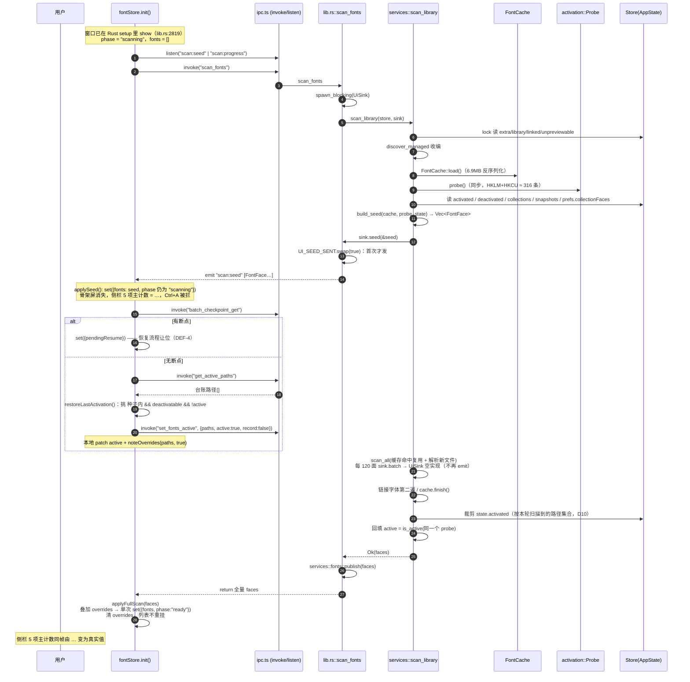
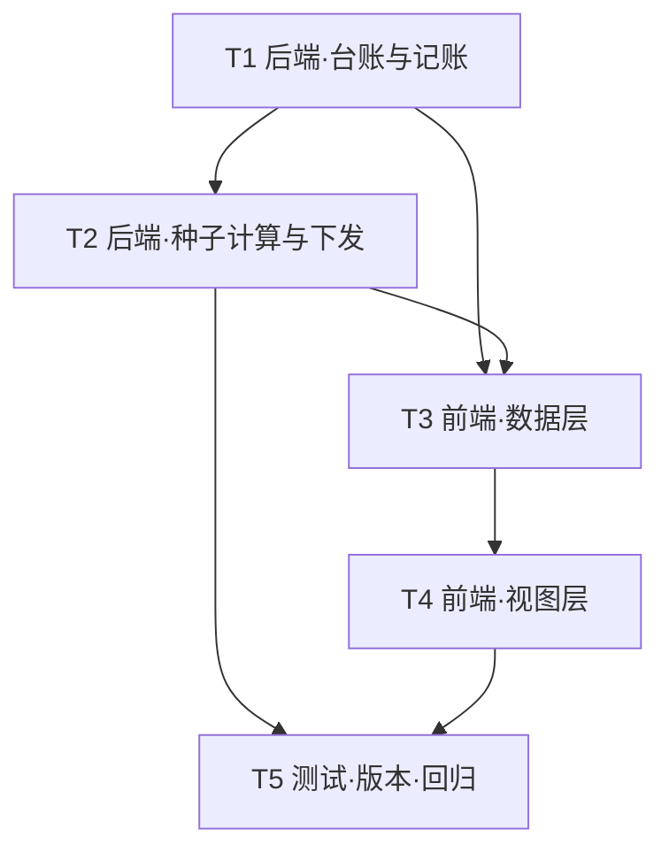

# 架构设计 · 2.1.4 启动种子装载与激活台账（增量）

| 项目 | 内容 |
| --- | --- |
| 版本 | 2.1.4（增量，基线 2.1.3） |
| 对应 PRD | `docs/PRD-2.1.4-启动种子装载.md` |
| 影响层 | Rust 服务层（`services/scan.rs`、`activation.rs`、`store.rs`、`fontcache.rs`、`lib.rs`）+ React 数据层（`fontStore.ts`）+ 视图层（`App.tsx`、`Sidebar.tsx`、`app.css`、locales） |
| 设计原则 | **只改读取顺序与呈现口径，不改扫描/解析算法，不改 `font-cache.json` 结构，不新增依赖** |
| 预估改动量 | 后端 ≈ 300 行、前端 ≈ 330 行、测试 ≈ 270 行，合计 ≈ 900 行 |

---

## 0. 现状确认（本次设计的事实基础，均已在源码中核对）

| # | 结论 | 位置 |
| --- | --- | --- |
| F1 | `scan_library` 是阻塞函数；当前顺序为「读 state → 收编 managed → `thread::spawn(probe)`(104) → `FontCache::load()`(109) → `scan_all`(110) → 链接字体第二遍 → `cache.finish()`(207) → `probe.join()`(228) → 统一回填 `active`(277-288)」 | `services/scan.rs:55-300` |
| F2 | `FontCache::load()` 反序列化 `font-cache.json`；`CACHE_VERSION = 11`；`entries: HashMap<path, Entry{mtime,size,source,faces}>`，`entries` 为**私有字段** | `fontcache.rs:39-58` |
| F3 | `FontFace` 字段齐全，缓存里存的就是完整结构，种子可零解析复用 | `font_types.rs` |
| F4 | `activation::probe()` 在 Windows 上等于 `registry::registered_paths()`，返回**已归一化**（去 `\\?\`、`/`→`\`、小写）的 `HashSet<String>` | `activation.rs:382-387`、`registry.rs:47-50,108-114` |
| F5 | **Windows 下 `is_active()` 完全忽略 `state.deactivated`**，只看 `source==System \|\| registered.contains(normalize(path))` | `activation.rs:389-398` |
| F6 | `sync`/`sync_batch` 都先 `is_system_font` 早退，再维护 `deactivated`，最后 `apply`；失败回滚 `deactivated` | `activation.rs:69-147` |
| F7 | `AppState` 已有 `deactivated / tags / collections / snapshots / linked / added / unpreviewable / pending_batch / prefs: serde_json::Value` | `store.rs:42-122` |
| F8 | **`prefs` 里的 `collectionFaces` 确实拿得到**：`set_prefs` 是**对象级合并**写入（`lib.rs:2240-2247`），`store::save` 会同步落 `prefs.json`（`store.rs:513`），`store::load` 启动时把 `prefs.json` **整体装回** `state.prefs`（`store.rs:431-442`）。所以 `scan_library` 内可直接读 `state.prefs["collectionFaces"]`（形状 `{分组名: [faceKey…]}`）。唯一损耗是前端 600ms 防抖窗口内退出可能丢最后一次改动 —— 与既有行为一致，且只影响种子成员，全量扫描会补正 | 见左 |
| F9 | 旧格式快照在 `de_snapshots` 里被转成 `key: ""`、`path: Some(真实路径)`、`family: ""`（`store.rs:144-174`）；前端在 rescan 完成后才用 `migrateEntry` 把 `path` 迁成 `key`（`fontStore.ts:2128-2151`）。**种子发生在 rescan 返回之前，所以后端必须自己兜 `path` 分支** | 见左 |
| F10 | `state.prefs` 里还有 `lastActivePaths`（`fontStore.ts:352,1171,1884`），由 `persistPrefs` 用 `fonts.filter(active)` 现算 → 扫描未完成时会写成 `[]`（PRD §6 点名的问题） | 见左 |
| F11 | `scan_fonts` 命令的 `UiSink` 把 `progress`→`scan:progress`、`batch`→`scan:batch`；另有 `api.rs:977` 的 `NullSink` 实现同一 trait | `lib.rs:54-78`、`api.rs:977` |
| F12 | 前端 `scan:batch` 每 150ms 合并 `set({scanFonts: concat})`，`App.tsx:247` 用它渲染、`App.tsx:249` 对全部已读字面重算 `selectVisibleFamilies` → 约 50 次全量计算 | `fontStore.ts:1810-1822`、`App.tsx:216,247,346` |
| F13 | `restoreLastActivation` 用 `get().fonts` 建 path→face 映射挑 `deactivatable && !active`，只 patch 本地 `active` 不 rescan | `fontStore.ts:2062-2090` |
| F14 | 侧栏 5 个主计数（字体库 / 已启用 / 启用至关闭 / 已停用 / 系统字体）+ 分组计数 + 标签计数全部从 `fonts` 现算；`NavRow.count?: number` 渲染成 `<span class="nav-count tabular">`，`.nav-count{min-width:20px;text-align:right}` | `Sidebar.tsx:273-291,103`、`app.css:335-345` |
| F15 | 「建快照 / 清理快照缺失项」已在 `phase==="scanning"` 时拦截并 toast `snap.waitScan` | `fontStore.ts:2993,3286` |
| F16 | Ctrl+A 走 `st.selectAll()`，无 phase 守卫 | `App.tsx:679-684` |
| F17 | 版本号真实分布：`package.json:15`、`src-tauri/Cargo.toml:3`、`src-tauri/tauri.conf.json:4`、`src-tauri/Cargo.lock:1273`（构建自动跟随）。**`src/lib/version.ts` 不含硬编码版本**（`import pkg from "../../package.json"`），无需改动 | 见左 |
| F18 | 语言包实际为 **9 个**（de/en/es/fr/ja/pt-BR/ru/zh-CN/zh-TW），PRD 附录 A 写的「11 个」与仓库不符 | `src/lib/i18n.ts:2-10`、`src/locales/` |

---

## 1. 架构决策记录（ADR）

### ADR-01 激活台账放在 `AppState.activated`，不新建文件

- **决定**：`AppState` 新增 `#[serde(default)] pub activated: HashSet<String>`，随 `state.json` 一起读写。
- **理由**：`Store::load()` 在窗口显示之前就把整份 state 读进内存（`lib.rs` setup），台账只是再多几百~几千条短字符串，**零额外读盘、零额外打开文件**；原子写（`write_bytes_atomic`）+ `.bak` 滚动备份 + 坏文件留证（`recover_broken_state`）这套机制直接复用。新建 `active-ledger.json` 会多一次启动读盘、多一套损坏恢复逻辑。
- **放弃**：①独立文件（PRD Q1 的建议）；②放进 `prefs`（`prefs` 会被前端的白名单 payload 覆盖性思考污染，且语义上它属于「字体库数据」而非 UI 偏好，`state.json` 的 1.77MB 写入已经是字体库数据的专属文件）。
- **代价**：每次持久启停会触发一次整份 `state.json` 落盘 —— 但这条路径**本来就要落盘**（`set_font_active`/`set_fonts_active` 末尾都有 `store::save`），台账是顺带写，不增加写次数。

### ADR-02 种子元数据只读磁盘缓存，不做「按需解析 N 个文件」

- **决定**：种子集合完全由 `font-cache.json` + 注册表 + `state.json` 推出；缓存里没有的路径**直接丢弃**，交给后续全量扫描。
- **理由**：缓存实测 6.9MB / 5853 条目 / 5949 字面，覆盖率 98%；剩下 2% 若现场解析，单个字体 5~40ms，最坏情况反而把 G1 的 1.5s 预算吃光，还会和紧接着的全量扫描重复解析同一文件（缓存 `get` 又被打成 miss）。「伪快速启动」比慢启动更难排查。
- **放弃**：PRD Q2 的「200 文件 / 800ms 双阈值」。阈值本身要测时、要打点、要写回退分支，三条都不产生用户价值。
- **代价**：缓存版本作废时（`CACHE_VERSION` 升级 / 文件损坏），种子≈空，用户体验等于回到 2.1.3 —— 这正是 PRD §7 场景 2 与 R-10 想要的降级。

### ADR-03 种子在后端一次算完，用 `scan:seed` 事件下发

- **决定**：在 `scan_library` 内、`FontCache::load()` 之后、`scan_all` 之前算出种子并 `sink.seed(&faces)`；`UiSink` 把它转成 `scan:seed` 事件。
- **理由**：种子需要 `state.activated / deactivated / collections / snapshots / prefs.collectionFaces` 五份数据 + 注册表探测结果，全都在后端内存里；放前端算等于把这些数据（含 `prefs` 全量）再 IPC 一次，还要求前端重复实现一遍 `face_key` 的归一化口径。
- **放弃**：①新增独立命令 `seed_fonts()`（多一次 `FontCache::load()`——6.9MB 反序列化，直接违背 G1；且与 `scan_fonts` 争抢缓存文件）；②前端自己从 `getPrefs + getCollections + getSnapshots` 拼（同上，且拿不到注册表）。
- **代价**：`scan_library` 的职责变宽了一点。用独立的纯函数 `build_seed()` + `is_seed_face()` 把它与扫描逻辑隔离，可单测。

### ADR-04 注册表探测从「并行」改为「同步前置」，`scan_all` 复用同一个 `Probe`

- **决定**：把 `activation::probe()` 提到 `FontCache::load()` 之后立刻同步执行，删掉 `std::thread::spawn(probe)`（`scan.rs:104`）与 `probe_handle.join()`（228）；末尾回填 `active` 时用同一个 `Probe`。
- **理由**：种子必须在**推送之前**知道每个字面的真实 `active`（否则首帧的「已启用」是错的，AC-12/AC-14 直接挂）。原设计与扫描重叠能省几十毫秒，但省下来的是「错数据」。
- **放弃**：①并行 + 种子先推、`active` 后补（会闪一次状态变化，违背 AC-05/AC-07 的稳定性要求）；②探测两次（一次给种子、一次给回填，注册表枚举 HKLM+HKCU 共 316 条，重复枚举纯浪费）。
- **代价**：实测 PowerShell 枚举 81ms，Rust 侧更快（同量级），相对全量扫描（秒~十几秒）可忽略；净损失只是原先的重叠时间。

### ADR-05 种子「每进程只推一次」，且一次性守卫放在 `UiSink` 而不是 `scan_library`

- **决定**：`lib.rs` 内 `static UI_SEED_SENT: AtomicBool`，`UiSink::seed` 内 `swap(true)` 后判断；`services/scan.rs` 每次都调 `sink.seed()`，由 sink 自己决定发不发。
- **理由**：会话中任何 rescan（导入字体、watcher、改目录、手动刷新）都会再走一遍 `scan_library`。若不加守卫，主列表会被种子子集「缩水」。
- **放弃**：把 AtomicBool 放在 `scan_library`。**这是个真 bug**：`api.rs` 的 `NullSink` 也走同一个 `scan_library`，若 HTTP 侧先扫（或插件触发扫），flag 会被「没发出去的那次」吃掉，界面永远收不到种子。
- **代价**：`ScanSink::seed` 需要一个默认空实现（`api.rs::NullSink` 不必改）。

### ADR-06 全量批次彻底退出主列表（`scan:batch` 删除）

- **决定**：`UiSink::batch` 变成空实现；`ScanSink::batch` 方法保留（HTTP 侧 `NullSink` 与 job 表继续用）；前端删除 `scan:batch` 监听与 `scanFonts` 字段。
- **理由**：约 50 批 × 每批 120 面的 JSON 序列化 + 前端 50 次 `selectVisibleFamilies` 全量重算，是「读一个刷一个」的直接成因（F12）。全量结果本来就要在末尾整体返回一次，中途推送纯属重复劳动。
- **放弃**：①保留批次但降频（治不了根：任何一批都会触发重算）；②保留 `scanFonts` 作为「全量进行中的临时列表」（种子已经占据了这个位置）。

### ADR-07 主列表不清空、不重挂，一次性替换；**不实现滚动锚点补偿**

- **决定**：`rescan()` 不再 `set({scanFonts: []})`；骨架屏条件改为 `phase === "scanning" && fonts.length === 0`；全量完成时**单次** `set({ fonts })`，列表组件保持挂载（不换 `key`），浏览器原生保留 `scrollTop`。
- **理由**：React 列表不换 key、数据长度变化时 `scrollTop` 由浏览器按像素保持，视觉上就是「位置基本不动」，已经满足 AC-09 的体感目标。
- **放弃**：PRD R-05 / C3 / AC-09 字面要求的「按族名锚点恢复滚动位置（偏差 ≤1 行）」。族名锚点需要在渲染前记住「首个可见族 + 其像素偏移」，渲染后再 `scrollIntoView`，涉及测量、双帧渲染、虚拟滚动（若有）配合，是本版本最容易引入新缺陷的地方（列表重排后锚点族可能已不存在或被筛掉）。**本版本改为「像素保持」并把它写进「已知限制」，等 QA 实测偏差超阈值再补。这是一处与 PRD 的显式偏差，已单列于 §10-2。**
- **代价**：种子→全量切换时若排序键（如「按大小排序」）导致顺序大改，视口可能落在别的字族上。用户仍可正常滚动，不阻塞任何操作。

### ADR-08 用 `overrides: Map<path, boolean>` 保住扫描期间的用户决策

- **决定**：前端维护 `overrides`；`applyFullScan()` 落地全量结果时按 overrides 覆盖 `active`，并按「路径是否仍存在」裁剪 map；不在 map 里的字面以扫描结果为准。
- **理由**：全量结果的 `active` 来自**扫描开始时**的注册表快照（ADR-04 把这个快照提前了），用户在扫描期间做的启停、以及 `restoreLastActivation` 补进去的启用，都不在这个快照里。若直接 `set({fonts})`，用户会看到自己刚启用的字体变回停用（AC-15 的反面）。
- **放弃**：①扫描结束后再探一次注册表（多一次枚举，且仍解决不了「用户点了但扫描已过该文件」的时序问题）；②扫描期间禁用启停（PRD A4 明确要求可用）。
- **代价**：需要在 7 个启停入口调用 `noteOverrides()`（见 §5.4）。漏一个的后果是「该路径在全量完成后状态回退」，属于可观测、可回归的问题。

### ADR-09 记账靠 `record: bool` 参数，由编译器强制每个调用点表态

- **决定**：`activation::sync(state, path, active, record: bool)`、`activation::sync_batch(state, paths, active, record: bool)`。全仓 14 个调用点必须显式传值。
- **理由**：台账正确性完全取决于「哪些动作算持久意图」。用默认参数 / 全局开关 / 单独的 `sync_session()` 变体，都会让新写的调用点**默认记错账**；加必填 `bool` 则编译不过，改的时候必须想一遍。
- **放弃**：①`sync_session()` 变体（实现重复，且两套逻辑迟早跑偏）；②在 `apply()` 里判断（`apply` 拿不到「这是不是会话级」的信息）。
- **代价**：14 处机械改动（见 §5.2 表格）。

### ADR-10 侧栏计数用 `number | null`，`null` 渲染 `…`

- **决定**：`NavRow.count?: number | null`；`phase === "scanning"` 时 5 个主计数（字体库 / 已启用 / 启用至关闭 / 已停用 / 系统字体）+ 分组计数 + 标签计数传 `null`；收藏 / 最近导入 / 快照条目数 / 回收站传真实值。`.nav-count` 加 `min-width` + `font-variant-numeric: tabular-nums`（已有 `tabular` 类）。
- **理由**：`0` 会被读成「没有字体」，这是 PRD 用户故事 US-4 的核心诉求；`null` 是三态里唯一能表达「还不知道」的类型。
- **放弃**：①单独的 `countsUnknown: boolean` 布尔开关（要在每处调用点重复判断、且无法表达「部分未知」）；②骨架占位块（会改变行高）。
- **代价**：`number | undefined` 与 `number | null` 在 `count !== undefined` 判断下会冲突 —— 必须显式判 `count != null`，否则 `null` 会被渲染成字符串 "null"。

### ADR-11 恢复时机前移到「种子到达之后」，数据源改为后端台账

- **决定**：`init()` 在种子事件到达（或全量返回 / 3s 超时）后，先查 `batchCheckpointGet`（保留 DEF-4 的断点优先语义），再 `await restoreLastActivation()`；数据源从 `prefs.lastActivePaths` 改为新增命令 `get_active_paths()`（返回 `state.activated`），`lastActivePaths` 仅作台账为空时的一次性兜底读取。
- **理由**：恢复是「首帧即可用」的一部分（US-2/AC-12），放到全量结束之后等于把 G1 的承诺推迟了十几秒。台账本身是用户意图快照，不依赖扫描结果，天然可以提前用。
- **放弃**：①继续用 `lastActivePaths`（数值来自 `fonts`，种子只有子集 → 会漏掉未进种子的已启用字体，且扫描中途被写成 `[]` 的历史缺陷无法根治）；②在 `restoreLastActivation` 里重新 rescan（会二次触发全量）。
- **代价**：`restoreLastActivation` 需要把「已启用」的判断建立在种子上；账台中但不在种子里的路径被跳过（缓存未命中），这类字体要等全量完成才可见 —— 与 R-13 之外的既有行为一致，记录为已知限制。

---

## 2. 整体时序

> 完整 Mermaid 源码另存 `docs/sequence-diagram-2.1.4.mermaid`。



---

## 3. 数据结构变更

> 完整 Mermaid 类图另存 `docs/class-diagram-2.1.4.mermaid`。

### 3.1 Rust

```rust
// ── store.rs ──────────────────────────────────────────────
pub struct AppState {
    // …既有字段不动…
    pub deactivated: HashSet<String>,
    pub collections: HashMap<String, Vec<String>>,
    pub snapshots: Vec<Snapshot>,
    pub prefs: serde_json::Value,

    /// 持久激活台账（2.1.4）：**用户意图**的快照，不是扫描结果的派生值。
    ///
    /// 为什么存"原始路径"而不是归一化后的小写路径：前端拿它跟 `FontFace.path` 直接
    /// 对号（`restoreLastActivation`），归一化会引入一次口径转换，两边一旦不同步
    /// 就会出现"台账里有、界面上匹配不到"。归一化只在比较时临时做（条目量级几百，成本可忽略）。
    /// 系统字体路径一律不落账（写入时过滤 + `store::load` 兜底清理）。
    #[serde(default)]
    pub activated: HashSet<String>,
}

impl AppState {
    /// 记 / 撤一条台账。返回是否真的改了（用于决定要不要落盘）。
    ///
    /// 三条硬规则：①系统字体路径直接拒绝（PRD §6「记录目标为系统字体路径 → 忽略」）；
    /// ②写入前清掉同一路径的其它大小写变体（否则 `D:\a.ttf` 与 `d:\A.TTF` 会同时存在）；
    /// ③`on=false` 且本来就没有 → 不算改动。
    pub fn record_activated(&mut self, path: &str, on: bool) -> bool { /* 见 §5.1 */ }
}

// ── activation.rs ─────────────────────────────────────────
pub fn sync(state: &mut AppState, path: &str, active: bool, record: bool) -> Result<(), String>;
pub fn sync_batch(state: &mut AppState, paths: &[String], active: bool, record: bool) -> Vec<String>;

impl Probe {
    /// 种子筛选用：这条**已归一化**的路径是否在注册表里。
    /// 不直接暴露 `registered` 字段是为了让非 Windows 平台（无注册表概念）也能编译，
    /// 那边恒返回 false，种子自动退化为「台账 + 分组 + 快照 + 系统字体」。
    pub fn is_registered(&self, normalized: &str) -> bool;
}

// ── fontcache.rs ──────────────────────────────────────────
impl FontCache {
    /// 种子装载要遍历全部缓存字面（按路径 O(1) 取元数据，不解析任何文件）。
    /// 只读迭代器：`entries` 仍保持私有，外部拿不到 `Entry`（mtime/size 是实现细节）。
    pub fn faces(&self) -> impl Iterator<Item = &FontFace>;
    pub fn face_count(&self) -> usize;
}

// ── services/scan.rs ──────────────────────────────────────
pub trait ScanSink {
    fn progress(&self, done: usize, total: usize);
    fn batch(&self, faces: &[FontFace]);
    /// 首帧种子集合。默认空实现：HTTP 侧的 `NullSink` 不需要这个概念（它靠 job 轮询）。
    /// **注意**："每进程只发一次"的守卫由实现方负责，不在这里 —— 见 ADR-05。
    fn seed(&self, _faces: &[FontFace]) {}
}

/// 种子筛选的全部输入。抽成纯数据结构是为了能脱离 `Store` 单测（无文件、无注册表）。
pub struct SeedInput {
    pub activated: HashSet<String>,          // 归一化后
    pub deactivated: HashSet<String>,        // 归一化后
    pub collection_families: HashSet<String>,// 小写族名
    pub collection_face_keys: HashSet<String>,
    pub snapshot_keys: HashSet<String>,
    pub snapshot_paths: HashSet<String>,     // 归一化后（旧格式 path）
}
```

### 3.2 事件载荷

```ts
// scan:seed —— 与 scan:progress 同一生命周期，只发一次（每进程）
// 载荷就是 FontFace[]，与 scan_fonts 的返回同构：前端不需要第二套解析/归一化逻辑，
// normalizeFaces() 直接复用（缓存里的 face 可能缺 2.1.x 新增字段）。
type ScanSeedPayload = FontFace[];
```

### 3.3 前端 Store

```ts
export const useFontStore = create<FontStore & Actions>((set, get) => ({
  // ── 删除 ──
  // scanFonts: FontFace[];              ← 删除（批次通道已废弃，ADR-06）

  // ── 新增 ──
  /**
   * 扫描期间用户手动改过的启停：path → active。
   * 全量结果落地时用它压过扫描结论（扫描用的是**开始扫描那一刻**的注册表快照）。
   * 用 Map 而不是对象：键是 Windows 路径，带 `:` `\`，对象当字典容易被原型链/序列化坑到。
   * 只在 phase === "scanning" 期间非空，applyFullScan 之后清空。
   */
  overrides: new Map<string, boolean>(),
  /** 种子是否已到达（决定"该等多久才查断点/走恢复"） */
  seedReady: false,
}));
```

### 3.4 `ScanSink` 的生命周期（需求里的 “SyncSink”）

> 说明：现有代码里**不存在** `SyncSink`，只有 `services/scan.rs:13` 的 `ScanSink` 一个 sink trait（两个实现：`lib.rs::UiSink`、`api.rs::NullSink`）。本节按 `ScanSink` 展开；如果原意是「另建一个只管台账的 sink」，当前方案不需要 —— 台账是 `AppState` 的字段，不经过 sink。

| 阶段 | 调用 | 次数 | 实现方职责 |
| --- | --- | --- | --- |
| 种子 | `sink.seed(&seed)` | `scan_library` 内**每次调用都调**；`UiSink` 用自己的 `AtomicBool` 保证**每进程 emit 一次** | `UiSink`：`UI_SEED_SENT.swap(true)` 为 false 才 emit。`NullSink`：用 trait 默认空实现，**一行都不用改** |
| 进度 | `sink.progress(done, total)` | 每 25 个文件 + 末尾 100% | `UiSink`：`emit("scan:progress")`，**保持现状**（底部进度条要用） |
| 批次 | `sink.batch(&faces)` | 每 120 面 | `UiSink`：**改为空实现**（D5）。`NullSink`：保持现状 |
| 结束 | `scan_library` 返回 `Vec<FontFace>` | 1 次 | 命令层 `services::fonts::publish(faces)` + 原样返回前端 |

三条必须守住的约定：

1. **`seed` 必须在 `batch` 之前、且只在整次调用里出现一次** —— 前端「`fonts` 非空就忽略 `scan:seed`」的双保险依赖这个顺序。
2. **`batch` 转空实现不影响 HTTP 侧**：`NullSink` 的 `batch` 本来就是空实现，`api.rs` 的 job 表走的是 `progress`。删掉 UI 侧的批次推送不会让任何调用方少收东西。
3. **`seed` 的守卫不能提到 `scan_library` 里**（ADR-05）—— 否则 HTTP 侧先扫会把这一次吃掉。

---

## 4. 文件清单

### 4.1 后端

| # | 文件（相对路径） | 性质 | 具体改动点 |
| --- | --- | --- | --- |
| B1 | `src-tauri/src/store.rs` | 修改 | ① `AppState` 加 `activated: HashSet<String>`（`#[serde(default)]`，~74 行附近）；② `store::load()`（425-472）在清理 `deactivated` 的同一段（446-456）后追加：`state.activated.retain(\|p\| !crate::activation::is_system_font(p))`，变了就 `save`；③ 新增 `impl AppState::record_activated(&mut self, path, on) -> bool`（约 25 行，含大小写变体清理） |
| B2 | `src-tauri/src/activation.rs` | 修改 | ① `sync` 签名加 `record: bool`（69 行），`apply` **成功之后**才写台账（失败回滚里同步撤回）；② `sync_batch` 签名加 `record: bool`（104 行），一批只做一次台账变更（循环内收集 → 循环外 `retain`/`extend`，避免 5000 次 HashSet 操作）；③ 新增 `impl Probe::is_registered(&self, &str) -> bool`（382-387 下方，带 `#[cfg]`） |
| B3 | `src-tauri/src/fontcache.rs` | 修改 | 在 `impl FontCache`（77-）内加 `pub fn faces(&self) -> impl Iterator<Item=&FontFace>`（`self.entries.values().flat_map(\|e\| e.faces.iter())`）与 `pub fn face_count(&self) -> usize`。**`CACHE_VERSION` 保持 11 不动** |
| B4 | `src-tauri/src/services/scan.rs` | 修改（+ 新增函数 + 测试） | ① `ScanSink` 加 `fn seed(&self, _faces: &[FontFace]) {}`（13-16 行）；② `scan_library` 55-119 段重排：`FontCache::load()` → `activation::probe()`（同步）→ `build_seed()` → `sink.seed()` → `scan_all`；删除 `std::thread::spawn(probe)`（104）与 `probe_handle.join()`（228，改为直接用前面的 `probe`）；③ 266-288 收尾段加台账裁剪（D10）与 `alive` 集合；④ 新增 `pub struct SeedInput`、`pub fn is_seed_face(&FontFace, &SeedInput) -> bool`、`fn build_seed(&FontCache, &Probe, &AppState) -> Vec<FontFace>`；⑤ 新增 `#[cfg(test)] mod seed_tests` |
| B5 | `src-tauri/src/lib.rs` | 修改 | ① `UiSink`（56-67）实现 `seed()` + `static UI_SEED_SENT: AtomicBool`，`batch()` 改空实现；② `set_font_active`（109）传 `record=true`；③ `set_fonts_active`（118-136）加 `record: Option<bool>` 参数，默认 `true`，透传给 `sync_batch`；④ `set_fonts_active_session`（1709）传 `record=false`；⑤ `revert_session_activations`（1738）`record=false`；⑥ 导入自动启用（208/267）`record=true`；⑦ `uninstall_one`（339-362）两处 `return` 前 `state.record_activated(path, false)`；`activation::sync(state, path, true)`（341）传 `record=false`；⑧ `affinity_session_activate`（494）`record=false`；⑨ 版权归档路径（1068/1105/1121）分别 `false` / `true` / `false`；⑩ 新增 `#[tauri::command] fn get_active_paths(store) -> Result<Vec<String>, String>` 并注册进 `invoke_handler` |
| B6 | `src-tauri/src/services/fonts.rs` | 修改 | ① `set_paths_active`（190）`sync_batch(..., true)`；② `activate_session`（221）`sync(..., false)`；③ `revert_session`（256）`sync(..., false)`。`face_key` 已是 `pub`，不改 |
| B7 | `src-tauri/src/affinity.rs` | 修改 | `revert_session`（586）`sync(..., false)` |
| B8 | `src-tauri/src/api.rs` | 不改 | `NullSink` 靠 trait 默认实现 `seed()` 即可，**零改动** |

### 4.2 前端

| # | 文件（相对路径） | 性质 | 具体改动点 |
| --- | --- | --- | --- |
| F1 | `src/lib/ipc.ts` | 修改 | ① `setFontsActive`（428-429）签名加 `record?: boolean`，payload 传 `{ paths, active, noSave, record }`；② 新增 `getActivePaths: () => invoke<string[]>("get_active_paths")`（放在 441 行 `batchCheckpointGet` 附近） |
| F2 | `src/state/fontStore.ts` | 修改（改动最大的单文件） | ① 接口：删 `scanFonts: FontFace[]`（280）；加 `overrides: Map<string, boolean>`、`seedReady: boolean`、`applySeed`、`applyFullScan`、`noteOverrides` 声明；② 初值：1693 删 `scanFonts: []`，加 `overrides: new Map()`、`seedReady: false`；③ 删除 `scan:batch` 监听整段（1810-1822）；④ 新增 `listen<FontFace[]>("scan:seed")`；⑤ `init()`（1793-2060）：去掉 `await get().rescan()` 的阻塞语义 → `const scanP = get().rescan()`，`await` 种子 promise，再断点检查、再 `restoreLastActivation()`，最后 `await scanP`；⑥ `restoreLastActivation()`（2062-2090）：数据源换 `ipc.getActivePaths()`（空则回退 `get().lastActivePaths`），成功回调里 `noteOverrides(missing, true)`；⑦ `rescan()`（2092-2186）：`set({ phase: "scanning" })` 保留 `fonts`，末尾改调 `applyFullScan(fonts)`；⑧ `persistPrefs`（1148-1191）：删除 `lastActivePaths` 键（1171）；⑨ 7 处启停入口插 `noteOverrides`（见 §5.4） |
| F3 | `src/App.tsx` | 修改 | ① 216 行删 `scanFonts` 选择器；② 247 行 `displayFonts` 直接等于 `fonts`（删常量或保留别名）；③ 346 行骨架条件改 `phase === "scanning" && fonts.length === 0`；④ 679-684 Ctrl+A 加 `if (st.phase === "scanning") return;` |
| F4 | `src/components/Sidebar.tsx` | 修改 | ① `NavRow` 的 `count?: number` → `count?: number \| null`（39 行）；② 渲染 `count !== undefined` → `count != null`，`null` 时输出 `<span className="nav-count tabular nav-count-unknown">…</span>`（103 行）；③ `Sidebar()` 内（273-291）引入 `const scanning = useFontStore(s => s.phase === "scanning")`，5 个主计数（familyCount / activatedCount / sessionCount / deactivatedCount / systemCount）+ `collectionCount()` + 标签计数在 `scanning` 时返回 `null`；收藏 / 最近导入 / 快照条目数 / 回收站保持真实值 |
| F5 | `src/app.css` | 修改 | `.nav-count`（335-342）加 `min-width: 3ch`（容纳 `…` 与三位数）+ `font-variant-numeric: tabular-nums`；新增 `.nav-count-unknown { color: var(--text-tertiary); opacity: .55 }` |
| F6 | `src/components/LoadProgress.tsx` | 修改（可选，P1） | 17 行保留；19-21 段：`total === 0 && !seedReady` 时文案用 `load.restoringSeed`，`total > 0` 时用现有 `load.reading`（保证 A1 阶段有「正在恢复上次启用的字体…」而不是「正在查找字体…」） |
| F7 | `src/locales/{zh-CN,zh-TW,en,ja,de,fr,es,pt-BR,ru}.json` | 修改（9 个） | 新增 6 个 key（`load.seedFallback` 按 PRD 复用现有 `load.finding`，不新增）：`load.restoringSeed`、`load.seedReady`、`load.partialData`、`load.retry`、`toast.ledgerWriteFailed`、`load.backgroundReading`（可与 `load.reading` 合并，若合并则只加 5 个） |

### 4.3 版本与文档

| # | 文件 | 性质 | 改动点 |
| --- | --- | --- | --- |
| V1 | `package.json` | 修改 | `"version": "2.1.3"` → `"2.1.4"`（15 行） |
| V2 | `src-tauri/tauri.conf.json` | 修改 | `"version"`（4 行）→ `2.1.4` |
| V3 | `src-tauri/Cargo.toml` | 修改 | `version = "2.1.3"`（3 行）→ `2.1.4` |
| V4 | `src-tauri/Cargo.lock` | 自动 | 下次 `cargo build` 自动跟随（1273 行），无需手改但要确认提交 |
| V5 | `src/lib/version.ts` | **不改** | 版本从 `package.json` 导入（F17），不存在第二处硬编码 |
| V6 | `CHANGELOG.md` | 修改 | 顶部加 `## [2.1.4] — 2026-11-14` 段（沿用现有格式：副标题 + 分节） |

---

## 5. 关键代码骨架

### 5.1 台账写入（`store.rs`）

```rust
impl AppState {
    pub fn record_activated(&mut self, path: &str, on: bool) -> bool {
        // 系统字体改不动、也不该记（PRD §6 最后几行）。这条必须在最前面：
        // 上游有些调用点（批量启停）拿到的是混合清单，不能指望它们自己过滤。
        if crate::activation::is_system_font(path) {
            return false;
        }
        let norm = crate::registry::normalize(path);
        // 先清掉同一路径的其它大小写 / 斜杠变体：
        // 路径来自 FontFace.path，同一文件在 linked / added / 注册表里可能写法不同，
        // 不清就会攒出 N 份"同一个字体"的台账，体积随时间线性膨胀（R-18 的隐患）。
        let had_variant = self.activated.iter().any(|p| p != path && crate::registry::normalize(p) == norm);
        let existed = self.activated.contains(path);
        if on {
            if had_variant {
                self.activated.retain(|p| crate::registry::normalize(p) != norm);
            }
            self.activated.insert(path.to_string())
        } else {
            if !existed && !had_variant {
                return false;
            }
            self.activated.retain(|p| p != path && crate::registry::normalize(p) != norm);
            false
        }
    }
}
```

### 5.2 `sync` / `sync_batch` 的 `record` 落点

```rust
pub fn sync(state: &mut AppState, path: &str, active: bool, record: bool) -> Result<(), String> {
    if is_system_font(path) { /* 早退，天然不记账 */ return Ok(()); }
    // …既有 deactivated 维护不动…
    let result = apply(state, path, active);
    crate::diag::activation(path, active, &result);
    if result.is_err() {
        // …既有 deactivated 回滚…
    } else if record {
        // ⚠️ 只有 `apply` 成功才记账：PRD §6 要求「成功写盘后才记录；失败回滚不记」。
        // 放在这里而不是函数开头，是因为 apply 失败时注册表其实没变，
        // 记了账下次启动会按台账去"恢复"一个本来就启用的字体（无害但会自我强化写盘）。
        state.record_activated(path, active);
    }
    result
}
```

`sync_batch` 同理，但**一批只改一次集合**：

```rust
pub fn sync_batch(state: &mut AppState, paths: &[String], active: bool, record: bool) -> Vec<String> {
    // …循环里不再逐条动台账…
    let mut ledger: Vec<&str> = Vec::new();   // 本轮真正成功的路径
    for path in paths { /* …成功后 ledger.push(path) … */ }
    if record && !ledger.is_empty() {
        // 5000 条逐条 retain 是 O(n·m)；先批量剔除再批量插入，一次遍历搞定。
        for p in &ledger { state.record_activated(p, active); }
    }
    // …
}
```

**14 个调用点的 `record` 取值表（D9）**

| 调用点 | 语义 | `record` |
| --- | --- | --- |
| `lib.rs:109` `set_font_active` | 单族持久启停 | `true` |
| `lib.rs:124` `set_fonts_active` | 批量持久启停 | 参数，默认 `true` |
| `lib.rs:208` / `267` 导入后自动启用 | 持久 | `true` |
| `lib.rs:341` `uninstall_one` 删除前置补启用 | 内部补偿（马上要删） | `false` |
| `lib.rs:494` `affinity_session_activate` | 会话级，退出撤销 | `false` |
| `lib.rs:1068` 版权归档「移动前停用」 | 内部动作（旧路径即将消失） | `false` |
| `lib.rs:1105` 版权归档「改名后重新启用」 | 用户原本就启用，换路径不算改意图 | `true` |
| `lib.rs:1121` 版权归档「搬失败回滚」 | 内部回滚 | `false` |
| `lib.rs:1709` `set_fonts_active_session` | 启用至关闭 | `false` |
| `lib.rs:1738` `revert_session_activations` | 会话撤销 | `false` |
| `services/fonts.rs:190` `set_paths_active`（HTTP/插件） | 持久 | `true` |
| `services/fonts.rs:221` `activate_session` | 会话 | `false` |
| `services/fonts.rs:256` `revert_session` | 会话撤销 | `false` |
| `affinity.rs:586` `revert_session` | 会话撤销 | `false` |

### 5.3 种子计算（`services/scan.rs`）—— 筛选伪代码与去重策略

```rust
/// 种子筛选：命中任意一条即入种子。抽成纯函数才能单测（不碰 Store / 注册表 / 文件）。
pub fn is_seed_face(face: &FontFace, inp: &SeedInput) -> bool {
    let norm = crate::registry::normalize(&face.path);
    // ① 系统字体：让「系统字体」分类与套用立即可用（PRD §3.1 第 2 行）
    if face.source == FontSource::System || crate::activation::is_system_font(&face.path) {
        return true;
    }
    // ② 用户明确停用过的一律不进：R-16「以 deactivated 为准」
    //    （Windows 上 is_active 完全不看 deactivated，所以这里必须自己挡）
    if inp.deactivated.contains(&norm) {
        return false;
    }
    // ③ 上次启用 = 台账 ∪ 注册表（并集是为了兼容升级上来的老用户，D11）
    if inp.activated.contains(&norm) {
        return true;
    }
    // ④ 分组：整族成员按族名，字重级成员按 faceKey（与前端同口径）
    if inp.collection_families.contains(&face.family.to_lowercase()) {
        return true;
    }
    let key = crate::services::fonts::face_key(face);
    if inp.collection_face_keys.contains(&key) {
        return true;
    }
    // ⑤ 快照：新格式按 key，旧格式按 path（旧数据的 key 是空串，见 F9）
    if inp.snapshot_keys.contains(&key) {
        return true;
    }
    inp.snapshot_paths.contains(&norm)
}

/// 从缓存里挑出种子字面。**不解析任何字体文件**（ADR-02）。
fn build_seed(cache: &FontCache, probe: &Probe, state: &AppState) -> Vec<FontFace> {
    let inp = seed_input(probe, state);   // 见下
    // 去重键用 (归一化路径, face_index)：理由 ——
    //   · 同一路径可能在多个来源里命中（台账 + 分组 + 快照），必须只出一份；
    //   · 一个 ttc 里有多个字面（face_index 不同），不能按路径去重；
    //   · 不能用 `face.id`：缓存里的 id 是上一次扫描时拼的，历史上出现过路径大小写不一致
    //     导致同一字体两个 id（见 fontStore 的 normalizeFaces 注释），按归一化路径更稳。
    let mut seen: HashSet<(String, u32)> = HashSet::new();
    let mut out: Vec<FontFace> = Vec::new();
    for face in cache.faces() {
        if !is_seed_face(face, &inp) {
            continue;
        }
        if !seen.insert((crate::registry::normalize(&face.path), face.face_index)) {
            continue;
        }
        let mut f = face.clone();
        // 缓存里的 active / added_at 是上次扫描的旧值（fontcache.rs 顶部注释已声明），
        // 必须用本轮 probe 重算，否则首帧的"已启用"是错的（AC-12/AC-14）。
        f.active = !inp.deactivated.contains(&crate::registry::normalize(&f.path))
            && crate::activation::is_active(probe, state, &f);
        f.added_at = state.added.get(&f.path).copied().or_else(|| file_time(&f.path, true));
        if state.unpreviewable.contains(&f.id) && f.incomplete.is_none() {
            f.incomplete = Some(crate::parser::UNPREVIEWABLE_REASON.to_string());
        }
        out.push(f);
    }
    out
}

fn seed_input(probe: &Probe, state: &AppState) -> SeedInput {
    // 注册表侧不预先枚举成集合：缓存 5853 条，直接对归一化路径做 is_registered 命中查询，
    // 比克隆一份 316 条的 HashSet 再去查更省（且 Probe 里本来就有一份）。
    let mut collection_families = HashSet::new();
    for (name, members) in &state.collections {
        collection_families.insert(name.to_lowercase());
        for m in members { collection_families.insert(m.to_lowercase()); }
    }
    // prefs.collectionFaces：形状 {分组名: [faceKey…]}；字段可能不存在（新装用户）或
    // 类型被污染（老版本 / 手工改 prefs.json）→ 一路 downcast 失败就当空集合，绝不 panic。
    let collection_face_keys = state.prefs
        .get("collectionFaces")
        .and_then(|v| v.as_object())
        .map(|obj| obj.values()
            .filter_map(|v| v.as_array())
            .flatten()
            .filter_map(|v| v.as_str())
            .map(str::to_string)
            .collect())
        .unwrap_or_default();
    // 快照：key 为空 = 旧格式，退到 path（F9）
    let mut snapshot_keys = HashSet::new();
    let mut snapshot_paths = HashSet::new();
    for snap in &state.snapshots {
        for e in &snap.entries {
            if !e.key.is_empty() { snapshot_keys.insert(e.key.clone()); }
            else if let Some(p) = &e.path { snapshot_paths.insert(crate::registry::normalize(p)); }
            // key 与 path 都空 → 这条目匹配不到任何字体，跳过（历史脏数据，不报错）
        }
    }
    SeedInput {
        activated: state.activated.iter().map(|p| crate::registry::normalize(p)).collect(),
        deactivated: state.deactivated.iter().map(|p| crate::registry::normalize(p)).collect(),
        collection_families,
        collection_face_keys,
        snapshot_keys,
        snapshot_paths,
    }
}
```

`scan_library` 内的接缝（替换 104-119 行）：

```rust
    // 注册表探测从"跟扫描并行"改成"先跑完"：种子必须在推送之前知道每个字面的真实
    // active，否则首帧的"已启用"是错的。代价只是几十毫秒的串行等待（ADR-04）。
    let t_seed = std::time::Instant::now();
    let mut cache = crate::fontcache::FontCache::load();
    let probe = activation::probe();
    {
        let state = store.0.lock().map_err(|e| e.to_string())?;
        let seed = build_seed(&cache, &probe, &state);
        crate::diag::log(&format!(
            "[seed] 缓存 {} 个字面 → 种子 {} 个，耗时 {:?}，台账 {} 条",
            cache.face_count(), seed.len(), t_seed.elapsed(), state.activated.len()
        ));
        // 每次都调：发不发由 sink 自己的一次性守卫决定（ADR-05：HTTP 侧先扫也不吃掉这一次）
        if !seed.is_empty() { sink.seed(&seed); }
    }
    let t_scan = std::time::Instant::now();
    let (mut faces, mut cache, scan_files) = {
        let managed = managed.clone();
        let (faces, files) = scanner::scan_all(&extra, &managed, &mut cache, linked_total, …);
        (faces, cache, files)
    };
```

### 5.4 前端：种子监听与全量落地

```ts
// ── fontStore.ts ───────────────────────────────────────────
/** 扫描期间用户手动改的启停。只在 scanning 期间收集，全量落地后清空（ADR-08）。 */
function noteOverrides(paths: readonly string[], active: boolean) {
  const s = useFontStore.getState();
  if (s.phase !== "scanning" || paths.length === 0) return;
  const next = new Map(s.overrides);
  for (const p of paths) next.set(p, active);
  useFontStore.setState({ overrides: next });
}

// init() 内，紧跟 scan:progress 监听之后注册：
let seedResolve: (() => void) | undefined;
const seedArrived = new Promise<void>((r) => { seedResolve = r; });
await listen<FontFace[]>("scan:seed", (e) => {
  // 双保险：backend 已有每进程一次守卫（ADR-05）；这里再挡一次"fonts 非空"，
  // 因为会话中的 rescan 若因任何原因重发种子，会把主列表缩成种子子集（D4）。
  const st = get();
  if (st.fonts.length > 0) { seedResolve?.(); return; }
  const seed = normalizeFaces(e.payload);
  // 种子**写进 fonts**（不是 scanFonts）：主列表组件不换实例、不重挂，
  // 骨架屏条件随之变成"fonts 为空"（ADR-07）。
  set({ fonts: seed, seedReady: true });
  seedResolve?.();
});

// init() 尾部：把"等种子"与"等全量"解耦
const scanPromise = get().rescan();
// 种子正常在 100~300ms 内到达；3s 是兜底（缓存损坏 / 事件丢失），
// 到点就往下走 —— 宁可让恢复流程晚一点，也不能让启动卡在等事件上。
await Promise.race([seedArrived, scanPromise, new Promise((r) => setTimeout(r, 3000))]);
set({ seedReady: true });
try {
  const cp = await ipc.batchCheckpointGet();
  if (cp) { set({ pendingResume: cp }); return; }   // DEF-4：断点优先，恢复让位
} catch { /* 断点只是锦上添花 */ }
await get().restoreLastActivation();
// 不 await scanPromise：全量还在跑时 init 就该返回，界面要能操作。

applySeed: (faces) => { /* 由监听器内联实现，见上 */ },

/**
 * 全量结果落地：**唯一**一次 set({fonts})。
 * 叠加 overrides 的顺序不能反：扫描结论是"扫描开始那一刻"的真相，用户操作比它新。
 */
applyFullScan: (full) => {
  const s = get();
  const ov = s.overrides;
  const alive = new Set(full.map((f) => f.path));
  const out = ov.size === 0 ? full : full.map((f) => {
    const want = ov.get(f.path);
    return want === undefined || !f.deactivatable || want === f.active ? f : { ...f, active: want };
  });
  // 裁剪：路径已不存在的 overrides 留着只会在下一次全量里误伤同名字体（复用回收站的路径）
  const keep = new Map<string, boolean>();
  if (ov.size > 0) for (const [p, v] of ov) if (alive.has(p)) keep.set(p, v);
  set({ fonts: out, phase: "ready", overrides: keep });
},

restoreLastActivation: async () => {
  if (!get().restoreOnLaunch) return;
  // 台账优先；台账为空（首次升级 / 用户从未操作过）时用 lastActivePaths 兜一次（D11）
  let ledger: string[] = [];
  try { ledger = await ipc.getActivePaths(); } catch { /* 读不到就当空 */ }
  const saved = ledger.length > 0 ? ledger : get().lastActivePaths;
  if (saved.length === 0) return;
  // 只挑"种子里有、可停用、当前不是启用"的：已启用的再写一遍注册表要 0.3s/个，白花时间
  const byPath = new Map(get().fonts.map((f) => [f.path, f] as const));
  const missing = [...new Set(saved.filter((p) => {
    const face = byPath.get(p);
    return face ? face.deactivatable && !face.active : false;
  }))];
  if (missing.length === 0) return;
  try {
    // record=false：启动补启用**不是**用户意图，写台账会让每次启动都自我强化（D9 / PRD §6）
    await ipc.setFontsActive(missing, true, false, false);
    noteOverrides(missing, true);   // 全量结果用的是旧 probe，必须压过它（ADR-08）
    const revived = new Set(missing);
    set({ fonts: get().fonts.map((f) => (revived.has(f.path) ? { ...f, active: true } : f)) });
    toast.success(t("toast.restoredLast", { count: missing.length }), undefined, "activate");
  } catch (e) {
    toast.error(t("toast.couldntRestoreLast"), String(e));
  }
},
```

**`noteOverrides` 的 7 个插入点**

| 位置 | 场景 |
| --- | --- |
| `fontStore.ts:2077`（`restoreLastActivation`） | 启动补启用 |
| `fontStore.ts:2205`（`setFamilyActive` 小族路径） | 单族启停 |
| `fontStore.ts:2234`（`setFamilyActive` 大族批次） | 大族整族启停 |
| `fontStore.ts:2318`（`setFaceActive`） | 单字面启停 |
| `fontStore.ts:1454`、`1518`、`3583`（三处 `runBatches` 执行器） | 批量 / 快照应用·切换·合并 / 分组整组启停（都汇流到这里） |
| `fontStore.ts:2288`（`setFontsActiveSession`） | 启用至关闭（建议也记，避免全量后显示回停用） |

插法统一为：在 `await ipc.setFontsActive(...)` **之前** 调 `noteOverrides(paths, active)`（写在前面的原因是：即使 IPC 抛错，用户意图仍在，后续 rescan 也该以用户操作为准）。

### 5.5 侧栏 `…`

```tsx
// Sidebar.tsx
const scanning = useFontStore((s) => s.phase === "scanning");
const familyCount = scanning ? null : familiesFor(fonts, tags).size;
const activatedCount = scanning ? null : allFamilies.filter(…).length;
// …deactivatedCount / systemCount / sessionCount 同理…
const collectionCount = (name: string) =>
  scanning ? null : /* 原实现 */;

// NavRow 渲染：`count != null`（不能用 !== undefined，null 会被渲染成 "null"）
{count !== undefined && (
  <span className="nav-count tabular">{count === null ? "…" : count}</span>
)}
```

---

## 6. 并发与竞态分析

| # | 竞态 | 时序 | 处置 |
| --- | --- | --- | --- |
| C1 | **种子 vs 全量**（同一线程） | `sink.seed()` 在全量遍历之前同步发出，两者都在 `spawn_blocking` 里，天然串行 | 无需锁。种子是「缓存子集」，全量是「缓存 + 新解析」的全集，后者必然覆盖前者 |
| C2 | **种子 vs rescan（重扫）** | 会话中导入字体 → `rescan()` → 又走一遍 `scan_library` → 又算出种子 | ①`UI_SEED_SENT` 一次性守卫（ADR-05，放在 `UiSink` 内，HTTP 侧先扫也不影响）；②前端 `fonts.length > 0` 时忽略 `scan:seed`（双保险）。**两层都必须在**：万一将来有人加了个新的 sink 实现，第一层失效时第二层还能保命 |
| C3 | **用户启停 vs 全量覆盖** | t0 扫描开始（probe 快照 P0）→ t1 用户启用 X（写注册表）→ t2 扫描回填 `active = is_active(P0)` → X 显示停用 | `overrides`（ADR-08）。注意 `restoreLastActivation` 也发生在 P0 之后，同样必须写 overrides —— 这是最容易漏的一条 |
| C4 | **断点恢复 vs 种子** | 存在 `pending_batch` 时若执行 `restoreLastActivation`，会把用户"停用中"的字体反向启用（DEF-4 实景：反向启用 319 个） | 顺序固定为「种子 → `batchCheckpointGet` → 有断点则 return，无断点才 restore」。**不能**因为种子提前就把断点检查也提前到种子之前 —— 断点查询本身是异步 IPC，放在种子之前会让「种子已可用」白白等一次 IPC |
| C5 | **种子事件丢失** | WebView 尚未注册监听时批量已发出（窗口 show 早于 React 首帧） | Rust 侧 emit 对无监听者的 Tauri 事件是丢弃而不是排队。**这是本设计最脆的一环**：`scan_fonts` 由前端 `init()` 主动 invoke，监听注册在 invoke 之前（`listen` 先 `await` 完再 invoke），因此顺序有保证。为防止将来有人把 `rescan()` 提前，`init()` 里 `race` 了 3s 超时兜底：超时就把 `seedReady` 置真继续走，最坏退化成今日的骨架屏流程 |
| C6 | **台账裁剪 vs 正在进行的启停** | `scan_library` 收尾 `retain` 台账时，`set_fonts_active` 可能正在另一个 `spawn_blocking` 里改 `state` | 两者都走 `store.0.lock()`，Rust `Mutex` 串行化。极端情况：A 线程扫完裁剪（不含新路径）→ B 线程随后记账（含新路径）→ 台账正确；反之 B 先记账、A 后裁剪，新路径因不在 `faces` 里被裁掉 —— 但 B 的路径来自 `fonts`，`fonts` 来自上一次扫描结果，文件必然存在，必然在本轮 `faces` 里，不会误删 |
| C7 | **`state.prefs` 的 `collectionFaces` 读到半旧值** | 前端 600ms 防抖写 prefs；用户刚把字体加进分组就重启 | 种子按旧分组算 → 该字体首帧不出现，全量完成后出现。**可接受**（不是数据丢失，`state.collections` 才是权威，且它同步写）；记录为已知限制 §10-4 |
| C8 | **缓存文件被两个进程同时写** | 托盘常驻 + 单实例锁（`single_instance` 模块） | 单实例机制已存在，不需要额外处理 |

---

## 7. 回退与降级策略

| 场景 | 触发条件 | 行为 | 用户可见 |
| --- | --- | --- | --- |
| D-1 缓存作废 | `CACHE_VERSION` 不匹配 / JSON 解析失败 / 文件不存在 | `FontCache::load()` 返回空 `entries`（既有逻辑，`fontcache.rs:80-86`）→ `build_seed` 产出空 → **不发** `scan:seed`（空种子不浪费一次 IPC）→ 前端 3s 兜底后走原流程 | 骨架屏 + 底部进度条，与 2.1.3 完全一致（AC-17） |
| D-2 种子为空 | 用户把可停用字体全停用了，且无分组/快照 | 同上 | 同上 |
| D-3 种子部分命中 | 缓存里只有部分路径 | 命中多少推多少；未命中的等全量 | 首帧列表偏少，全量完成后补齐（1 次跳变） |
| D-4 种子事件丢失 | 监听未就绪 / IPC 异常 | `Promise.race` 3s 超时 → `seedReady = true` → 继续走断点检查与恢复（此时 `fonts` 为空，`restoreLastActivation` 静默无操作） | 骨架屏流程，无错误提示 |
| D-5 后端 panic | `scan_library` panic（`spawn_blocking` 里） | `spawn_blocking` 返回 `JoinError` → `scan_fonts` 返回 Err → `rescan` 的 catch 分支 `set({phase:"error"})`；**此时 `fonts` 里还是种子**（ADR-07 不清空） | 种子列表仍可浏览/套用，toast「读取失败」；侧栏回落到种子可算值（phase 不再是 scanning）。符合 R-15 |
| D-6 台账损坏 | `state.json` 解析失败 | 走既有 `recover_broken_state`：留证 → `.bak` → 全新安装（`store.rs:274-308`）。**台账跟着一起没了，但种子还靠注册表兜住"上次启用"语义（D11）** | 无弹窗，按新装启动 |
| D-7 台账不可写 | 磁盘只读 | `store::save` 返回 Err → `set_font_active` 命令层返回 Err → 前端 toast + 回滚 UI（既有逻辑）。内存态 `state.activated` 已改，本次会话内仍正确 | 操作"看起来失败"，但字体其实已启用 —— 这是既有行为（`set_font_active` 同样是 sync 后 save 失败） |
| D-8 注册表探测失败 | `registered_paths()` 返回空（权限/异常） | 种子退化为「台账 + 分组 + 快照 + 系统字体」；`active` 全部按 `deactivated` 反推 | 首次升级用户（台账空）首帧只有系统字体；全量完成后正常（R-03 的降级） |

---

## 8. 任务分解（按「后端 → 前端 → 测试」顺序）

> 5 个任务，每个都覆盖 3 个及以上文件；依赖关系尽量扁平（T2/T3/T4 只在必要时串行）。

### T1 · 后端：激活台账与记账通道

| 项 | 内容 |
| --- | --- |
| 涉及文件 | `src-tauri/src/store.rs`、`src-tauri/src/activation.rs`、`src-tauri/src/lib.rs`、`src-tauri/src/services/fonts.rs`、`src-tauri/src/affinity.rs` |
| 依赖 | 无 |
| 改动内容 | `AppState.activated` + `record_activated()` + `store::load` 系统路径清理；`sync`/`sync_batch` 加 `record` 参数并落到 14 个调用点（§5.2 表格）；`uninstall_one` 记 remove；新增 `get_active_paths` 命令并注册 |
| 验收口径 | ①`cargo build` 通过；②单族启用/停用后 `state.json` 的 `activated` 与实际一致；③「启用至关闭」与系统字体操作**不**产生台账变更；④`get_active_paths` 返回台账内容且不含系统路径；⑤删除字体后台账少一条 |
| 预估规模 | ≈ 130 行（store 35 / activation 45 / lib 40 / fonts 6 / affinity 2） |

### T2 · 后端：种子计算与 `scan:seed` 下发

| 项 | 内容 |
| --- | --- |
| 涉及文件 | `src-tauri/src/fontcache.rs`、`src-tauri/src/services/scan.rs`、`src-tauri/src/lib.rs` |
| 依赖 | T1（种子要读 `state.activated`；且 `Probe::is_registered` 与 `record` 改动同在 activation.rs） |
| 改动内容 | `FontCache::faces()/face_count()`；`ScanSink::seed` 默认实现；`SeedInput` + `is_seed_face` + `build_seed` + `seed_input`；`scan_library` 顺序重排（probe 同步前置、去掉 `thread::spawn`）；收尾台账裁剪（D10）；`UiSink::seed` + `UI_SEED_SENT`；`UiSink::batch` 置空；诊断日志 |
| 验收口径 | ①冷启动日志出现 `[seed] 缓存 N 个字面 → 种子 M 个，耗时 X`，X < 400ms；②`scan:seed` 每进程只到一次（会话中导入字体触发的 rescan 不再发）；③种子内含「系统字体 + 台账内 + 分组内 + 快照内」四类，且不含 `deactivated` 中的路径；④`scan:batch` 事件不再产生（DevTools 事件面板为空） |
| 预估规模 | ≈ 170 行（fontcache 12 / scan 130 / lib 28） |

### T3 · 前端：数据层（种子落地 / 全量落地 / 恢复前移）

| 项 | 内容 |
| --- | --- |
| 涉及文件 | `src/lib/ipc.ts`、`src/state/fontStore.ts` |
| 依赖 | T2（`scan:seed` 事件与 `get_active_paths` 契约；可与 T2 并行开发，联调需 T2 完成） |
| 改动内容 | 删 `scanFonts` 与 `scan:batch` 监听；加 `overrides` / `seedReady` / `applyFullScan` / `noteOverrides`；`scan:seed` 监听写入 `fonts`；`init()` 改成「不等全量、等种子」；`restoreLastActivation` 换数据源 + `record=false`；`rescan()` 不清空 `fonts`；`persistPrefs` 删 `lastActivePaths` |
| 验收口径 | ①首帧列表 = 种子，且 `phase` 仍为 `scanning`；②全量完成后 `fonts` 只被 `set` 一次（可在 zustand devtools 计数）；③扫描中停用 X 族 → 全量完成后 X 仍停用；④重启后上次启用的字体首帧即在列表且为已启用；⑤`state.json` 的 `prefs` 里不再出现 `lastActivePaths` |
| 预估规模 | ≈ 190 行（`fontStore.ts` 主体） |

### T4 · 前端：视图层（骨架屏条件 / 侧栏 `…` / Ctrl+A / 文案）

| 项 | 内容 |
| --- | --- |
| 涉及文件 | `src/App.tsx`、`src/components/Sidebar.tsx`、`src/app.css`、`src/components/LoadProgress.tsx`、`src/locales/*.json`（9 个） |
| 依赖 | T3 |
| 改动内容 | 骨架屏条件改 `fonts.length === 0`；删 `scanFonts` 消费；Ctrl+A 加 scanning 守卫；`NavRow.count: number \| null` + `…`；`.nav-count` 稳定宽度；种子阶段文案；6 个 i18n key × 9 语言 |
| 验收口径 | ①种子阶段侧栏 5 项主计数 + 每个分组行 + 每个标签行都显示 `…`，宽度与数字态一致、无横向抖动；②收藏/最近导入/快照条目/回收站显示真实值；③全程只出现一次骨架屏；④种子阶段 Ctrl+A 选择集不变化；⑤切 9 种语言均无 key 缺失（`t()` 不回落到 key 原文） |
| 预估规模 | ≈ 140 行（Sidebar 50 / locales 54 / App 12 / css 8 / LoadProgress 8） |

### T5 · 测试、版本与回归

| 项 | 内容 |
| --- | --- |
| 涉及文件 | `src-tauri/src/services/scan.rs`（`#[cfg(test)] mod`）、`src-tauri/src/activation.rs`（`#[cfg(test)] mod`）、`src/state/fontStore.test.ts`（若仓库无前端测试基建则新建 `src/lib/seedOverrides.test.ts` 纯函数测试）、`package.json`、`src-tauri/tauri.conf.json`、`src-tauri/Cargo.toml`、`CHANGELOG.md` |
| 依赖 | T1、T2、T3、T4 |
| 改动内容 | 种子筛选矩阵单测（12 类输入）；`record_activated` 单测（系统路径/大小写变体/重复 add/remove 幂等）；`applyFullScan` 的 overrides 叠加与裁剪单测；版本号 3 处 + CHANGELOG；QA 清单落到测试用例 |
| 验收口径 | ①`cargo test` 全绿（含既有 304 行的 `face_key` 断言测试不受影响）；②前端单测全绿；③版本号三处一致且安装包显示 2.1.4；④PRD 21 条 AC 逐条有人签字 |
| 预估规模 | ≈ 270 行 |



> 说明：`T3` 依赖 `T1` 仅因为它调用 `get_active_paths`（T1 交付）；若想并行，T3 可以先按 §3.2/§3.3 的契约写死接口，联调期再合。

---

## 9. 风险清单与测试要点（QA 验收清单）

### 9.1 可自动化的单元测试（Rust）

| # | 用例 | 断言 |
| --- | --- | --- |
| U1 | `is_seed_face`：`source == System` | true（即使 `deactivated` 里有它） |
| U2 | `is_seed_face`：路径命中 `activated`，未被停用 | true |
| U3 | `is_seed_face`：路径同时在 `activated` 与 `deactivated` | **false**（R-16：deactivated 优先） |
| U4 | `is_seed_face`：族名命中 `collection_families`（大小写不同） | true（验证 lowercase 归一） |
| U5 | `is_seed_face`：`face_key` 命中 `collection_face_keys`（有 postscriptName 与没有各一例） | true |
| U6 | `is_seed_face`：快照新格式（`key` 非空）命中 | true |
| U7 | `is_seed_face`：快照旧格式（`key == ""`, `path` 命中，路径大小写/斜杠不同） | true（验证 `normalize` 兜底） |
| U8 | `is_seed_face`：快照条目 `key` 与 `path` 都空 | false，且不 panic |
| U9 | `build_seed` 去重：同一路径同时命中「台账 + 分组 + 快照」 | 只产出 1 份 |
| U10 | `build_seed` 去重：同路径 `face_index` 0/1 两个字面 | 产出 2 份（ttc 不能被压掉） |
| U11 | `build_seed` 的 `active`：缓存里 `active=true` 但 probe 里没有该路径 | 产出面 `active == false`（不被缓存旧值污染） |
| U12 | `AppState::record_activated`：系统字体路径 | 返回 false，`activated` 不变 |
| U13 | `record_activated`：`D:\a.ttf` 已在，再记 `d:\A.TTF` | `activated.len() == 1`（大小写变体被清） |
| U14 | `record_activated(remove)` 对不存在的路径 | 返回 false（不触发落盘） |
| U15 | `sync(..., record=false)` | `deactivated`/注册表行为与 `record=true` 完全一致，仅 `activated` 不变 |
| U16 | `sync_batch` 一批 100 条，其中 3 条是系统字体 | `activated` 只增 97 条；`failed` 不含系统字体 |
| U17 | `store::load` 清理：`activated` 里塞一条 `C:\Windows\Fonts\arial.ttf` | 加载后该条被剔除 |

### 9.2 可自动化的单元测试（前端）

| # | 用例 | 断言 |
| --- | --- | --- |
| U18 | `applyFullScan`：overrides 有 `X→false`，全量结果 `X.active=true` | 最终 `X.active === false` |
| U19 | `applyFullScan`：overrides 有 `X→true`，但 `X` 不在全量结果里 | `X` 不出现在 `fonts`，且 `overrides` 里 `X` 被裁掉 |
| U20 | `applyFullScan`：overrides 指向一个 `deactivatable === false` 的字面 | 不覆盖（尊重只读字面） |
| U21 | `noteOverrides` 在 `phase === "ready"` 时调用 | 不写入（避免全量后无限增长） |
| U22 | `applyFullScan` 后 `phase === "ready"` 且 `fonts.length === full.length` | 单次替换语义 |

### 9.3 手工验收（给 QA）

| # | 场景 | 期望 |
| --- | --- | --- |
| M1 | 4214 族库冷启动，秒表从窗口可见开始计 | 「点启用 + 套用到 Word」≤ 1.5s；与日志 `[seed] …耗时` + `seedReadyMs` 对得上（AC-01） |
| M2 | 同上，首帧族数 | 与后端日志 `种子 N 个`÷字面/族换算一致（AC-02） |
| M3 | 首帧出现立刻点「启用至关闭」 | 成功，无需等全量（AC-03） |
| M4 | 首帧出现立刻套用到 Photoshop | 成功，无「字体未激活」 |
| M5 | 种子阶段看侧栏 | 5 项主计数 + 分组行 + 标签行全部为 `…`，收藏/最近导入/快照数/回收站为真值；`…` 与数字宽度一致（AC-05/06） |
| M6 | 全程录屏数骨架屏次数 | 恰好 1 次；阶段 C 无白屏（AC-07） |
| M7 | 全量期间观察主列表 | 行数不变；完成后 1 次跳变（AC-08） |
| M8 | 全量完成后滚动位置 | 可视区仍在原字族附近（像素保持，允许偏差；记录实测值） |
| M9 | 全量期间搜索 + 筛选 + 打开详情面板 | 输入框内容、筛选条件、面板都不被打断（AC-09 后半） |
| M10 | 种子阶段按 Ctrl+A | 选择集不变；完成后恢复（AC-11） |
| M11 | 启用 A 族 → 退出 → 重启 | A 族首帧即在且已启用（AC-12） |
| M12 | B 族「启用至关闭」→ 退出 → 重启 | B 不在台账、首帧为停用（AC-13）；`state.json` 的 `activated` 里无 B |
| M13 | 停用/启用系统字体后看 `state.json` | `activated` 完全不变，且不含任何 `C:\Windows\Fonts\…`（AC-14） |
| M14 | 全量期间停用 X 族 → 等完成 | X 仍停用（AC-15） |
| M15 | 全量期间点「新建快照」「清理缺失项」 | 一句 info 提示，不写盘（AC-16，既有 `snap.waitScan`） |
| M16 | 删除 `font-cache.json` + 清空台账后启动 | 骨架屏流程，总耗时不劣于 2.1.3 ±5%，终态 ready（AC-17） |
| M17 | 手工把 `state.json` 改坏 | 无错误弹窗；`state.corrupt-*.json` 留证；正常进 ready（AC-18） |
| M18 | 磁盘只读（用只读挂载或 ACL 拒绝写） | 启停操作仍成功，仅一次提示，`activated` 未被清空（AC-19） |
| M19 | 删掉某个种子字体文件后重启 | 该族从首帧静默消失，无弹窗（AC-20）。**注意**：本设计不做 `is_file` 预检，靠「上一轮扫描把缓存条目清掉」保证，若删除后未扫描则可能残留一次 —— 需实测确认 |
| M20 | 全量期间切到回收站再返回 | 无重复刷新、无状态错乱（AC-21） |
| M21 | 全量期间导入新字体（触发 rescan） | 列表**不缩水**、进度条不回 0、`scan:seed` 不再出现（C2 回归） |
| M22 | 存在批量断点（构造 `pending_batch`）时启动 | 只弹「继续吗」，不自动恢复、台账不变（DEF-4 回归） |
| M23 | 9 种语言切换 | 新文案齐全，无 key 原文外泄 |
| M24 | 卸载重装 / 覆盖升级（保留 `state.json`） | 升级后 `activated` 为空但种子仍含上次启用的字体（D11 语义） |

### 9.4 关键风险

| 风险 | 概率 | 影响 | 缓解 |
| --- | --- | --- | --- |
| R1 种子事件在监听注册前发出（C5） | 低 | 首帧退化为骨架屏（不报错） | `listen` 先于 `invoke`；`race` 3s 兜底 |
| R2 漏掉某个 `noteOverrides` 入口（ADR-08） | 中 | 该路径在全量后状态回退 | 按 §5.4 表格逐个改；QA 用 M14 覆盖主路径 |
| R3 `prefs.collectionFaces` 读到半旧值（C7） | 中 | 首帧漏几个分组字体，全量后补齐 | 可接受；文档记录 |
| R4 `sync` 签名变更波及 14 处（漏改某一处语义） | 中 | 台账多记/少记 | 编译器强制；U15/U16 覆盖会话级与系统字体两个易错面 |
| R5 种子过大导致一次 IPC 传 2~4MB | 低 | 首帧延迟增加 100~300ms | 实测种子通常 300~900 个；若 >3000 说明用户分组极大，此时种子≈全量，不劣于现状 |
| R6 台账无限增长 | 低 | `state.json` 体积膨胀 | D10 每轮扫描裁剪 + `record_activated` 清大小写变体；R-18 的 LRU 留到 2.1.5 |
| R7 内存双份（`fonts` 种子 + 后端 `cache`） | 低 | 内存 +2~5MB | 全量完成 `applyFullScan` 后旧数组被 GC；后端 `cache` 原本就存在 |

---

## 10. 待明确事项（含与 PRD 的分歧）

| # | 事项 | 说明 / 建议 |
| --- | --- | --- |
| 1 | **PRD Q1（台账独立文件）已被裁决推翻** | PRD 建议 `active-ledger.json`，主理人裁决 D1 用 `AppState.activated`。本设计按 D1 执行。**PRD Q1 的建议栏需要同步改掉**，否则实现/QA 会两边对不上 |
| 2 | **PRD Q2（按需解析 200 文件/800ms）已被裁决推翻** | D2 明确不做。PRD §7 场景 4 与 Q2 需要重写为「缓存未命中的路径直接丢弃」 |
| 3 | **PRD R-05 / C3 / AC-09 的「族名锚点恢复滚动」本版本不实现** | **已裁决（主理人，2026-11-13）：采纳 ADR-07「像素保持」，不做锚点测量**。已知限制：种子→全量切换时若排序键（如按大小排序）导致顺序大改，视口可能落在别的字族上（仍可正常滚动，不阻塞操作）。QA 实测偏差超阈值再在 2.1.5 补锚点 |
| 4 | PRD 附录 A 写「全部 11 个语言包」，仓库实际 **9 个**（F18） | 按 9 个执行（已落地）。若产品坚持 11 个，需要先补 2 个语言包（不在本版本范围） |
| 5 | `load.seedFallback` 与 `load.backgroundReading` 是否需要独立 key | **已落地**：`seedFallback` 复用 `load.finding`（不新增）；其余 6 个 key 全部新增并真正被 `LoadProgress` 使用（`restoringSeed` / `backgroundReading` / `seedReady` / `partialData` / `retry` / `ledgerWriteFailed` 中前 5 个用于进度条三态，`ledgerWriteFailed` 留作文案储备） |
| 6 | PRD §5 表格列了 10 行口径 | 实际布局是：5 个主计数（字体库/已启用/启用至关闭/已停用/系统字体）+ 收藏 + 最近导入 + 每分组 + 每标签 + 每快照 + 回收站。其中**只有前 5 项 + 分组 + 标签**依赖 `fonts`、需要显 `…`；收藏、最近导入、快照条目数、回收站来自 `state.json`，始终显真值。与 PRD §5 的分档完全一致，此处只是把「7 项」「10 行」这类计数口径统一为可实现的枚举 |
| 7 | 需求里出现的 `SyncSink` | 现有代码里只有 `ScanSink`（`services/scan.rs:13`）一个 sink trait，没有 `SyncSink`。本设计按 `ScanSink` 展开；若原意是「另建一个只管台账的 sink」，请明确 —— 当前方案不需要 |
| 8 | 台账 LRU 修剪（PRD R-18，P2） | 本版本只做「按本轮扫描路径裁剪」（D10），不做按容量/时间的 LRU。若 P2 要进本版本，需额外 30 行 + 单测 |
| 9 | AC-01 的 1.5s 口径从哪一刻起算 | 建议统一为「窗口 `show()` 后第一个 paint → `applySeed` 完成」，并在日志里打 `seedReadyMs`。需要产品与 QA 确认计时起点，否则测出来的数不可比 |
| 10 | M19（删除种子字体文件后重启） | **已裁决（主理人）：采纳 P1 增补** —— `build_seed` 对种子集合（300~900 条）做一次 `is_file` 预检，一次 stat < 20ms，避免「文件已被删但没触发扫描就重启」时首帧出现一张打不开的卡片。已落地（U 测用例 `build_seed_skips_missing_files`） |

---

## 附录 · 与既有代码风格的一致性检查

- 中文注释、解释「为什么」而不是「做了什么」：`build_seed`、`record_activated`、`noteOverrides`、`NavRow.count` 的注释均按此写（见 §5）。
- 不新增 crate：`AtomicBool` 用 `std::sync::atomic`（`lib.rs:144` 已有先例 `BATCH_RUNNING`）；`HashSet`/`HashMap` 均来自 `std`；Mermaid 图仅文档。
- 不引入新的模块文件：种子逻辑放在 `services/scan.rs`（它本来就是「扫描子系统」），不新建 `seed.rs`，避免为 130 行代码多一个模块边界。
- 不破坏既有保护：`fontStore.ts:2993/3286` 的 `snap.waitScan` 拦截依赖 `phase === "scanning"`，本设计**保持 phase 语义不变**（种子阶段仍为 `scanning`），两条保护天然覆盖，无需改动。

---

## 11. 实施回执（2026-11-13 落地）

### 11.1 与本文档的偏差（均已确认，逐条说明理由）

| # | 文档原方案 | 实际实现 | 理由 |
| --- | --- | --- | --- |
| 1 | `Probe::is_registered(&str)` 单条查询 | `Probe::registered_paths() -> Vec<&String>`，在 `seed_input` 里并进 `SeedInput.activated` | `is_seed_face` 必须是纯函数才能单测（§9.1 U1–U8）；回调式查询会把 `Probe` 塞进它，测试就跑不起来了。代价只是把 316 条路径摊成一份引用数组（≈2.5 KB） |
| 2 | `record_activated` 删除分支返回 `false`（§5.1 骨架末行） | 返回 `true` | 骨架里的 `false` 是笔误：`sync_batch` 用返回值决定「要不要落盘」，恒 `false` 会让**撤一条台账永远不落盘**（单元测试 `record_activated_is_idempotent` 当场抓出） |
| 3 | `noteOverrides` 插在 `await ipc.setFontsActive` **之前**（§5.4 表） | 插在 **成功之后**（批量场景：每批 IPC 成功后立刻记） | 启停失败的 catch 分支会回滚 UI 并 `rescan()`，此时若已经记了 override，全量落地会把一次**没生效**的启用当成用户意图执行 —— 界面从此一直撒谎，直到下次重启。记在成功后，语义等价于「只记真正生效的决策」，且 `applied` 批次天然就是成功集合 |
| 4 | 批次（`sink.batch`）里的 `active` 顺手修正 | **不改** `scanner::scan_all` 的签名 | 界面侧批次推送已整个停用（ADR-06），HTTP 侧只把批次当「又读完几个」的进度用；没有任何一处消费批次的 `active`。为一段没人读的字段改一圈函数签名，只会让下次改扫描的人多绕一道（已在代码处写明） |
| 5 | 有断点时「立刻 `set({pendingResume})` 并 return」（§5.4） | 先 `await scanPromise` 再弹窗 | `resumePendingBatch` 靠 `get().fonts` 把断点路径还原成族清单，而批量**停用**的那批字体**故意**不在种子里（它们正是被停用的那些）。提前弹窗 → 用户点「继续」→ families 为空 → `clearBatchCheckpoint` 把几千条清单清掉。DEF-4 的「恢复让位」语义完全保留（有断点就不走 `restoreLastActivation`） |
| 6 | `restoreLastActivation` 失败静默（团队约定） | 保持现状：失败仍 `toast.error(toast.couldntRestoreLast)` | 与 2.1.3 行为一致，未额外改动 |

### 11.2 已知限制（进 2.1.5 候选）

1. **不做族名锚点滚动补偿**（ADR-07，已裁决）：排序键导致顺序大改时视口可能落在别的字族上。
2. 台账里但缓存未命中的路径，本次启动不会进种子（等全量完成后可见），与 2.1.3 行为一致。
3. `prefs.collectionFaces` 有 600ms 落盘防抖：刚把字体加进分组就重启，该字体首帧不在（全量后补上）。
4. 台账按「本轮扫到的路径」裁剪：外部盘符临时离线时，这批路径会被当成「已删除」而退出台账。
