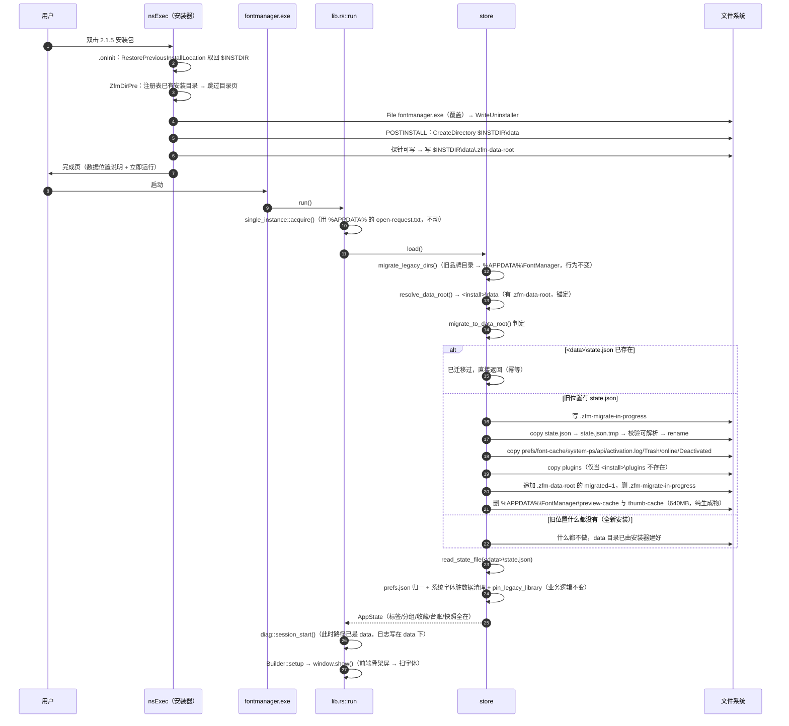
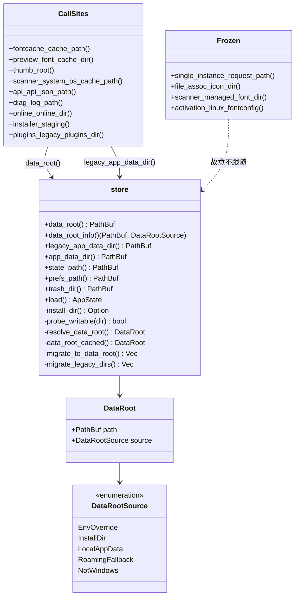

# 架构设计 · 2.1.5 · 安装器 UI 重做 + 数据落盘改道

> 作者：高见远（架构师） · 目标版本 2.1.5 · 基线 2.1.4（本地 `dev`）
> 范围：**只改 UI 与路径**。字体扫描、启停、台账、快照、插件、本地 API 的业务行为一律不变。
> 不新增任何依赖（`Cargo.toml` 只许改 `version`，`package.json` 的 `dependencies` 零改动）。

---

## 0. 需求拆解

| 编号 | 需求 | 判定标准 |
|---|---|---|
| **G1** | 安装器界面重做成"大气、留白足、排版讲究"的现代风格，参考 Adobe 2026 CC 安装器的观感 | 装机时第一眼不觉得是 2010 年的 NSIS 向导；黑白灰与主程序一致；**功能零变化** |
| **G2** | 除必须留在 C 盘的系统级物（WebView2 运行时、注册表、系统字体目录）外，缓存 / 数据 / 产物 / 日志 / 插件全部落到安装目录之下 | 把软件装到 D 盘后，`%APPDATA%`、`%LOCALAPPDATA%` 下不再有新增的软件数据；数据目录随安装目录一起可整体搬走 / 备份 |

G2 的验收要加一条隐性要求（用户没明说但必然在意）：**升级后标签、分组、收藏、台账、快照一个都不能少**。

**本轮明确不做的一项（记录在案，避免被当成漏项）**：WebView2 用户数据目录 `%LOCALAPPDATA%\com.iieozo.fontmanager`（实测 108MB）**不搬**。判断过程与重估条件见 ADR-D10；一句话理由是"要搬它就得把建窗从配置搬到 Rust，失败模式是应用打不开，而收益只有 108MB"。

---

## 1. 现状核实（本次设计的事实基础）

以下每一条都在本机核对过，实现时不要再凭印象推断。

### 1.1 安装器侧

| # | 事实 | 影响 |
|---|---|---|
| A1 | `tauri.conf.json` 的 `bundle.windows.nsis` 只有 `installerIcon`/`uninstallerIcon`/`installerHooks`，**没有 `template`** | 当前用 Tauri 内置模板 |
| A2 | Tauri v2 的 NSIS 模板是 **handlebars 模板**，占位符形如 `{{product_name}}`、`{{#each resources}}`（已从 `node_modules/@tauri-apps/cli-win32-x64-msvc/cli.win32-x64-msvc.node` 里提取出内嵌模板原文核对） | 自定义模板**必须**写成同样的 handlebars 形式，否则构建期报"未替换的 token"或产物字段错位 |
| A3 | 模板全文 984 行；本次可 fork 的基线是构建产物 `软件迭代/rust-target/release/nsis/x64/installer.nsi`（935 行，已渲染版）。**它是构建产物，每次构建被覆盖** | 自定义模板必须落在源码树（`src-tauri/windows/installer.nsi`），通过 `nsis.template` 引用 |
| A4 | **默认模板里已经有 `MUI_PAGE_DIRECTORY`**（基线 385 行） | D1 不是"要不要加目录页"，而是"如何不让它变成两套安装" |
| A5 | `MUI_WELCOMEFINISHPAGE_BITMAP` 的默认值是 `${NSISDIR}\Contrib\Graphics\Wizard\win.bmp`（蓝色 Windows 图），而且 **置空字符串会 `!error "Invalid ...BITMAP"`**（`Pages/Welcome.nsh:26-28`） | 用户抱怨的"深蓝侧栏"就是这张图。**不能靠"不放图"去掉它**，必须给一张自己的 164×314 24bit BMP |
| A6 | `Contrib/Language files/SimpChinese.nlf` 与本机 NSIS 都在 | `MUI_LANGUAGE "SimpChinese"` 可用，双语方案可行 |
| A7 | 模板里所有 MUI 文案都是 `$(LangString)` 形式的运行时替换（MUI 自己就这么写，如 `MUI_WELCOMEPAGE_TITLE "$(MUI_TEXT_WELCOME_INFO_TITLE)"`） | **可以做到"零自绘页面"的双语 + 自定义文案**：`!define MUI_WELCOMEPAGE_TITLE "$(ZM_WELCOME_TITLE)"` |
| A8 | 应用内一键更新走 `setup.exe /S`（`update.rs:952`），装完核对版本号 | 静默模式下的所有页面必须被 `SkipIfPassive` 跳过；`$INSTDIR` 必须仍从注册表恢复 |
| A9 | 安装形态 per-user，默认 `%LOCALAPPDATA%\FontManager`；注册表 `HKCU\Software\IIEOzo\FontManager` 默认值存 `$INSTDIR`（基线 660 行） | 升级必须落回同一目录，这条链路不能动 |
| A10 | **首页数其实已经是 4 页**：License 因 `LICENSE=""` 不插入（170-172 行）；StartMenu 因 `STARTMENUFOLDER=""` 走 `!define MUI_PAGE_CUSTOMFUNCTION_PRE Skip`（393 行）恒被跳过；Reinstall 页在没有既有安装时 `ReadRegStr` 为空 → `Abort`（216 行）自我跳过。所以**全新安装实际流程 = Welcome → Directory → InstFiles → Finish**，升级时多一页维护选项 | 「收敛到 3~4 页」这个目标**无需删任何页**，只需改外观。任何"合并页面"的动作都是纯风险（A11） |
| A11 | `src-tauri/icons/icon.png` = 512×512、8bit/通道、colortype 6（RGBA）、interlace 0，chunk 只有 IHDR/IDAT | 纯 Python（`zlib`+`struct`）可解码；降采样（面积平均）后可画进 BMP。**不需要 PIL** |
| A12 | `%LOCALAPPDATA%\com.iieozo.fontmanager` = 108MB，是 WebView2 用户数据目录。Tauri v2 **强制**把 `data_directory` 设为 `app_local_data_dir()`（`tauri-2.12.3/src/manager/webview.rs:559-568`，注释原文 "in windows, we need to force a data_directory"），且 config 的 `dataDirectory` **只接受相对路径**、锚定在 `%LOCALAPPDATA%\<label>\`（`webview/mod.rs:398-431`） | 见 ADR-D10：`WEBVIEW2_USER_DATA_FOLDER` 环境变量**无效**（Tauri 总是显式传值），config 也到不了 D 盘，唯一途径是把建窗搬到 Rust |
| A13 | `%LOCALAPPDATA%\FontManager` 实测只有 `fontmanager.exe`(23M)、`uninstall.exe`、三个 `.ico`、`plugins`(674K)、`字体库`(空) | `<install>\data` 是干净新目录，不会与现有文件同名冲突；不需要任何"占位/改名"处理 |
| A14 | `src/design/tokens.css` 亮色主题实测值：`--canvas:#ffffff`、`--text-primary:#1c1c24`、`--text-secondary:rgba(28,28,38,.62)`、`--text-tertiary:rgba(28,28,38,.44)`、`--e2:rgba(22,22,32,.07)`、`--accent-a:#3f3f46` | 安装器配色直接取这一组，见 ADR-D6 的 `0xBBGGRR` 换算表 |

### 1.2 数据落盘侧

| # | 事实 | 影响 |
|---|---|---|
| B1 | `store::app_data_dir()` = `dirs::data_dir()/FontManager` = `%APPDATA%\FontManager`，全仓 14 个调用点 | 这是**唯一入口**，改它有杠杆效应 |
| B2 | 5 处绕开它直接拼路径（`preview_font.rs:837`、`thumb.rs:22`、`fontcache.rs:61`、`store.rs:280`、`activation.rs:238`） | 前 4 处收口；**第 5 处是 Linux fontconfig，与 Windows 无关，动它等于破坏 Linux** |
| B3 | `plugins::plugins_dir()` **1.3.8 起已经在 `<exe 目录>\plugins`**，且带写探针 + "老用户不搬家"规则；它的 `legacy_plugins_dir()` 现在写成 `store::app_data_dir().join("plugins")`（`plugins.rs:373`） | ⚠️ 如果 `app_data_dir()` 语义一改，`legacy` 会漂到新位置，判定逻辑会得出"老位置没有插件"→ **老用户插件看似全消失**。必须把 legacy 钉死在旧字面路径上 |
| B4 | `scanner::resolve_managed_dir()` 已有"`<exe>\字体库` → `%LOCALAPPDATA%\FontManager\字体库` → 旧系统字体目录"三级回退 + `is_writable_dir()` 写探针 | 可写性探测的实现范式已存在，直接复用口径，别新写一套 |
| B5 | `single_instance::request_path()` 与 `file_assoc::icon_dir()` **用的是裸 `APPDATA` 环境变量**，不是 `app_data_dir()` | **不要动**。单实例 IPC 文件若跟着数据搬家，2.1.4 与 2.1.5 同时在场时会各写各的文件 → 双开 |
| B6 | `api.rs:456` 的报错文案里硬编码了 `%APPDATA%\FontManager\api.json` | 路径一改，这句提示就是在骗人，必须改成动态拼 |
| B7 | `Store::load()` 在 `lib.rs:2767` 调用，**早于** `tauri::Builder` 与 `setup`；`diag::session_start()` 在其后 | 迁移只能放在 `load()` 里（和现有 `migrate_legacy_dirs()` 同位置） |
| B8 | `diag::log()` 的路径由 `app_data_dir()` 决定 | 迁移期间调 `diag::log` 会把日志写进"还没搬完"的位置，随后被覆盖 → 迁移内部禁止用 `diag::log`（见 §5.3） |
| B9 | 现有 `hooks.nsh` 白名单删除口径：只删自己创建的目录、只认特征文件、`/UPDATE` 全跳过、不整删 `$INSTDIR` | 新路径必须按同一口径补进去，**不改原有条目** |
| B10 | Windows 的启用/停用是就地注册（HKCU Fonts 值指向 `<install>\字体库` 里的文件），不往 `C:\Windows\Fonts` 复制 | 字体文件本来就"在安装目录下"，符合需求，不要动 |
| B11 | `localStorage` 里存的是**用户可见偏好**：界面语言（`lib/i18n.ts`）、`EXPORT_FONTS_KEY`、`LAST_PACK_AT`、样板页字重选择（`FACE_STORE_KEY`）、实验开关 | 它属于 WebView2 用户数据目录。任何"换 UDF 但不搬 profile"的方案都会让**界面语言被重置**（ADR-D10 的取舍依据之一） |

---

## 2. 关键决策（ADR · D0~D11）

> 阅读顺序建议：D1（页数结论）、D6/D7（视觉定稿）、D2/D3/D4（落盘与迁移）、D10（WebView2 取舍）。

### ADR-D0 · 平台边界：改道只在 Windows 生效

**决策**：`store::data_root()` 内部按平台分支。Windows 走"安装目录优先"的判定链；macOS / Linux 保持 `dirs::data_dir()/FontManager`（与 2.1.4 完全一致）。

**为什么**：
- macOS 的安装单位是 `FontManager.app` 包，`Contents/MacOS/data` 在签名后不可写（Gatekeeper / App Translocation 会把它变只读或变副本），数据写进去 = 用户数据凭空消失。真正的 macOS 惯例是 `~/Library/Application Support`。
- Linux 走的是 deb/AppImage 等，`/usr/lib/...` 同样不可写。
- 本次需求明确是"Windows 安装包 + 装到 D 盘"，只有 Windows 有 `$INSTDIR` 这个概念。

**放弃的替代方案**：全平台统一"可执行文件同级"。→ 在 mac 上会直接引发数据丢失事故，且没有对应需求。

**风险**：三条平台的路径从此分叉，读代码的人要看清 `cfg`。已在函数文档里写明"为什么 mac 不这么做"。

---

### ADR-D1 · 页面流程：**一页都不删**（已经是 4 页），目录页只加两道门

**决策**：

1. **不合并、不删除任何页面**。理由见下面的实测结果——目标形态已经存在。
2. 首次安装（注册表 `${MANUPRODUCTKEY}` 为空）：保留 MUI 目录页，让用户自己选（这是用户对"装到 D 盘"的入口，必须有）。
3. 升级（注册表已有 `$INSTDIR`）：在 `MUI_PAGE_CUSTOMFUNCTION_PRE` 里 `StrCpy $INSTDIR <注册表值>` 后 `Abort`，**跳过这一页**。
4. 目录页 `LEAVE` 里做**写探针**：建目录 + 写一个 `.zfm-probe` 文件，失败就 `MessageBox` + `Abort`（停在原页）。
5. 不引入 `MultiUser`（即不改 `installMode: "both"`）。

**为什么"一页都不删"** —— 这是本轮最重要的一次口径纠正：

| 页面 | 实际会不会出现 | 依据（基线行号） |
|---|---|---|
| Welcome | 会 | 165 |
| License | **不会**（`LICENSE=""`，`!if` 不进） | 169-172 |
| Reinstall（升级维护） | 仅当已装过；否则 `Abort` 自我跳过 | 216 |
| Directory | 会 | 385 |
| StartMenu | **不会**（`STARTMENUFOLDER=""` → `PRE Skip`） | 389-395 |
| InstFiles | 会 | 398 |
| Finish | 会 | 404 |

所以**全新安装 = Welcome → Directory → InstFiles → Finish，正好 4 页**，已经是"Adobe 那种 3~4 页"。要做的只是把这 4 页**看起来**换掉，不是把 7 页砍成 4 页。

如果为了"看起来更收敛"去删 StartMenu 页/Reinstall 页：
- StartMenu 页**删了没有收益**（它本来就不显示），但如果有人同时把 `startMenuFolder` 配置填上，删掉这一页 = 用户不能选开始菜单文件夹名 = **功能回退**。保持"跟着配置走"的原逻辑才是对的。
- Reinstall 页删了 = 升级时不再让用户选"先卸载再装 / 直接覆盖"，而**必须**保留，因为 `/UPDATE` 之外的 GUI 升级路径靠它决定是否走卸载分支（`PageLeaveReinstall` 里的 `Goto reinst_uninstall`）。
- 把目录页并入欢迎页 = 自己画 `nsDialogs` 的目录树 + 浏览按钮，等于重写 `MUI_PAGE_DIRECTORY`，**换不来任何视觉收益**（目录页本来就长得比欢迎页干净）。

**为什么升级要锁目录**：
- 不锁 → 老用户在升级时手滑把路径从 `%LOCALAPPDATA%\FontManager` 改成 `D:\FontManager`，装完就是**两套**：桌面快捷方式指向新的，字体库与数据留在旧的，用户看到的是"我的标签分组全没了"。这是"升个级数据消失"最现实的成因，比迁移逻辑出错更常见。
- `RequestExecutionLevel user` 下，用户选 `C:\Program Files\...` 时 NSIS 会在 `File "fontmanager.exe"` 那一步报 `Error opening file for writing`，然后**留下半装目录**。探针把失败提前到页面内，用户能改。
- 不改 `installMode`：`both` 需要 `MultiUser.nsh` + UAC 提权 + 注册表 scope 切换，等于把安装形态整个换掉，与"只改 UI"冲突，也会让老用户的 HKCU 数据/关联全部对不上。

**放弃的替代方案**：
- (a) 完全去掉目录页 → 用户无法把软件装到 D 盘，G2 直接失去意义。
- (b) 允许升级改目录 + 自动搬数据 → 要搬可能几个 GB 的字体库、要改 registry 里所有字体路径、还要处理"旧目录删不掉"，收益远小于风险。
- (c) `installMode: "both"` → 见上。
- (d) 把 Welcome 与 Directory 合成一页 → 见上，纯工作量无收益。

**风险**：程序化安装（企业内静默部署）若显式传 `/D=D:\xxx`，NSIS 的 `/D` 会覆盖 `$INSTDIR` 且**跳过目录页**，我们的 `PRE` 不执行 → 仍可能出现两套。缓解：`/D` 是 NSIS 内建参数，属"显式要求"，按用户意愿执行；在文档里注明。

---

### ADR-D2 · `data_root` = `<安装目录>\data`；字体库**不搬进 data**

**决策**：
```
<安装目录>\
├─ fontmanager.exe / uninstall.exe
├─ 字体库\            ← 保持原位（现有默认库，不动）
├─ plugins\           ← 保持原位（1.3.8 起就在这）
└─ data\              ← 新增：全部运行时数据（软件自己产生的一切）
```

**为什么 data 用子目录**：
- 卸载时能"一个目录整删"，不用在白名单里逐个列举 10 个子目录（白名单越短，误删风险越低）。
- 不污染程序目录：`<install>\data` 之外只有 exe、卸载器、字体库、plugins，一眼能分清"什么是程序、什么是数据"。
- 便携版（未来把整个安装目录拷到 U 盘）只需要认 `data` 一个名字。

**为什么字体库不搬进 `data\字体库`**：
1. **它已经在安装目录之下了**——用户的原话是"都尽可能都放在安装地址的下面"，`<install>\字体库` 完全满足，搬进 `data` 只是"更好看"。
2. 已有老用户的 `state.libraryDir` / `library_dirs` 里存的是绝对路径，`hooks.nsh` 的字体注册项前缀匹配、`store::load()` 的 `pin_legacy_library()`、卸载白名单全都是按 `$INSTDIR\字体库` 写的。搬一次要同时改 4 处口径 + 搬可能几个 GB 的文件 + 改写 state 里几千条路径，**收益为 0、事故面极大**。
3. 字体是**用户资产**（用户导入的、可能买了授权的），数据是**软件产物**。混在一层里，用户"清缓存"时容易连字体一起删。

**放弃的替代方案**：`data\字体库`（见上，不值得）；散落在 `<install>\` 根下（卸载白名单会长到 12 条，且用户自己放进安装目录的文件和我们的数据混在一起，`RMDir /r` 任何一条都可能误伤）。

**风险**：目录树里 `字体库` 与 `data` 同级，看起来"不够整齐"。用安装器完成页的一句话文案说明即可（"数据在 data 文件夹里"）。

---

### ADR-D3 · 可写性回退：写探针 + 四级判定 + 只锚定一次

**决策**：判定顺序（仅 Windows）：

| 序 | 条件 | 结果 | 说明 |
|---|---|---|---|
| 0 | 环境变量 `ZFM_DATA_DIR`（绝对路径）且可写 | 用它 | 排障 / QA 自动化用；不写进文档的 UI |
| 1 | `<install>\data` **已存在**，且（含 `state.json` 或可写） | 用它 | **已存在即锚定**：绝不因为一次探针抖动就换地方 |
| 2 | `<install>\data` 可写（建目录 + 写探针 + 删探针） | 用它 | 正常路径 |
| 3 | `%LOCALAPPDATA%\FontManager\data` 可写 | 用它 | 装到 `C:\Program Files` 的普通用户 |
| 4 | 兜底 `%APPDATA%\FontManager` | 用它 | 保证永远不会失败 |

**为什么用写探针而不是读 ACL**：
- ACL 判定要区分"当前用户 / 管理员组 / 继承的拒绝项"，读出来还要自己推演 effective rights，代码量与出错面都远大于"真的写一个文件试试"。探针是**结果导向**的，Windows 怎么算权限都对。
- 现成范式已在 `scanner::is_writable_dir()` 里跑了一个大版本（默认字体库的三级回退），团队已经踩过坑（探针文件必须删、不能用带 BOM 的内容）。

**为什么第 1 条要"已存在即锚定"**：
- 如果每次启动都重新探测，会出现"今天 Program Files 可写（用户以管理员运行）、明天不可写"→ 数据在两处之间反复横跳，用户看到的是"我的标签忽然没了"。锚定一次，之后只认这一处。
- 结果用 `OnceLock` 缓存，进程生命周期内只算一次（`diag::log()` 每次都会问路径，不能每次打盘）。

**为什么回退目标是 `%LOCALAPPDATA%\FontManager\data`**：默认安装目录就是 `%LOCALAPPDATA%\FontManager`，所以**对默认安装的用户，回退目标与正常目标完全重合**——不存在"回退后到处是第二份数据"的可能。这是特意选的。

**UI 上怎么让用户知道**：见 ADR-D9。P0 阶段用安装器的完成页文案 + 目录页文案说明"数据会放在安装目录的 data 下"；若走到回退（用户选了 Program Files），安装器**在安装目录页就拦下来**让他改目录（D1 的探针），所以正常路径下用户不会遇到"装完才知道数据在 C 盘"。

**风险**：网络盘 / 加密盘上的 `FileOpen` 可能很慢（几百毫秒），但只发生一次，可接受。

---

### ADR-D4 · 迁移：copy 不 move、先账本后缓存、失败就原地不动

**决策**：在 `store::load()` 的最前面（现有 `migrate_legacy_dirs()` 之后）加 `migrate_to_data_root()`。

```
源：%APPDATA%\FontManager          （1.2.4 至今的老位置）
目标：<install>\data               （data_root()）
```

**搬什么（白名单，其余一律不搬）**：

| 必须搬 | 理由 |
|---|---|
| `state.json` + `state.json.bak*` | 账本：标签、分组、收藏、启停台账、快照。丢了就是"升个级全没了" |
| `prefs.json` + `prefs.json.bak-*` | 20KB 偏好，丢了用户会觉得软件被重置 |
| `font-cache.json` | 6.9MB 解析缓存，丢了只是下次扫描慢 1~2 秒，但搬它几乎无成本 |
| `system-ps.json` | 几 KB |
| `api.json` | 端口 + 令牌，丢了插件/MCP 要重连一次 |
| `activation.log` | 诊断历史，排查问题要用 |
| `Trash/` | 回收站里有用户可以恢复的字体 |
| `online/` | 在线目录 + 许可证 + staging（可能含已下载未安装的包） |
| `plugins/` | ⚠️ **只搬 `%APPDATA%\FontManager\plugins` 且仅在 `<install>\plugins` 不存在时**——见下 |
| `Deactivated/` | macOS 用；搬过去无害 |

**不搬**：`preview-cache/`（实测 385MB）、`thumb-cache/`（上限 256MB）。两者都是**纯生成物**，丢了自动重建。搬一遍要读 640MB 写 640MB，在机械盘上是分钟级，而用户感受是"升级卡住了"。

**copy 还是 move**：
- 用 **copy**，成功后**不删旧目录**（只删旧的两个缓存目录，见下）。
- 理由：`move` 到一半失败（磁盘满 / 权限 / 被杀软拦）时源文件已经没了，用户真丢数据；而且用户回退到 2.1.4 时还能接着用旧位置（回退是真实发生的场景）。
- 代价：`%APPDATA%\FontManager` 会剩一份小文件副本（约 9MB）。可接受。

**删旧缓存的条件（唯一会删东西的地方）**：必须同时满足
1. `<install>\data\state.json` 已写入且**能反序列化成 `serde_json::Value`**（证明搬成功，不是搬了个空文件）；
2. 白名单里的文件/目录全部 copy 成功或被跳过（不是"中途报错退出"）；
3. 目标不是 `%APPDATA%\FontManager` 本身（即真的改道了）。
才 `remove_dir_all` 旧 `preview-cache/` 与 `thumb-cache/`。任一不满足 → 一个字节都不删。

**幂等 / 防重复搬**：
- 唯一判据是 **`<data_root>\state.json` 是否存在**。存在 → 本次不搬。
- 为什么不用标记文件：标记文件和"实际有没有数据"可能不一致（标记写了但 copy 失败），而 state.json 的存在性本身就是最强的证据。标记文件只在 D1 的"安装器建 data 目录"里用，不参与迁移判定。
- 顺带解决一个隐蔽场景：用户**卸载时保留数据 → 装到另一个目录**。此时 `%APPDATA%\FontManager` 还在，新安装目录的 `data` 空 → 自动"收养"旧账本。这就是"不删旧目录"带来的额外好处。

**失败时怎么办**：`resolve_data_root()` 的判定链里，第 1 条是"`<install>\data` 已存在即锚定"。迁移失败时 data 目录里可能只有半个 `state.json.tmp`——所以我们**先写 `.tmp` 再 rename 生效**，`state.json` 只有在完整写入后才出现。于是：迁移失败 → `state.json` 不存在 → 下一次 `load()` 会看到一个空 data 目录 …… 但 `data_root()` 已经锚定在它上面了！这就坏了：新一轮启动会认为"全新安装"，把默认状态写进去，然后把旧账本当成历史垃圾。

**所以必须加一条硬规则**：`data_root()` 的"已存在即锚定"条件要收紧为
> `<install>\data` 已存在 **且**（含 `state.json` **或** 含 `.zfm-data-root` 标记）

`.zfm-data-root` 由**安装器的 `NSIS_HOOK_POSTINSTALL`** 写入（见 ADR-D5），只表示"这个安装根启用 data 布局"，不代表迁移完成。迁移失败时它已经在，data 目录仍被锚定 —— 那还怎么避免"半迁移被当成全新安装"？

**最终方案（这条是本设计里最容易出事故的地方，实现时必须照做）**：
1. 迁移**第一步**就写 `<install>\data\.zfm-migrate-in-progress`（内容：时间戳 + 源路径）；
2. 迁移**全部成功**后删掉它，并写 `.zfm-data-root` 的 `migrated=1` 行（追加，不是覆盖）；
3. `load()` 读到 `.zfm-migrate-in-progress` 存在 → **本次不搬、也不读 state**，直接走"从中断处继续搬"（重跑迁移），搬不动就报错退出（弹窗提示数据位置异常），**绝不落一份默认 state**。

这样"半迁移 → 被当成全新安装 → 覆盖旧数据"这条最致命的事故链被切断。

**迁移期间 UI 提示**：迁移在窗口 `show()` 之前完成（`lib.rs` 里 `store::load()` 早于 `setup`），用户看到的是"双击图标后什么都没发生"。常规数据量（9MB 小文件）在 SSD 上 < 300ms，无需提示。**若迁移耗时 > 3s**（机械盘 + plugins 里带运行时的插件），在 `Store::load` 之后由前端在首屏骨架屏上补一句"正在整理数据位置…"——这是 P2 优化，不进 P0。

**放弃的替代方案**：
- (a) move → 见上。
- (b) 不迁移，直接用新位置（老用户数据"留在 AppData 里当备份"）→ 用户看到的是"升级后全空"，绝对不行。
- (c) 搬 preview-cache → 见上。
- (d) 用注册表做"已迁移"标记 → 注册表在卸载时被清，重装后标记丢失 → 重复搬。文件系统判断更贴合。

**风险**：见 R-01 / R-02 / R-03。

---

### ADR-D5 · 卸载清理：白名单扩三条，`/UPDATE` 一律不删

**决策**：只改 `hooks.nsh`，不改卸载器的页面结构。

1. **新增 `NSIS_HOOK_POSTINSTALL`**（`hooks.nsh` 里本来没有这个宏，是安全的新增）：
   - `CreateDirectory "$INSTDIR\data"`
   - 探针能写 → 写 `$INSTDIR\data\.zfm-data-root`（内容 `v=1` + 版本号）。写不进去（Program Files 普通用户）→ 什么都不写，让程序自己回退。
   - 不再做别的。**绝不在这里建 `字体库` / `plugins`**（`plugins` 的创建有它自己的老用户规则，冲突）。
2. **`NSIS_HOOK_POSTUNINSTALL` 的 `$DeleteAppDataCheckboxState=1 && $UpdateMode<>1` 分支里追加**（放在现有 2.1 段尾部）：
   ```
   ; data 根：必须先认特征文件，避免用户把一个空的 data 目录塞满了自己的东西被整删
   ${If} ${FileExists} "$INSTDIR\data\state.json"
   ${OrIf} ${FileExists} "$INSTDIR\data\font-cache.json"
   ${OrIf} ${FileExists} "$INSTDIR\data\api.json"
   ${OrIf} ${FileExists} "$INSTDIR\data\.zfm-data-root"
     RMDir /r "$INSTDIR\data"
   ${EndIf}

   ; 回退位置（装到 Program Files 时程序会退到这里）
   ${If} ${FileExists} "$LOCALAPPDATA\FontManager\data\state.json"
     RMDir /r "$LOCALAPPDATA\FontManager\data"
   ${EndIf}
   ```
3. **`/UPDATE` 与"覆盖升级"两种情况**：现有结构已经把整个清理块包在 `${If} $DeleteAppDataCheckboxState = 1 ${AndIf} $UpdateMode <> 1` 里，新加的两段天然受保护。**不要**为了"省事"把 `RMDir /r "$INSTDIR\data"` 挪到括号外面——那会导致升级时把用户账本删掉（R-04）。
4. **`RMDir "$INSTDIR"`（基线 778 行）保持非递归**：`data` 存在时它自动失败，正是我们要的。
5. 字体注册项的前缀匹配白名单**追加** `$INSTDIR\data\`（防御性：将来若把库搬进 data），现有 4 条前缀原样保留。
6. `%APPDATA%\FontManager` 的整删块保持原样（迁移后它可能还剩 3 个小文件，仍应被清掉）。

**风险**：用户在卸载时勾了"删除全部数据"，字体库（`$INSTDIR\字体库`）里用户花钱买的字体也会被删——这是既有行为（2.1.4 就是这样），本次**不改行为，只改文案**：把 `$(deleteAppData)` 覆盖成"同时删除全部数据与字体库"（§6.3），让用户勾之前就知道字体库也在删除范围内。这属于必要的信息披露，不是行为变更。

---

### ADR-D6 · UI 技术路线：**纯白极简**，只把欢迎页改成自绘，其余用 MUI 原生控件换文案

**决策**：

1. **走亮色**。底色 `#ffffff`，主体文字 `#1c1c24`（就是 `tokens.css` 亮色主题的 `--text-primary`），次要信息用同一色降透明度后的实色。**放弃暗色方案**。
2. **欢迎页自绘**（`Page custom ZfmWelcome`），做成参考稿那种"大标题 + 灰色副标题 + 1px 细线 + 小字说明"的纯白版式。
3. **目录页 / 进度页 / 完成页保持 MUI2 原生**，只换文案与配色。**不自绘窗口边框，不重画按钮。**
4. 细节：去掉默认蓝色侧栏图（见 ADR-D7）、去掉所有"推荐关闭其他程序"类废话、正文压到 1~2 行。

**为什么走亮色**（不是"参考稿要求"这种被动理由）：

| 理由 | 说明 |
|---|---|
| NSIS 的按钮/进度条/目录树/复选框**由 Windows 主题绘制** | `SetCtlColors` 只作用于静态文本、编辑框、部分控件；**对 push button 完全无效**。暗底上会贴一排浅色系统按钮，比现在的蓝色向导更难看 |
| 暗色必须自绘所有控件 | = 全部页面 `nsDialogs` 手画 + 自己处理 hover/pressed/focus/键盘 Tab/高对比度 → 违背"可维护性优先"，且屏幕阅读器读不到自绘按钮 |
| 高对比度模式 / 系统浅色主题 | 亮色底在 Windows 的辅助功能下表现最稳；暗底 + 系统强制高对比度会变成"深底白字 + 系统强制白底控件"的拼贴 |
| 两份参考都是浅底 | Adobe 2026 浅底深字，第三份参考是纯白极简，方向一致 |

**配色表（直接可用；NSIS 的 `SetCtlColors` 用 `0xBBGGRR`，注意是反的）**

| 用途 | token（`tokens.css` 亮色） | hex | NSIS 写法 |
|---|---|---|---|
| 页面底 / 面板底色 | `--canvas` | `#ffffff` | `0xFFFFFF` |
| 主标题 / 正文 | `--text-primary` | `#1c1c24` | `0x241C1C` |
| 副标题 / 次要说明 | `--text-secondary` `rgba(28,28,38,.62)` 压到白底 | `#727279` | `0x797272` |
| 最小字 / 页脚 | `--text-tertiary` `rgba(28,28,38,.44)` 压到白底 | `#9b9ba0` | `0xA09B9B` |
| 1px 分隔线 | `--e2` `rgba(22,22,32,.07)` 压到白底 | `#efefef` | `0xEFEFEF` |
| 强调（仅完成页的对勾/图标） | `--accent-a` | `#3f3f46` | `0x463F3F` |

> 换算方法写进注释：`hex #RRGGBB` → `0xBBGGRR`；半透明色必须先**按白底手动混色**成实色，
> 因为 `SetCtlColors` 不支持 alpha（写 `0xAARRGGBB` 会被当成错误的 BGR 值，颜色会乱）。

**版式规范（自绘欢迎页）**

- 度量单位**一律用 `u`**（对话单位），禁止像素。MUI 自己的欢迎页就是 `120u`/`195u`/`28u`/`38u`，我们沿用同一套度量。
- 左边距 `16u`（≈24px @96dpi，比 NSIS 默认的 8px 视觉边距明显宽，满足"留边很宽"）。
- 字号阶（`CreateFont`，字族用 `$(^Font)` 而不是硬编码"微软雅黑"，否则英文系统会 fallback 成难看的字）：

| 元素 | 字号/字重 | 内容 |
|---|---|---|
| 产品名大标题 | 22pt / 700 | `FontManager` |
| 副标题 | 10pt / 400，`#727279` | `版本 2.1.5 · 免费开源字体管理器` |
| 1px 细线 | 高度 `1u` 的 Label，`SetCtlColors $h "0xEFEFEF" "0xEFEFEF"` | NSIS 没有 Line 控件，这是标准做法（实心背景的静态控件） |
| 说明正文 | 9pt / 400，`#727279`，两行 | 见 §6.2 文案定稿 |
| 页脚小字 | 8pt / 400，`#9b9ba0` | `IIEOzo` + 许可 |

**必须写清楚"做不到"的部分（别在文档里许诺配图效果）**

| 参考稿的元素 | 能不能做 | 说明 |
|---|---|---|
| 纯白满版留白 | ✅ 能做 | 自绘欢迎页整页白底 + `SetCtlColors` |
| 大标题 + 灰色副标题 + 细线 | ✅ 能做 | `CreateFont` + 1u 高实心 Label |
| 无边框窗口 / 自绘按钮 | ❌ 不做 | 按钮、进度条、目录树、复选框都是**系统主题绘制的原生控件**；自绘要接管 hover/pressed/focus/键盘/高对比度，属于重写整个向导 |
| 圆角大按钮、渐变、阴影 | ❌ 不做 | 同上；NSIS 也拿不到 Win11 的圆角按钮 API |
| 页脚细线条纹 / 图标网格 | ⚠️ 部分 | 条纹可以用一串 1u 高 Label 模拟，但每多一条就多一个控件，收益不抵维护成本，不做 |

**DPI 处理方案**

1. **原生页（目录/进度/完成）**：由 MUI2 的 `u` 度量 + 系统字体自动缩放，`PerMonitorV2` 清单原样保留 → 100/125/150% 都正确，**零额外代码**。
2. **自绘页**：坐标全用 `u`；字号用 `CreateFont`（NSIS 内部按 `GetDeviceCaps(LOGPIXELSY)/72` 换算，同一台显示器上正确）。**不需要** `System::Call` 取 DPI——只有"像素"坐标才需要，而我们不用像素。
3. **唯一需要像素换算的地方是卸载确认页的复选框**（基线 425-453 行已经用 `GetDpiForWindow` + `/96` 做好）。**这段原样保留，不要"顺手优化"**，改了就错位。

**已知的高 DPI 错位风险（要在验收里盯）**

| 页面 | 100% | 125% | 150% | 风险说明 |
|---|---|---|---|---|
| 自绘欢迎页 | 安全 | 安全 | **需目视** | 用户在辅助功能里把"文本大小"调到 125% 以上时，`u` 会整体变大，固定 `u` 高度的 Label 可能装不下两行正文 → 靠给足 2 行余量 + 文案不超过 2 行来兜 |
| 目录页 | 安全 | 安全 | 安全 | 纯原生 |
| 进度页 | 安全 | 安全 | 安全 | 纯原生 |
| 完成页 | 安全 | 安全 | 图标偏小 | `MUI` 的图标控件是固定像素，高 DPI 下相对变小；这是 MUI 既有行为，不修 |
| 卸载确认页复选框 | 安全 | 安全 | 安全 | 有 `GetDpiForWindow` 换算 |
| 跨显示器拖动安装器 | — | — | — | NSIS 不处理 `WM_DPICHANGED`，拖到不同缩放的显示器后内容不会重排。**已知限制，不修**（修 = 自己写窗口过程） |

**放弃的替代方案**：

- (a) 全自绘 `nsDialogs` 多页向导 → 6 个页面 × 每页 10 个控件 × DPI 换算 × 双语，约 800 行 NSIS，且每次 Tauri 升级都要重新对模板；还丢键盘可达性与屏幕阅读器。
- (b) 换第三方安装器（Inno Setup / WiX）→ 等于重做整条发布链路（签名、升级、文件关联、注册表），不是"只改 UI"。
- (c) 暗色主题 → 见上表。

**风险**：R-07（DPI）、R-08（模板与 Tauri 升级脱节）。

---

### ADR-D7 · 图片资源：**必须**给一张 BMP，内容走"白底 + 1px 竖细线"，图标可选

**决策**：
- 新增 `src-tauri/windows/wizard.bmp`（164×314，24bit，未压缩）。**内容：纯白 `#ffffff` + 右边缘 1px 的 `#efefef` 竖细线。** 不放 logo。
- 由 `src-tauri/windows/gen-nsis-images.py`（纯标准库：`zlib`+`struct`，**不需要 PIL**）生成，**产物入库**，构建时不跑脚本。
- 通过 `bundle.windows.nsis.sidebarImage` 引用，模板保留 `{{sidebar_image}}` 机制。
- **可选（P2）**：`sidebarImage` 换成"白底 + 居中单色图标"的版本，图标从 `src-tauri/icons/icon.png` 派生（见下）。

**为什么"必须给"**（这条最反直觉，也最容易踩）：
`MUI_WELCOMEFINISHPAGE_BITMAP` 的默认值是 NSIS 自带的 `${NSISDIR}\Contrib\Graphics\Wizard\win.bmp`（**蓝色 Windows 图**，用户抱怨的正是它），而把它置空会编译期 `!error "Invalid ...BITMAP"`（`Pages/Welcome.nsh:26-28`、`Pages/Finish.nsh:75-76`）。所以"不放图"的结果不是"干净"，而是"还是那张蓝图"。

**为什么内容走"纯白 + 细线"而不是深色块 / 图标**：
1. 第三份参考稿的美学是"**纯白 + 大量留白 + 1px 细线**"，侧栏做成白底就等于"没有侧栏"，正是要的效果；那条 1px 竖线给出参考稿里的"细线分隔"层次。
2. 欢迎页改成自绘（ADR-D6）后，**这张图只剩完成页在用**。完成页左侧做成留白最不打扰（完成页右侧已经有"立即运行 / 桌面快捷方式"两个交互，左边再放个 logo 会抢注意力）。
3. `MUI_WELCOMEFINISHPAGE_BITMAP_STRETCH` 默认 `FitControl`，图会被**拉伸**到控件尺寸。纯白 + 1px 竖线拉伸后仍是纯白 + 略粗的竖线（可接受）；换成图标会被拉变形，还得按 `109u` 的实际像素宽高比去凑 164:314，维护成本高。
4. 图里的文字没法本地化（中英两套图 = 两倍维护），所以任何方案都不放文字。

**如果将来要放图标（P2，给出可行做法）**：
`src-tauri/icons/icon.png` 实测是 **512×512 / 8bit / colortype 6(RGBA) / interlace 0**（只含 IHDR/IDAT），纯 Python 可解：

1. `zlib.decompress` 所有 IDAT → 逐行按 filter type（0-4）做反过滤（None/Sub/Up/Average/Paeth）。
2. **降采样必须用面积平均（box filter），不要最近邻**：最近邻在 512→96 这种 5.3× 缩小下会把图标的细笔画整条丢掉、边缘出现锯齿。面积平均 = 把目标像素覆盖的源像素矩形做加权平均（对 RGBA 要先按 alpha 预乘再平均，否则透明边缘会发黑）。
3. 合成到白底 164×314 画布的中心（先 `C = src*a + white*(1-a)` 把 alpha 压平）。
4. 写 24bit BMP：`BITMAPFILEHEADER(14) + BITMAPINFOHEADER(40)`，像素 **BGR** 顺序、**自底向上**、每行补齐到 4 字节。

> 这条只写方案不排期：**P0 用纯白 + 细线**。理由不是"做不到"，而是"做了不加分、还要多维护一份图标渲染代码"。

**为什么不用 NSIS 自带的现成图**：`Contrib/Graphics/Wizard/` 下有 `nsis3-grey.bmp`（灰的），但已开图核对——里面是 **NSIS 自己的 logo**。把别人的 logo 放我们的安装器上不专业。

**为什么不用 PIL / System.Drawing**：本机三个 Python 环境都没有 PIL/numpy（已核实 `import PIL` 失败），`Add-Type`（System.Drawing）被安全策略禁用（已实测抛错）。手写 BMP 是最小可行路径：40 行。

**风险**：R-09。BMP 必须是 24bit 未压缩，否则 NSIS 的 `!pragma verifyloadimage` 在编译期报错（这是好事，构建期就炸）。

---

### ADR-D8 · 文案：`languages: ["SimpChinese", "English"]` + LangString 覆盖，跟随系统

**决策**：
1. `bundle.windows.nsis.languages = ["SimpChinese", "English"]`，`displayLanguageSelector: false`。
2. 所有界面文案集中在 `src-tauri/windows/zfm-strings.nsh`，用 `LangString ZM_*` 定义两份（zh / en），在模板里 `!include` 于 `{{#each languages}}!insertmacro MUI_LANGUAGE{{/each}}` **之后**（LangString 只能往已加载的语言里写）。
3. 模板里 MUI 的页面标题/正文 define 全部指向 LangString：`!define MUI_WELCOMEPAGE_TITLE "$(ZM_WELCOME_TITLE)"`（A7 已核实这是 MUI 自己在用的写法，运行时会按当前语言替换）。
4. MUI 自己的 `$(MUI_TEXT_*)` 用同名的 `LangString` 后定义覆盖（NSIS 后定义生效），用来砍掉"推荐关闭其他程序"这类废话。

**为什么不是"全部中文硬编码"**：Tauri 会拒绝无 `MUI_LANGUAGE` 的构建吗？不会；硬编码中文在英文系统上也能显示（`Unicode true`）。但那样 9 种语言的用户里，只有中文用户看到中文，其余看到中文+英文混排，观感更差。双语跟随系统是成本最低的正确选择（一份文案文件，40 行）。
**为什么不是 9 种语言**：安装器上只有 6 句话，翻 9 份的维护成本与收益不成比例；且 `zh-TW` 用户看到简体通常可接受。列 P2。

**回退方案（必须写进 T02 的验收里）**：若 `MUI_LANGUAGE "SimpChinese"` 在构建机上编译失败（`.nlf` 缺失等），**立刻降级为 `languages: ["English"]` + `zfm-strings.nsh` 只留英文段 + 模板文案改硬编码中文**。不允许为了"看起来完整"而让构建卡在那里。（本机已核实 `SimpChinese.nlf` 存在，风险低。）

**风险**：T02 里有一个 5 分钟的编译验证 gate（见任务分解）。

---

### ADR-D9 · 用户怎么知道数据在哪：安装器文案为主，设置页为辅

**决策**：
- **P0**：目录页顶部一行"程序、字体库和全部数据都会保存在这个目录下"；完成页一行"数据保存在安装目录的 data 文件夹"。零前端改动、零 i18n 成本。
- **P2（可选）**：设置页"默认库"下方加一行只读的"数据位置"，配"打开文件夹"按钮，后端加一个只读命令 `data_root_info()` 返回 `{ path, source, writable, migratedFrom }`。需要 3 个 i18n key（`check-locales.mjs` 把缺键算覆盖度、不算失败，所以只补 `en.json` + `zh-CN.json` 不会破构建）。

**为什么 P0 不做设置页**：
- 需求是"改安装器 UI"，设置页不在范围内；加一个只读行属于"顺手扩范围"，会牵动 9 个语言包的评审。
- 正常路径下用户选目录时就已经被告知数据在哪，不需要事后解释。

**风险**：装到 Program Files 且用户没仔细看文案 → 数据静默回退到 `%LOCALAPPDATA%`，用户以为"在 D 盘"。但 D1 的写探针会先拦下 Program Files，所以这条只在"用户强行用 `/D` 安装"时成立。列 R-06。

---

### ADR-D10 · WebView2 用户数据目录（108MB）：**2.1.5 不做，但这是权衡不是偷懒**

**事实（已从 Tauri 源码核实，见 A12）**：

1. 那块 108MB 在 `%LOCALAPPDATA%\com.iieozo.fontmanager`（= `app_local_data_dir()`），是 WebView2 的用户数据目录。
2. Tauri v2 **强制**在没指定时把它设成 `app_local_data_dir()`（`manager/webview.rs:559-568`，注释原文 "in windows, we need to force a data_directory"）。
3. 因为它总是**显式传值**，所以 WebView2 的 `WEBVIEW2_USER_DATA_FOLDER` 环境变量**完全不生效**（这条我原本以为是零风险捷径，核实后否掉了）。
4. config 里的 `dataDirectory` **只接受相对路径**，解析成 `%LOCALAPPDATA%\<label>\<相对路径>`（`webview/mod.rs:398-431`）→ 到不了 D 盘。

**结论：唯一途径 = 把建窗从 `tauri.conf.json` 搬到 Rust**，用
`WebviewWindowBuilder::from_config(app, &cfg)?.data_directory(绝对路径).build()`。
（`from_config` 是 `pub`，内部走 `WindowBuilder::from_config` + `WebviewAttributes::from`，忠实复现 config —— 技术上可行，我已逐行确认过。）

**但 2.1.5 不做，三条理由按分量排序**：

1. **要交出一份永久维护税**：为了改 UDF，必须先把 `app.windows` 从 `tauri.conf.json` **整段删掉**（不删的话 Tauri 在 `Builder::build()` 时自动建一个 `main`，我们再建一个 → 标签冲突），把 `visible/decorations/transparent/shadow/dragDropEnabled/additionalBrowserArgs/width/height/minWidth/minHeight/label/title` 十几个属性搬进 Rust 硬编码。从此窗口配置不再有单一事实来源，Tauri 将来新增任何窗口属性都得手工同步。**这是为一个一次性 108MB 付的永久利息。**
2. **失败模式是"应用起不来"**：`data_directory` 指向的目录不可创建/不可用时，`create_dir_all` 或 WebView2 环境创建失败 → 窗口建不出来 → 用户双击图标**毫无反应**（连错误框都没有，因为还没窗口）。而收益只有 108MB。
3. **localStorage 里有用户可见偏好**（B11：界面语言、导出偏好、样板字重选择）。换 UDF 必须同时搬 profile，否则**界面语言被重置**；而搬 108MB profile 要写第二套"白名单 copy + 跳过 GPU/shader/HTTP 缓存 + 失败回退 + 幂等标记"的迁移逻辑 —— 我们在账本迁移上刚做完一遍，不想为缓存再做一遍。

**另外两个考虑过并否掉的方案**：

| 方案 | 为什么否 |
|---|---|
| `WEBVIEW2_USER_DATA_FOLDER` 环境变量 | Tauri 显式传值，环境变量被忽略（已核实）。零代码但**无效** |
| 目录联接（junction）：`%LOCALAPPDATA%\com.iieozo.fontmanager` → `D:\...\data\webview2` | 不需要改 Tauri、不用搬 108MB。但要 `windows-sys` 手写 `FSCTL_SET_REPARSE_POINT`（约 50 行 unsafe），且**用户一旦拖动安装目录，联接变成悬空链接 → WebView2 起不来 → 应用打不开**。等于把一个"缓存占 C 盘"的小问题换成一个"数据目录一动就废"的大问题 |

**缓解（零风险，P1 必做）**：在 `README` / `CHANGELOG` 里写一句
> WebView2 内核缓存由 Windows 托管在 `%LOCALAPPDATA%\com.iieozo.fontmanager`（约 100MB），
> 它是浏览器内核的缓存与本地存储，不属于 FontManager 的数据；卸载时勾选"删除全部数据"会一并清掉。

这句话的作用是**别让用户以为我们漏了**——他既然能翻到这块 108MB，就一定会问。

**什么条件下我会改主意（明确的重估触发器）**：
- 用户明确表态"这 100MB 也必须搬"；或
- 我们要做**便携版**（那时本来就得接管建窗，顺手就把 UDF 一起接管，边际成本≈0）。

**若真要做（T06 预案，独立可回滚，不进 2.1.5 主线）**：
1. 只在 `data_root_info().1 == InstallDir` 且探针通过时才启用；否则建窗**不做任何覆盖**（与现在完全一致）。
2. `.build()` 失败 → **重试一次不带 `data_directory`**，成功后日志记一条 `webview2: relocate failed, fell back`。这条是保命开关。
3. 回滚开关：`ZFM_NO_WEBVIEW_RELOCATE=1` 环境变量，或安装目录里放一个空文件也能禁用。
4. profile 精简搬迁：只 copy `EBWebView\Local State`、`Default\Local Storage`、`Default\Preferences`、`Default\IndexedDB`；跳过 `Cache`/`Code Cache`/`GPUCache`/`GPUPersistentCache`/`GrShaderCache`/`BrowserMetrics`/`Crashpad`（这几个占了绝大部分体积）。
5. 验收必须测：默认目录、D 盘、Program Files（应自动不启用）、拖动安装目录后启动、装到 exFAT U 盘。

---

### ADR-D11 · 明确**不动**的东西（防误改清单）

| 不动 | 原因 |
|---|---|
| `single_instance::request_path()` 的 `%APPDATA%\FontManager\open-request.txt` | 单实例 IPC 要跨版本一致；跟着数据搬家会导致新旧版本同时运行时**双开** |
| `file_assoc::icon_dir()` 的 `%APPDATA%` 回退 | 它已经"优先 exe 目录、不可写才回退"，逻辑正确，且卸载白名单按此写 |
| `scanner::managed_font_dir()` / `legacy_managed_font_dir()` | 默认字体库位置不变（ADR-D2） |
| `activation.rs:238`（Linux fontconfig 路径） | 非 Windows，与本次无关 |
| `update.rs` 的 `install_kind()` / `recorded_user_install_dir()` | 读的注册表键没变（`Software\Microsoft\...\Uninstall\FontManager`），模板保留 `WriteRegStr ... ""  $INSTDIR` 即可 |
| `installMode`、`identifier`、`productName`、`publisher`、`mainBinaryName` | 改了就是升级断链 + 桌面快捷方式错位 |
| 业务逻辑（扫描/启停/台账/快照/插件/API） | 硬性约束 |
| `src/lib/version.ts` | 版本从 `package.json` 导入，改 `package.json` 即可 |

---

## 3. 目标路径布局

```
<安装目录>                                  ← NSIS $INSTDIR，默认 %LOCALAPPDATA%\FontManager
│                                            用户在目录页可以改到 D:\Apps\FontManager
├─ fontmanager.exe                           程序本体（升级时被覆盖）
├─ uninstall.exe                             卸载器（WriteUninstaller 生成）
├─ 字体库\                                    ★ 用户资产，不可删
│  └─ <族名>\*.ttf|otf|ttc                    导入/链接进来的字体实体文件
├─ plugins\                                  ★ 用户资产，不可删（1.3.8 起在此；自带运行时）
├─ snapshot-icon.ico / pack-icon.ico / data-icon.ico   文件关联图标（卸载时删）
└─ data\                                     ★ 软件产物，可整目录删
   ├─ state.json                             ⛔ 账本：标签/分组/收藏/启停台账/快照（~1.7MB）
   ├─ state.json.bak / state.json.bak-*      ⛔ 滚动备份（read_state_file 的救命绳）
   ├─ prefs.json / prefs.json.bak-*          ⛔ 偏好（~20KB，独立写，避免 1.7MB 重写）
   ├─ font-cache.json                        ○ 字体解析缓存（~6.9MB，删了下次扫描重建）
   ├─ system-ps.json                         ○ 系统字体 PostScript 名缓存（几 KB）
   ├─ api.json                               ○ 本地 API 端口 + 令牌（删了插件重连一次）
   ├─ activation.log / activation.log.old.log ○ 诊断日志（排查"字体没出现在别的软件里"必看）
   ├─ preview-cache\                         ○ 预览副本（实测 385MB，LRU 淘汰）
   ├─ thumb-cache\                           ○ 卡片缩略图（上限 256MB）
   ├─ online\                                ○ 在线字体目录 catalogue.json + licenses\ + staging\
   ├─ staging\                               ○ 拖入文件解包临时区（安装成功后清）
   ├─ Trash\                                 ⛔ 回收站（用户可能还要恢复）
   ├─ Deactivated\                           ○ macOS 停用停放区（Windows 不用）
   └─ .zfm-data-root                         ○ 安装器写的标记："此安装根启用 data 布局"

不可写时的回退（装到 C:\Program Files 的普通用户）：
   %LOCALAPPDATA%\FontManager\data\          ← 与上面的 data 结构完全一致
   再不可写则兜底：%APPDATA%\FontManager\    ← 2.1.4 的老位置（保证永远可用）

永远留在 C 盘的系统级物：
   HKLM/HKCU 注册表（字体表、Uninstall 键、文件关联）
   %LOCALAPPDATA%\Microsoft\Windows\Fonts   （Windows"当前用户字体"目录，只读它不写它）
   %LOCALAPPDATA%\<bundleId>\EBWebView      （WebView2 用户数据目录，实测 108MB，由 Tauri 强制指定，
                                             2.1.5 不搬 —— 取舍见 ADR-D10；卸载勾"删除全部数据"会一并清掉）
   C:\Windows\Fonts                         （系统字体，绝不触碰）
   WebView2 运行时本身                       （安装器按需下载安装）
```

图例：⛔ 删了用户会痛 · ○ 纯生成物，删了自动重建

---

## 4. 数据路径解析的唯一入口

### 4.1 函数签名

`src-tauri/src/store.rs`：

```rust
/// 应用数据根目录 —— **全软件唯一入口**。
///
/// 2.1.5 起语义变了：不再是"`%APPDATA%\<product>`"这个固定位置，
/// 而是"离程序最近、且当前用户确实可写的数据目录"。判定顺序见 [`resolve_data_root`]。
///
/// 函数名故意**不**改：全仓 14 个调用点靠这个名字自动跟随新规则；
/// 改名得到的是"更准确的名字"，付的代价是 14 处 diff —— 而漏改一处，
/// 就会有一部分数据顽固地留在 C 盘，且只在"装到 D 盘"的机器上才暴露。
pub fn data_root() -> PathBuf;

/// `data_root` 是怎么定下来的（只用于日志与排障 UI，不参与业务判断）。
#[derive(Clone, Copy, PartialEq, Eq, Debug)]
pub enum DataRootSource {
    EnvOverride,     // ZFM_DATA_DIR
    InstallDir,      // <exe>\data —— 正常路径
    LocalAppData,    // %LOCALAPPDATA%\<product>\data —— 装到 Program Files 时的回退
    RoamingFallback, // %APPDATA%\<product> —— 最后兜底，保证永不失败
    NotWindows,      // macOS / Linux：与 2.1.4 完全一致
}

pub fn data_root_info() -> (PathBuf, DataRootSource);

/// 2.1.4 及更早的位置：`%APPDATA%\<product>`。
///
/// 只给三件事用，**不要**再往业务代码里扩散：
///   1. 迁移的源目录；
///   2. `plugins` 的老位置判定（它的"老用户不搬家"规则依赖这个确切路径）；
///   3. 卸载白名单里的整删目标。
pub fn legacy_app_data_dir() -> PathBuf;

/// 程序自己所在的目录。调试构建返回 None（跑在 rust-target\debug 下，不该往那写数据）。
fn install_dir() -> Option<PathBuf>;

/// 写探针：建目录 → 写 `.zfm-probe` → 删探针。口径与 scanner::is_writable_dir 一致。
fn probe_writable(dir: &Path) -> bool;

fn resolve_data_root() -> DataRoot;               // 只执行一次，见 OnceLock
fn data_root_cached() -> &'static DataRoot;
```

### 4.2 判定顺序（`resolve_data_root` 的完整逻辑）

```rust
fn resolve_data_root() -> DataRoot {
    // ── 非 Windows：一行都不能变 ──
    #[cfg(not(target_os = "windows"))]
    {
        return DataRoot { path: legacy_app_data_dir(), source: DataRootSource::NotWindows };
    }

    #[cfg(target_os = "windows")]
    {
        // 0. 显式覆盖：排障 / QA 自动化。必须是绝对路径，且真的可写，否则忽略。
        if let Some(dir) = std::env::var_os("ZFM_DATA_DIR")
            .map(PathBuf::from)
            .filter(|p| p.is_absolute())
        {
            if probe_writable(&dir) {
                return DataRoot { path: dir, source: DataRootSource::EnvOverride };
            }
        }

        // 调试构建不进安装目录（会污染 rust-target\debug），直接走老位置
        let Some(base) = install_dir() else {
            return DataRoot { path: legacy_app_data_dir(), source: DataRootSource::RoamingFallback };
        };

        let dir = base.join("data");

        // 1. 已存在即锚定 —— 绝不因为一次探针抖动就在两个位置之间横跳。
        //    反例（每次重新探测）：用户今天以管理员身份跑了一次（可写），
        //    明天普通权限跑（不可写）→ 数据一半在新位置一半在 LOCALAPPDATA，
        //    用户看到的是"我的标签怎么少了一半"，而我们连查都没法查。
        if dir.is_dir() && (dir.join("state.json").is_file() || dir.join(MARKER).is_file()) {
            return DataRoot { path: dir, source: DataRootSource::InstallDir };
        }
        // 2. 可写 → 直接建（首次安装 / 首次以可写权限运行）
        if probe_writable(&dir) {
            return DataRoot { path: dir, source: DataRootSource::InstallDir };
        }
        // 3. 回退：默认安装目录就是 %LOCALAPPDATA%\<product>，
        //    所以对默认安装的用户，这一条与第 2 条**指向同一个目录**，
        //    不可能出现"回退后多出一份数据"。
        if let Some(local) = dirs::data_local_dir() {
            let dir = local.join(PRODUCT).join("data");
            if probe_writable(&dir) {
                return DataRoot { path: dir, source: DataRootSource::LocalAppData };
            }
        }
        // 4. 兜底：2.1.4 的老位置。宁可留在 C 盘，也不能让软件因为"没地方写数据"而崩。
        DataRoot { path: legacy_app_data_dir(), source: DataRootSource::RoamingFallback }
    }
}
```

### 4.3 缓存策略

```rust
fn data_root_cached() -> &'static DataRoot {
    static CELL: OnceLock<DataRoot> = OnceLock::new();
    // 为什么必须缓存：`diag::log()` **每次写日志**都会问一次路径，
    // 而探针要 create_dir_all + 写文件 + 删文件（一次 ~0.1ms，量级不大但白费）。
    // 更关键的是"锚定一次"的语义：启动后路径不允许再变，
    // 否则同一进程里 state.json 会写到两个地方（见 §4.2 第 1 条的反例）。
    CELL.get_or_init(resolve_data_root)
}
```

### 4.4 五个直连调用点的收口

| # | 位置 | 现状 | 改为 | 注意 |
|---|---|---|---|---|
| 1 | `preview_font.rs:837` `cache_dir()` | `dirs::data_dir()?.join("FontManager").join(CACHE_DIR)` | `store::data_root().join(CACHE_DIR)`（保留 `create_dir_all` 失败返回 `None`） | `cache_root()` 被 setup 用于 `allow_dir`，路径自动跟随，**CSP 不用改** |
| 2 | `thumb.rs:22` `root()` | `dirs::data_dir()?.join("FontManager").join(THUMB_DIR)` | `store::data_root().join(THUMB_DIR)` | 同上 |
| 3 | `fontcache.rs:61` `cache_path()` | `dirs::config_dir()/FontManager/font-cache.json` | `store::data_root().join("font-cache.json")` | 纯缓存，路径变了最多重建一次 |
| 4 | `store.rs:280` `prefs_path()` | `state_path().with_file_name("prefs.json")` | 无需单独改 | `state_path()` 改到 `data_root()` 后自动跟随（保持"同目录"的既有不变量） |
| 5 | `activation.rs:238` | Linux `dirs::config_dir()/fontconfig/conf.d` | **不动** | 改它 = 破坏 Linux 的 fontconfig 集成 |

**另外两处必须顺手改对**：

| 位置 | 改动 | 不改的后果 |
|---|---|---|
| `plugins.rs:373` `legacy_plugins_dir()` | `store::app_data_dir().join("plugins")` → `store::legacy_app_data_dir().join("plugins")` | `app_data_dir()` 语义一改，这里的 legacy 会漂到 `<install>\data\plugins`。`resolve_plugins_dir()` 的规则是"legacy 有插件 && 新位置没有 → 沿用 legacy"，两者都指向新位置且都为空 → 判定落到 `<exe>\plugins`，**老用户几十个插件在界面上全部消失**（文件还在 `%APPDATA%`，但软件不认） |
| `api.rs:456` | 报错文案里的 `%APPDATA%\FontManager\api.json` 改为 `api_json_path().display()` 动态拼接 | 用户按提示找不到文件，排查成本从 1 分钟变成 10 分钟 |

**故意不跟着改的（见 ADR-D11）**：`single_instance.rs:54`、`file_assoc.rs:71`、`scanner::managed_font_dir()`。

---

## 5. 迁移时序

### 5.1 正常路径（老用户从 2.1.4 升到 2.1.5，装回默认目录）



### 5.2 失败行为矩阵（每一步都要有确定行为，不许"看情况"）

| 步骤 | 失败表现 | 行为 | 用户可见后果 |
|---|---|---|---|
| `resolve_data_root` 探针全失败 | 连 `%APPDATA%\FontManager` 都写不了 | `RoamingFallback`，`diag::log` 会失败但**不 panic** | 软件能开，数据不落盘；日志里有一行 `data_root=roaming(fallback)` |
| 建 `data` 目录失败 | `create_dir_all` 报错 → 探针失败 | 落到下一条判定（LOCALAPPDATA / Roaming） | 数据在 C 盘，功能正常 |
| 写 `.zfm-migrate-in-progress` 失败 | 磁盘满/只读 | **整个迁移放弃**，回退到 `legacy_app_data_dir()` 作为本次 data_root，日志记一条 | 数据仍在 `%APPDATA%`，功能完全正常；下次启动重试 |
| copy `state.json` 失败 | 空间不足/被锁 | 删掉 `state.json.tmp`，**不写 state.json**，data_root 回退到 legacy，**保留 in-progress 标记** | 数据仍在 `%APPDATA%`，功能正常 |
| `state.json.tmp` 解析失败 | 源文件本来就是坏的 | 触发**现有**的 `recover_broken_state()` 走 `.bak` / `corrupt-*.json` 留证流程（不新写逻辑） | 与 2.1.4 相同行为 |
| copy 其他文件失败（prefs/font-cache/…） | 单个文件 | 记日志继续（它们都可重建 / 有默认值），**不影响** state 迁移 | 用户丢一个缓存，等于重新扫描一次 |
| copy `Trash/` 失败 | 权限 | 记日志继续；旧目录里的 Trash 保留（用户没丢东西） | 回收站看起来空，旧的在 `%APPDATA%` 里 |
| 删旧 `preview-cache` 失败 | 文件被占用 | 记日志，不重试 | C 盘多占 385MB（用户可手动删）；不影响功能 |
| `.zfm-data-root` 写入失败（安装器侧） | 安装目录不可写 | 安装器什么都不做 | 程序运行时会自己探针→回退到 LOCALAPPDATA |
| 迁移完成但 `load()` 后续步骤失败 | 业务逻辑异常 | 与 2.1.4 相同路径，**不新增兜底** | 不变 |

**铁律**：迁移路径上**任何一步失败，都不允许让软件以"空账本"启动**。宁可这次不改道（继续用 `%APPDATA%`），也不能让用户看见"标签全没了"然后再把那 1.7MB 覆盖掉。

### 5.3 迁移期的日志写哪儿（**明确答案，不留"看情况"**）

问题：`diag::log()` 的路径来自 `data_root()`，而 `data_root()` 在迁移过程中**可能被回退改写**。直接调 `diag::log` 会有三个后果：① 在 data 目录里先建一个 `activation.log`，随后被 copy 覆盖 → 丢会话头；② 迁移失败回退后，后半段日志跑到另一个文件；③ 最坏情况——**迁移失败、连日志都没写下来**，用户报"我的数据没了"我们手里零线索。

**答案（三层，按可写性从确定到兜底）**：

| 层 | 位置 | 什么时候用 |
|---|---|---|
| L1 内存 | `Vec<String>` notes | **迁移函数内部唯一允许的输出方式**。`migrate_to_data_root()` 与改造后的 `migrate_legacy_dirs()` 都只往里 push |
| L2 最终位置 | `<最终 data_root>\activation.log` | `load()` 在 `data_root` **尘埃落定之后**统一 `for line in notes { diag::log(&line) }` 写一次 |
| L3 绝对兜底 | `std::env::temp_dir()/fontmanager-migrate.log` | **只在 L2 也写不进去时**用（连 `%APPDATA%` 都不可写的极端机器）。`%TEMP%` 是登录会话必然可写的位置 |

**L3 的触发点写在哪**：`load()` 末尾加一个 `fn flush_migration_notes(notes: &[String])`——先试 `diag::log`，若 `data_root` 目录连 `create_dir_all` 都失败，就 `fs::OpenOptions::append` 到 `%TEMP%\fontmanager-migrate.log`（带时间戳前缀）；两者都失败就 `eprintln!` 到 stderr（NSIS `/S` 与调试器能看到）。

**顺带说明为什么不用 `eprintln!` 当主路径**：正式版是 Windows GUI 子系统程序，没有控制台，`eprintln!` 写进虚空。它只能当最后一道保险。

**迁移必须在 `diag::session_start()` 之前完成**：现状是 `lib.rs:2767 store::load()` → `2768 diag::session_start()`，顺序天然正确，**不要动这个顺序**（把 `session_start` 挪到前面会让会话头写进旧位置，然后被后面的日志分裂）。

---

## 6. 安装器页面流程与文案

### 6.1 页面清单（安装器）

**先说结论**：全新安装**已经是 4 页**（Welcome → Directory → InstFiles → Finish），不需要删页（见 ADR-D1 的实测表）。本轮只改"每页长什么样"。

| # | 页面 | 实现方式 | 内容 | 静默/被动模式 |
|---|---|---|---|---|
| 1 | 欢迎 | **自绘**（`Page custom ZfmWelcome`，内页 `nsDialogs::Create 1018`） | 纯白满版留白：产品名大标题 + 灰色副标题 + 1u 细线 + 两行说明 + 页脚小字 | 加 `SkipIfPassive` |
| 2 | 许可 | 不插入（`LICENSE=""`） | — | — |
| 3 | 安装模式 | 不插入（`installMode=currentUser`） | — | — |
| 4 | 升级/维护（`PageReinstall`） | **原生，逻辑一字不改**，只覆盖 `$(alreadyInstalled)` 等 LangString | 升级时才会出现；两个单选项：先卸载再装 / 直接覆盖 | `$PassiveMode=1` 时自动走默认分支 |
| 5 | 安装位置 | 原生 `MUI_PAGE_DIRECTORY` + 两个钩子函数 | 顶部一行说明 + 路径框 + 浏览按钮 + 空间提示 | `SkipIfPassive`；升级时 `PRE` 跳过 |
| 6 | 开始菜单 | 不插入（`STARTMENUFOLDER=""` → `PRE Skip`） | — | — |
| 7 | 安装中 | 原生 `MUI_PAGE_INSTFILES` | 进度条 + 折叠详情（**不许关掉详情**，见 R-11） | 被动模式自动关页 |
| 8 | 完成 | 原生 `MUI_PAGE_FINISH` + 覆盖文案 | 左侧留白（来自 wizard.bmp）+ 标题 + 两行说明 + 立即运行 + 桌面快捷方式 | `SkipIfPassive` |

**自绘 vs 原生一览（避免文档许诺做不到的事）**

| 元素 | 谁画的 | 能不能改外观 |
|---|---|---|
| 欢迎页全部内容 | 我们（`nsDialogs` Label） | 全权 |
| 目录页路径框 / 浏览按钮 / 目录树 | Windows 主题 | 只能改文字颜色与底色（`MUI_DIRECTORYPAGE_TEXT_TOP` / `MUI_DIRECTORYPAGE_BGCOLOR`） |
| 进度条 | Windows 主题 | 只能选 `smooth`/`block`，改不了高度与颜色 |
| 下一步 / 上一步 / 取消 / 安装 / 完成按钮 | Windows 主题 | **完全不能改外观**（只能改文字，且 `^Next` 是全局 LangString，改了影响所有页面） |
| 完成页复选框 | Windows 主题 | 只能改文字 |
| 窗口边框 / 标题栏 / 图标 | Windows 主题 | 不做（自绘 = 自己实现拖拽/DPI/键盘） |

卸载器页面：`un.ConfirmShow`（带"删除全部数据"复选框）+ `UNPAGE_INSTFILES`，**结构不动，只换文案**。

### 6.2 文案定稿（**实现阶段照抄，不允许自由发挥**）

字体一律 `$(^Font)`；`#727279` 用于副标题与正文，`#9b9ba0` 用于最小字。按钮**用 NSIS 原生文字**（见每页最后一行），不覆盖 `^Next`/`^Install`/`^Finish` —— 它们是全局 LangString，改了会影响所有页面，属于高危 hack 而收益只是措辞。

#### ① 欢迎页（自绘）

| 槽位 | 中文 | English | 样式 |
|---|---|---|---|
| 大标题 | `FontManager` | `FontManager` | 22pt/700 `#1c1c24` |
| 副标题 | `版本 2.1.5 · 免费开源的字体管理器` | `Version 2.1.5 · Free, open-source font manager` | 10pt/400 `#727279` |
| 细线 | —（1u 高实心 Label） | — | `#efefef` |
| 正文第 1 行 | `程序、字体库和全部数据都保存在安装目录下。` | `The app, your font library and all data live in the install folder.` | 9pt/400 `#727279` |
| 正文第 2 行 | `想整体搬走，直接搬这个文件夹就行。` | `To move FontManager, just move the folder.` | 9pt/400 `#727279` |
| 页脚 | `IIEOzo · GPL-3.0` | 同左（不翻译） | 8pt/400 `#9b9ba0` |
| 按钮 | `下一步` / `取消` | `Next` / `Cancel` | **原生，不改** |

#### ② 安装位置页（原生）

| 槽位 | 中文 | English |
|---|---|---|
| 页标题 | `选择安装位置` | `Choose a location` |
| 顶部说明 | `程序、字体库和全部数据都保存在这个目录下。` | `The app, your font library and all data live in this folder.` |
| 输入框标签 | `安装到：` | `Install to:` |
| 空间提示 | MUI 原生（`Space required` / `Space available`），不改 | 同左 |
| 写探针失败弹窗 | `这个位置当前用户没有写入权限。$\r$\n请换一个位置（例如“文档”下的文件夹），或者以管理员身份重新运行安装程序。` | `You don't have write access to this folder.$\r$\nPick another location (for example one under Documents), or run the installer as administrator.` |
| 按钮 | `安装` / `上一步` / `取消` | `Install` / `Back` / `Cancel`（**原生，不改**） |

#### ③ 安装中页（原生）

| 槽位 | 中文 | English |
|---|---|---|
| 页标题 | `正在安装` | `Installing` |
| 副标题 | `只需几秒钟。` | `This takes seconds.` |
| 详情区 | 保持原生（点"显示详细信息"才展开）。**禁止 `SetDetailsPrint none`** —— `/S` 静默装失败时全靠它留线索 | 同左 |
| 按钮 | `下一步`（灰）/ `取消` | `Next` / `Cancel`（原生） |

#### ④ 完成页（原生）

| 槽位 | 中文 | English |
|---|---|---|
| 页标题 | `安装完成` | `Installation complete` |
| 正文第 1 行 | `FontManager 2.1.5 已安装。` | `FontManager 2.1.5 is installed.` |
| 正文第 2 行 | `数据保存在安装目录的 data 文件夹。` | `Your data lives in the data folder next to the app.` |
| 正文第 3 行 | `卸载时可以选择是否保留。` | `You choose on uninstall whether to keep it.` |
| 复选框（立即运行） | `立即运行 FontManager` | `Launch FontManager now` |
| 复选框（桌面快捷方式） | `在桌面创建快捷方式` | `Create a desktop shortcut` |
| 按钮 | `完成` / `取消` | `Finish` / `Cancel`（原生） |

#### ⑤ 升级维护页（原生，仅升级时出现）

| 槽位 | 中文 | English | 对应 MUI LangString |
|---|---|---|---|
| 头标题 | `已安装较旧版本` | `Older version installed` | `$(alreadyInstalled)` |
| 正文 | `FontManager 将安装到现有位置，字体库和数据都会保留。` | `FontManager will install over the existing copy; your library and data are kept.` | `$(olderOrUnknownVersionInstalled)` |
| 选项 1 | `直接覆盖安装（推荐）` | `Install over the existing copy (recommended)` | 复用 `$(dontUninstall)` 的位置 |
| 选项 2 | `先卸载再安装` | `Uninstall first` | 复用 `$(uninstallBeforeInstalling)` 的位置 |

> ⚠️ **这一页只改措辞，不许改语义映射**。基线里 `$R0` 的值（0=同版本 / 1=升级 / -1=降级）决定哪个串进 `$R1/$R2/$R3`，而 `PageLeaveReinstall` 按 `$R1`（第几个 radio 被选中）分支到"卸载"或"直接装"。把两个串的位置对调 = 用户点"推荐"却走了卸载分支，**升级会先卸载再重装，中间如果失败用户就没软件了**。改文案时必须逐字核对基线 229-255 行的赋值。

#### ⑥ 卸载确认页（原生）

| 槽位 | 中文 | English |
|---|---|---|
| 页标题 | `卸载 FontManager` | `Uninstall FontManager` |
| 正文 | `将从这台电脑移除 FontManager。` | `This will remove FontManager from this computer.` |
| 复选框 | `同时删除全部数据与字体库` | `Also delete all data and the font library` |
| 按钮 | `卸载` / `取消` | `Uninstall` / `Cancel`（原生） |

> ⚠️ 这个复选框**必须**写"字体库"。基线用的是 Tauri 的 `$(deleteAppData)`（"Delete the application data"），而 `hooks.nsh` 在勾选时实际会删 `$INSTDIR\字体库`（用户花钱买的字体也在里面）。文案不写清楚 = 踩 R-04 的口径风险。

### 6.3 文案实现（`src-tauri/windows/zfm-strings.nsh`，必须在 `{{#each languages}}` 之后 include）

```nsis
; FontManager 安装器文案（2.1.5）
;
; 为什么单独一个文件：模板里塞满两种语言的中文字面量，改一句话要在 900 行里翻三次；
; 而且 LangString 只能往"已经 MUI_LANGUAGE 加载过的语言"里写，
; 所以这个文件**必须** include 在 MUI_LANGUAGE 之后（放前面 = 编译期 "language not found"）。
;
; 两份语言必须与 tauri.conf.json 的 languages 数组严格一一对应：
; 少一份 → 那种语言的页面文案空白（不报错，装机时才发现）；
; 多一份未加载的语言 → 编译期报错（好事，构建期就炸）。
!include "LogicLib.nsh"

; ── 简体中文（逐字对应 §6.2 定稿表）──────────────────────
LangString ZM_WELCOME_TITLE  ${LANG_SIMPCHINESE} "FontManager"
LangString ZM_WELCOME_SUB    ${LANG_SIMPCHINESE} "版本 ${VERSION} · 免费开源的字体管理器"
LangString ZM_WELCOME_L1     ${LANG_SIMPCHINESE} "程序、字体库和全部数据都保存在安装目录下。"
LangString ZM_WELCOME_L2     ${LANG_SIMPCHINESE} "想整体搬走，直接搬这个文件夹就行。"
LangString ZM_FOOT           ${LANG_SIMPCHINESE} "IIEOzo · GPL-3.0"

LangString ZM_DIR_TITLE      ${LANG_SIMPCHINESE} "选择安装位置"
LangString ZM_DIR_TOP        ${LANG_SIMPCHINESE} "程序、字体库和全部数据都保存在这个目录下。"
LangString ZM_DIR_DEST       ${LANG_SIMPCHINESE} "安装到："
LangString ZM_DIR_NOWRITE    ${LANG_SIMPCHINESE} "这个位置当前用户没有写入权限。$\r$\n请换一个位置（例如“文档”下的文件夹），或者以管理员身份重新运行安装程序。"

LangString ZM_FINISH_TITLE   ${LANG_SIMPCHINESE} "安装完成"
LangString ZM_FINISH_TEXT    ${LANG_SIMPCHINESE} "FontManager ${VERSION} 已安装。$\r$\n数据保存在安装目录的 data 文件夹。$\r$\n卸载时可以选择是否保留。"
LangString ZM_FINISH_RUN     ${LANG_SIMPCHINESE} "立即运行 FontManager"
LangString ZM_FINISH_DESKTOP ${LANG_SIMPCHINESE} "在桌面创建快捷方式"

LangString ZM_REINST_TITLE   ${LANG_SIMPCHINESE} "已安装较旧版本"
LangString ZM_REINST_TEXT    ${LANG_SIMPCHINESE} "FontManager 将安装到现有位置，字体库和数据都会保留。"

LangString ZM_UN_TITLE       ${LANG_SIMPCHINESE} "卸载 FontManager"
LangString ZM_UN_TEXT        ${LANG_SIMPCHINESE} "将从这台电脑移除 FontManager。"
LangString ZM_UN_DELDATA     ${LANG_SIMPCHINESE} "同时删除全部数据与字体库"

; 覆盖 MUI 自带的啰嗦文案（后定义生效）。原文案是英文直译，一屏 5 行废话。
LangString MUI_TEXT_WELCOME_INFO_TEXT       ${LANG_SIMPCHINESE} ""
LangString MUI_TEXT_DIRECTORY_INFO          ${LANG_SIMPCHINESE} "选择安装位置"
LangString MUI_TEXT_INSTALLING_TITLE        ${LANG_SIMPCHINESE} "正在安装"
LangString MUI_TEXT_INSTALLING_SUBTITLE     ${LANG_SIMPCHINESE} "只需几秒钟。"
LangString MUI_TEXT_FINISH_INFO_TITLE       ${LANG_SIMPCHINESE} "安装完成"
LangString MUI_TEXT_FINISH_INFO_TEXT        ${LANG_SIMPCHINESE} ""
; 升级维护页的四个串：位置语义见 §6.2 ⑤ 的警告，只改措辞不改映射
LangString alreadyInstalled                    ${LANG_SIMPCHINESE} "已安装较旧版本"
LangString olderOrUnknownVersionInstalled      ${LANG_SIMPCHINESE} "FontManager 将安装到现有位置，字体库和数据都会保留。"
LangString dontUninstall                       ${LANG_SIMPCHINESE} "直接覆盖安装（推荐）"
LangString uninstallBeforeInstalling           ${LANG_SIMPCHINESE} "先卸载再安装"
; 卸载确认页的复选框：必须提"字体库"，见 §6.2 ⑥
LangString deleteAppData                       ${LANG_SIMPCHINESE} "同时删除全部数据与字体库"

; ── English ──────────────────────────────────────────────
LangString ZM_WELCOME_TITLE  ${LANG_ENGLISH} "FontManager"
LangString ZM_WELCOME_SUB    ${LANG_ENGLISH} "Version ${VERSION} · Free, open-source font manager"
LangString ZM_WELCOME_L1     ${LANG_ENGLISH} "The app, your font library and all data live in the install folder."
LangString ZM_WELCOME_L2     ${LANG_ENGLISH} "To move FontManager, just move the folder."
LangString ZM_FOOT           ${LANG_ENGLISH} "IIEOzo · GPL-3.0"

LangString ZM_DIR_TITLE      ${LANG_ENGLISH} "Choose a location"
LangString ZM_DIR_TOP        ${LANG_ENGLISH} "The app, your font library and all data live in this folder."
LangString ZM_DIR_DEST       ${LANG_ENGLISH} "Install to:"
LangString ZM_DIR_NOWRITE    ${LANG_ENGLISH} "You don't have write access to this folder.$\r$\nPick another location (for example one under Documents), or run the installer as administrator."

LangString ZM_FINISH_TITLE   ${LANG_ENGLISH} "Installation complete"
LangString ZM_FINISH_TEXT    ${LANG_ENGLISH} "FontManager ${VERSION} is installed.$\r$\nYour data lives in the data folder next to the app.$\r$\nYou choose on uninstall whether to keep it."
LangString ZM_FINISH_RUN     ${LANG_ENGLISH} "Launch FontManager now"
LangString ZM_FINISH_DESKTOP ${LANG_ENGLISH} "Create a desktop shortcut"

LangString ZM_REINST_TITLE   ${LANG_ENGLISH} "Older version installed"
LangString ZM_REINST_TEXT    ${LANG_ENGLISH} "FontManager will install over the existing copy; your library and data are kept."

LangString ZM_UN_TITLE       ${LANG_ENGLISH} "Uninstall FontManager"
LangString ZM_UN_TEXT        ${LANG_ENGLISH} "This will remove FontManager from this computer."
LangString ZM_UN_DELDATA     ${LANG_ENGLISH} "Also delete all data and the font library"

LangString MUI_TEXT_WELCOME_INFO_TEXT   ${LANG_ENGLISH} ""
LangString MUI_TEXT_DIRECTORY_INFO      ${LANG_ENGLISH} "Choose a location"
LangString MUI_TEXT_INSTALLING_TITLE    ${LANG_ENGLISH} "Installing"
LangString MUI_TEXT_INSTALLING_SUBTITLE ${LANG_ENGLISH} "This takes seconds."
LangString MUI_TEXT_FINISH_INFO_TITLE   ${LANG_ENGLISH} "Installation complete"
LangString MUI_TEXT_FINISH_INFO_TEXT    ${LANG_ENGLISH} ""
LangString alreadyInstalled                    ${LANG_ENGLISH} "Older version installed"
LangString olderOrUnknownVersionInstalled      ${LANG_ENGLISH} "FontManager will install over the existing copy; your library and data are kept."
LangString dontUninstall                       ${LANG_ENGLISH} "Install over the existing copy (recommended)"
LangString uninstallBeforeInstalling           ${LANG_ENGLISH} "Uninstall first"
LangString deleteAppData                       ${LANG_ENGLISH} "Also delete all data and the font library"
```

> 覆盖 `MUI_TEXT_*` / `alreadyInstalled` / `deleteAppData` 这类名字的风险：它们是 MUI 与
> Tauri utils 的私有 LangString，上游升级可能改名。改名后的表现是"覆盖失效、文案回到默认"
> （不会崩）。所以模板顶部注释里写明："若某段文案突然变回英文长句，先来查这张覆盖表"。
>
> `${VERSION}` 在 `LangString` 里是**编译期**展开（NSIS 先做 define 替换再存字符串表），
> 已确认可用。若实测没展开，退化为在模板里用普通 define 拼接（会失去本地化）。

### 6.4 模板关键骨架（`src-tauri/windows/installer.nsi`）

从基线 fork，**保留全部 `{{...}}` 占位符与 `{{#each ...}}` 循环**，只改 UI 段。

```nsis
Unicode true
ManifestDPIAware true
ManifestDPIAwareness PerMonitorV2   ; 原样保留：PerMonitorV2 是 MUI 布局在 125%/150% 下不糊的前提

!if "{{compression}}" == "none"
  SetCompress off
!else
  SetCompressor /SOLID "{{compression}}"
!endif

{{#if signed_plugins_path}}
!addplugindir "{{signed_plugins_path}}"
{{/if}}

!include MUI2.nsh
!include FileFunc.nsh
!include x64.nsh
!include WordFunc.nsh
!include "utils.nsh"
!include "FileAssociation.nsh"
!include "Win\COM.nsh"
!include "Win\Propkey.nsh"
!include "Win\RestartManager.nsh"
!include "StrFunc.nsh"
${StrCase}
${StrLoc}

{{#if installer_hooks}}
!include "{{installer_hooks}}"
{{/if}}

; ────── 以下 define 与基线完全一致，一个字节都别改（升级链路全靠它们）──────
!define WEBVIEW2APPGUID "{F3017226-FE2A-4295-8BDF-00C3A9A7E4C5}"
!define MANUFACTURER "{{manufacturer}}"
!define PRODUCTNAME "{{product_name}}"
!define VERSION "{{version}}"
!define VERSIONWITHBUILD "{{version_with_build}}"
!define HOMEPAGE "{{homepage}}"
!define INSTALLMODE "{{install_mode}}"
!define LICENSE "{{license}}"
!define INSTALLERICON "{{installer_icon}}"
!define SIDEBARIMAGE "{{sidebar_image}}"
!define HEADERIMAGE "{{header_image}}"
!define UNINSTALLERICON "{{uninstaller_icon}}"
!define UNINSTALLERHEADERIMAGE "{{uninstaller_header_image}}"
!define MAINBINARYNAME "{{main_binary_name}}"
!define MAINBINARYSRCPATH "{{main_binary_path}}"
!define BUNDLEID "{{bundle_id}}"
!define COPYRIGHT "{{copyright}}"
!define OUTFILE "{{out_file}}"
!define ARCH "{{arch}}"
!define ADDITIONALPLUGINSPATH "{{additional_plugins_path}}"
!define ALLOWDOWNGRADES "{{allow_downgrades}}"
!define DISPLAYLANGUAGESELECTOR "{{display_language_selector}}"
!define INSTALLWEBVIEW2MODE "{{install_webview2_mode}}"
!define WEBVIEW2INSTALLERARGS "{{webview2_installer_args}}"
!define WEBVIEW2BOOTSTRAPPERPATH "{{webview2_bootstrapper_path}}"
!define WEBVIEW2INSTALLERPATH "{{webview2_installer_path}}"
!define MINIMUMWEBVIEW2VERSION "{{minimum_webview2_version}}"
!define UNINSTKEY "Software\Microsoft\Windows\CurrentVersion\Uninstall\${PRODUCTNAME}"
!define MANUKEY "Software\${MANUFACTURER}"
!define MANUPRODUCTKEY "${MANUKEY}\${PRODUCTNAME}"
!define UNINSTALLERSIGNCOMMAND "{{uninstaller_sign_cmd}}"
!define ESTIMATEDSIZE "{{estimated_size}}"
!define STARTMENUFOLDER "{{start_menu_folder}}"
!define MARKER ".zfm-data-root"    ; ★ 新增：data 根标记文件名（安装器与程序共用）

; ────── 视觉：纯白极简（色值 = tokens.css 亮色主题，见 ADR-D6 换算表）──────
; 注意 SetCtlColors 要的是 0xBBGGRR，不是 0xRRGGBB。写反了颜色会变成互补色。
!define MUI_BGCOLOR   "FFFFFF"   ; --canvas
!define MUI_TEXTCOLOR "241C1C"   ; --text-primary #1c1c24
!define ZFM_C_SECOND  "797272"   ; #727279（--text-secondary 压白）
!define ZFM_C_TERT    "A09B9B"   ; #9b9ba0（--text-tertiary 压白）
!define ZFM_C_HAIR    "EFEFEF"   ; #efefef（--e2 压白），1px 细线

; 侧栏图：MUI_WELCOMEFINISHPAGE_BITMAP 的默认值是 NSIS 自带的蓝色 win.bmp，
; 且置空会 !error（Pages/Welcome.nsh:26-28）。所以必须给一张自己的。
; 内容 = 纯白 + 右缘 1px 细线：参考稿的"留白 + 细线"，且 FitControl 拉伸后不变形。
; 欢迎页自绘后，这张图只剩**完成页**在用。
!if "${SIDEBARIMAGE}" != ""
  !define MUI_WELCOMEFINISHPAGE_BITMAP "${SIDEBARIMAGE}"
!endif

!if "${INSTALLERICON}" != ""
  !define MUI_ICON "${INSTALLERICON}"
!endif
!if "${UNINSTALLERICON}" != ""
  !define MUI_UNICON "${UNINSTALLERICON}"
!endif

; 内页不做 header 图（不启用时左上角显示安装器图标，干净；启用要额外维护 150×57 BMP）
!if "${HEADERIMAGE}" != ""
  !define MUI_HEADERIMAGE
  !define MUI_HEADERIMAGE_BITMAP "${HEADERIMAGE}"
  !define MUI_HEADERIMAGE_RIGHT
!endif

!define MUI_LANGDLL_REGISTRY_ROOT "HKCU"
!define MUI_LANGDLL_REGISTRY_KEY "${MANUPRODUCTKEY}"
!define MUI_LANGDLL_REGISTRY_VALUENAME "Installer Language"

; ────── 1. 欢迎页：自绘（纯白满版 + 大标题 + 细线）──────
; 为什么自绘而不是用 MUI_PAGE_WELCOME：
;   MUI 的欢迎页把标题固定成 12pt bold、正文固定 130u 高、左侧永远留 109u 给位图，
;   做不出参考稿那种"大标题 + 宽留白"的层次；而它的内部控件只能靠控件 ID 去改字体，
;   MUI 一升级就断。自绘一个内页反而更稳（内页 = nsDialogs 1018，
;   外层窗口/按钮/品牌字仍然是 MUI 的，DPI 与键盘可达性都还在）。
; 注意：自绘页里**不要**用像素坐标，全部用 u（见 ADR-D6 的 DPI 方案）。
Page custom ZfmWelcome
Function ZfmWelcome
  ; 被动模式（/P）跳过本页。静默模式（/S）NSIS 本来就不建页面。
  ; 普通 Page custom 没有 PRE 回调，靠"在 create 里 Abort"跳过 —— 这是 NSIS 的既定用法。
  ${If} $PassiveMode = 1
    Abort
  ${EndIf}

  ; 外层 header 文案留空（大标题由下面自己的 Label 承担，避免重复两遍）
  !insertmacro MUI_HEADER_TEXT "" ""
  nsDialogs::Create 1018
  Pop $0
  ${If} $0 == error
    Abort
  ${EndIf}

  ; 整页白底：给内页本身刷背景色，否则会露出系统灰
  SetCtlColors $0 "0x241C1C" "0xFFFFFF"

  ; 大标题 22pt/700。字族用 $(^Font)（系统 UI 字体）——写死"微软雅黑"会让英文系统 fallback
  ${NSD_CreateLabel} 16u 40u -32u 30u "$(ZM_WELCOME_TITLE)"
  Pop $1
  CreateFont $2 "$(^Font)" "22" "700"
  SendMessage $1 ${WM_SETFONT} $2 0
  SetCtlColors $1 "0x241C1C" "0xFFFFFF"

  ; 副标题 10pt
  ${NSD_CreateLabel} 16u 72u -32u 14u "$(ZM_WELCOME_SUB)"
  Pop $3
  CreateFont $4 "$(^Font)" "10" "400"
  SendMessage $3 ${WM_SETFONT} $4 0
  SetCtlColors $3 "0x797272" "0xFFFFFF"

  ; 1u 高的"细线"：NSIS 没有 Line 控件，用实心背景的静态控件模拟。
  ; 用 u 而不是 1px —— 150% 下 1px 会消失，1u 会变成约 2px（可接受）。
  ${NSD_CreateLabel} 16u 96u -32u 1u ""
  Pop $5
  SetCtlColors $5 "0xEFEFEF" "0xEFEFEF"

  ; 正文两行（分两个 Label，避免 $\r$\n 在不同 DPI 下换行位置不可控）
  ${NSD_CreateLabel} 16u 108u -32u 12u "$(ZM_WELCOME_L1)"
  Pop $6
  SetCtlColors $6 "0x797272" "0xFFFFFF"
  ${NSD_CreateLabel} 16u 124u -32u 12u "$(ZM_WELCOME_L2)"
  Pop $7
  SetCtlColors $7 "0x797272" "0xFFFFFF"

  ; 页脚小字（贴底：-22u 表示"距底 22u"）
  ${NSD_CreateLabel} 16u -22u -32u 10u "$(ZM_FOOT)"
  Pop $8
  SetCtlColors $8 "0xA09B9B" "0xFFFFFF"

  nsDialogs::Show
FunctionEnd

; ────── 2. 许可页（LICENSE 为空，不插入）──────
!if "${LICENSE}" != ""
  !define MUI_PAGE_CUSTOMFUNCTION_PRE SkipIfPassive
  !insertmacro MUI_PAGE_LICENSE "${LICENSE}"
!endif

; ────── 3. 升级/维护页：逻辑原样保留，只换文案 ──────
; （PageReinstall / PageLeaveReinstall / PageReinstallUpdateSelection 三个函数整段照抄基线）
Page custom PageReinstall PageLeaveReinstall

; ────── 4. 安装位置页 ──────
!define MUI_DIRECTORYPAGE_TEXT_TOP         "$(ZM_DIR_TOP)"
!define MUI_DIRECTORYPAGE_TEXT_DESTINATION "$(ZM_DIR_DEST)"
!define MUI_PAGE_CUSTOMFUNCTION_PRE        ZfmDirPre
!define MUI_PAGE_CUSTOMFUNCTION_LEAVE      ZfmDirLeave
!insertmacro MUI_PAGE_DIRECTORY

Function ZfmDirPre
  ; 升级（注册表里已有安装目录）→ 跳过本页并把 $INSTDIR 钉回去。
  ;
  ; 反例（不跳）：老用户在升级时手滑把路径从 %LOCALAPPDATA%\FontManager
  ; 改成 D:\FontManager，装完就是两套 —— 桌面快捷方式指向新的，
  ; 字体库和账本留在旧的，用户看到的是"升个级标签分组全没了"。
  ; 这比迁移逻辑写错更常见，也更容易被误判成"数据丢了"。
  ReadRegStr $0 SHCTX "${MANUPRODUCTKEY}" ""
  ${If} $0 != ""
    StrCpy $INSTDIR $0
    Abort
  ${EndIf}
FunctionEnd

Function ZfmDirLeave
  ; 写探针：RequestExecutionLevel user 下，普通用户往 C:\Program Files 写会被拒。
  ; 不拦的话 NSIS 会在 File "fontmanager.exe" 那一步报
  ; "Error opening file for writing"，留下一个只建了目录的半装状态。
  CreateDirectory "$INSTDIR"
  ClearErrors
  FileOpen $0 "$INSTDIR\.zfm-probe" w
  ${If} ${Errors}
    MessageBox MB_ICONEXCLAMATION "$(ZM_DIR_NOWRITE)"
    Abort          ; 停在当前页，让用户改路径
  ${EndIf}
  FileClose $0
  Delete "$INSTDIR\.zfm-probe"
FunctionEnd

; ────── 5. 开始菜单页（STARTMENUFOLDER 为空 → Skip，与基线一致）──────
Var AppStartMenuFolder
!define MUI_PAGE_CUSTOMFUNCTION_PRE Skip
!insertmacro MUI_PAGE_STARTMENU Application $AppStartMenuFolder

; ────── 6. 安装中 ──────
!insertmacro MUI_PAGE_INSTFILES

; ────── 7. 完成页 ──────
!define MUI_FINISHPAGE_NOAUTOCLOSE
!define MUI_FINISHPAGE_TITLE   "$(ZM_FINISH_TITLE)"
!define MUI_FINISHPAGE_TEXT    "$(ZM_FINISH_TEXT)"
!define MUI_FINISHPAGE_RUN
!define MUI_FINISHPAGE_RUN_TEXT "$(ZM_FINISH_RUN)"
!define MUI_FINISHPAGE_RUN_FUNCTION RunMainBinary
!define MUI_FINISHPAGE_SHOWREADME
!define MUI_FINISHPAGE_SHOWREADME_TEXT "$(ZM_FINISH_DESKTOP)"
!define MUI_FINISHPAGE_SHOWREADME_FUNCTION CreateOrUpdateDesktopShortcut
!define MUI_PAGE_CUSTOMFUNCTION_PRE SkipIfPassive
!insertmacro MUI_PAGE_FINISH

; ────── 卸载器：结构原样（含 GetDpiForWindow 的 DPI 换算），只换文案 ──────
; ... un.ConfirmShow / un.ConfirmLeave / MUI_UNPAGE_CONFIRM / MUI_UNPAGE_INSTFILES 照抄基线 ...

; ────── 语言 ──────
{{#each languages}}
!insertmacro MUI_LANGUAGE "{{this}}"
{{/each}}
!insertmacro MUI_RESERVEFILE_LANGDLL
{{#each language_files}}
  !include "{{this}}"
{{/each}}

; ★ 我们的文案必须放在 MUI_LANGUAGE 之后（LangString 只能往已加载语言里写）
!include "${__FILEDIR__}\zfm-strings.nsh"   ; ← 实现时用相对/绝对路径，见任务 T02 注

; ... .onInit / WebView2 Section / Install Section / Uninstall Section 全部照抄基线 ...
```

**必须逐字保留的基线片段**（改了就是事故，实现时按这份清单自检）：

1. `.onInit` 里 `$INSTDIR == "${PLACEHOLDER_INSTALL_DIR}"` 时才 `StrCpy $INSTDIR "$LOCALAPPDATA\${PRODUCTNAME}"` + `Call RestorePreviousInstallLocation`。
2. `Section Install` 里 `WriteRegStr SHCTX "${MANUPRODUCTKEY}" "" $INSTDIR`（update.rs 靠它找目录）。
3. `Section Install` 里 `WriteUninstaller`、`UNINSTKEY` 的全部值、`EstimatedSize` 计算。
4. `!insertmacro NSIS_HOOK_PREINSTALL` / `NSIS_HOOK_POSTINSTALL` / `NSIS_HOOK_POSTUNINSTALL` 三个插入点（位置不能变，`POSTINSTALL` 必须在 `StartMenuShortcut` 之后、`SetAutoClose` 之前）。
5. `un.ConfirmShow` 的 `GetDpiForWindow` + `/96` 换算（DPI 安全）。
6. `CheckIfAppIsRunning`、`SetContext`、`SemverCompare`、`RunAsUser` 的调用。
7. 所有 `{{#each resources}}` / `{{#each binaries}}` / `{{#each file_associations}}` / `{{#each deep_link_protocols}}` 循环（当前为空，将来加资源时全靠它们注入；删了以后加资源会静默丢失）。
8. `PageReinstall` / `PageReinstallUpdateSelection` / `PageLeaveReinstall` 三个函数的**全部逻辑**（含 `$R0` 语义 0/1/-1 与 `$R1` radio 分支的对应关系）。只允许改它们引用的 `$(...)` 文案，**不许动赋值顺序**（§6.2 ⑤ 的警告）。
9. `Section Install` 里 `Call CreateOrUpdateStartMenuShortcut` 与 `$PassiveMode/$Silent` 下补建桌面快捷方式的分支（`/S` 升级时靠它保证快捷方式不丢）。

> 注：上面 `!define` 区的 25 个 token 名**已从 CLI 二进制内嵌模板逐行核对**（含 `{{install_webview2_mode}}`
> 这种"多一个下划线"的坑）。仍建议 T01 用同一条命令再提取一次做自检，**不要凭记忆写 token 名**——
> 写错的后果是渲染出空字符串，`!if "" == "none"` 之类的判断会静默走错分支，构建不报错。
>
> 提取命令（Node 可用，或用 Python 找 `b'{{install_webview2_mode}}'` 的偏移后往前找 `Unicode true`）：
> ```
> node -e "const s=require('fs').readFileSync('node_modules/@tauri-apps/cli-win32-x64-msvc/cli.win32-x64-msvc.node');const m=new Set();for(const x of s.toString('latin1').match(/\{\{[#\/]?[a-z_]{3,40}\}\}/g)||[])m.add(x);console.log([...m].sort().join('\n'))"
> ```

---

## 7. 文件清单

### 7.1 新增

| 路径 | 说明 |
|---|---|
| `src-tauri/windows/installer.nsi` | 自定义 NSIS 模板（handlebars，从基线 fork，改 UI 段） |
| `src-tauri/windows/zfm-strings.nsh` | 双语文案（LangString），在 `MUI_LANGUAGE` 之后 include |
| `src-tauri/windows/wizard.bmp` | 164×314 24bit BMP，**纯白 + 右缘 1px 细线**（产物入库；替代 NSIS 默认的蓝色 win.bmp） |
| `src-tauri/windows/gen-nsis-images.py` | 生成上面 BMP 的脚本（纯标准库 `struct`，不联网、不装包；构建不依赖它）。P2 若要做图标版，用同文件里的 PNG 解码 + 面积平均降采样分支 |
| `docs/架构设计-2.1.5-安装器与落盘.md` | 本文档 |
| `docs/sequence-diagram-2.1.5.mermaid` | §5.1 时序图 |
| `docs/class-diagram-2.1.5.mermaid` | 附录 A 类图 |

### 7.2 修改

| 路径 | 函数级改动点 |
|---|---|
| `package.json` | `version` → `2.1.5` |
| `src-tauri/tauri.conf.json` | `version` → `2.1.5`；`bundle.windows.nsis` 增 `template: "./windows/installer.nsi"`、`sidebarImage: "./windows/wizard.bmp"`、`languages: ["SimpChinese","English"]`、`displayLanguageSelector: false` |
| `src-tauri/Cargo.toml` | `version` → `2.1.5`（**只此一行**） |
| `src-tauri/windows/hooks.nsh` | 新增 `NSIS_HOOK_POSTINSTALL`（建 `$INSTDIR\data` + 写标记）；`NSIS_HOOK_POSTUNINSTALL` 的 2.1 段尾追加 `$INSTDIR\data` 与 `$LOCALAPPDATA\FontManager\data` 白名单删除；`ZFM_MATCH_FONT_PREFIX` 调用列表追加 `$INSTDIR\data\`。**原有条目一条都不删** |
| `src-tauri/src/store.rs` | 新增 `DataRootSource`、`DataRoot`、`data_root()`、`data_root_info()`、`legacy_app_data_dir()`、`install_dir()`、`probe_writable()`、`resolve_data_root()`、`data_root_cached()`、`migrate_to_data_root()`、`copy_file_verified()`、`MARKER` 常量；`app_data_dir()` 改为 `data_root()` 的转发；`state_path()` 改走 `data_root()`；`migrate_legacy_dirs()` 的日志改成收集；`load()` 开头插入 `migrate_to_data_root()` 并在末尾统一写日志 |
| `src-tauri/src/fontcache.rs` | `cache_path()` |
| `src-tauri/src/preview_font.rs` | `cache_dir()` |
| `src-tauri/src/thumb.rs` | `root()` |
| `src-tauri/src/plugins.rs` | `legacy_plugins_dir()`（**关键**） |
| `src-tauri/src/scanner.rs` | `system_ps_cache_path()`；`managed_font_dir()` **不动** |
| `src-tauri/src/api.rs` | `api_json_path()` 走 `data_root()`；`write_api_json()` 的 `create_dir_all`；`api.rs:456` 报错文案动态拼路径 |
| `src-tauri/src/diag.rs` | `log_path()` 走 `data_root()` |
| `src-tauri/src/online/mod.rs` | `online_dir()` 走 `data_root()` |
| `src-tauri/src/installer.rs` | `install()` 里的 `staging` 走 `data_root()` |
| `src-tauri/src/lib.rs` | `run()` 里 `store::load()` 之后把 `data_root_info()` 写进日志（一行）；`allow_dir` 部分确认 `preview_font::cache_root()` / `thumb::root()` 已覆盖新路径（无需改代码，只需验证） |
| `CHANGELOG.md` | 2.1.5 条目（含一句 WebView2 缓存的已知限制说明，见 ADR-D10 的"缓解"） |
| `README.md` / `README.zh-CN.md` | 数据位置说明（原写 `%APPDATA%\FontManager` 的地方改口径）；补一句 WebView2 缓存在 `%LOCALAPPDATA%\com.iieozo.fontmanager` 的说明 |

**明确不改**（完整清单见 ADR-D11）：

`src/lib/version.ts`、`src-tauri/src/update.rs`、`src-tauri/src/single_instance.rs`、`src-tauri/src/file_assoc.rs`、`src-tauri/src/activation.rs`、`src-tauri/src/scanner.rs::managed_font_dir()`、**`tauri.conf.json` 的 `app.windows`（不搬建窗到 Rust，见 ADR-D10）**、任何前端组件。

---

## 8. 任务分解

> 5 个任务，全部按依赖排序。每条给验收口径与改动量级（行数含注释，本仓注释密度高）。

### T01 · 基础设施：版本 + 模板落地 + 构建链路打通（P0）

**源文件**：`package.json`、`src-tauri/tauri.conf.json`、`src-tauri/Cargo.toml`、`src-tauri/windows/installer.nsi`（新增，先做"零改动 fork"）、`src-tauri/windows/zfm-strings.nsh`（新增，先放两条占位）

**依赖**：无

**做法**：
1. 从 `软件迭代/rust-target/release/nsis/x64/installer.nsi` 复制一份作为骨架，把其中**已被渲染的具体值**替换回 `{{token}}`（token 清单从 CLI 二进制里提取，别凭记忆）。
2. 三处版本号改 2.1.5。
3. `nsis.template` 指向新文件；先只改 `languages` / `displayLanguageSelector` / `sidebarImage`。
4. 跑一次 `source ../env.sh && pnpm tauri build`。

**验收口径**：
- 构建成功，产出 `nsis-output.exe` 与 `msi`。
- 新生成的 `软件迭代/rust-target/release/nsis/x64/installer.nsi` 与**2.1.4 基线**做 diff，除 `{{token}}` 引号差异外**无结构性差异**（这一条是"模板 fork 正确"的唯一硬证据）。
- 生成的 nsi 里 `!define` 的值与基线逐项相同（`PRODUCTNAME` / `BUNDLEID` / `MAINBINARYNAME` / `UNINSTKEY` / `ESTIMATEDSIZE` 等）。
- 安装到默认目录后能启动、能读回 2.1.4 的 state.json（数据还没搬，此时应仍读 `%APPDATA%`）。
- 双语言编译通过（`SimpChinese.nlf` 存在，已核实）；**若失败 → 走 ADR-D8 的回退方案并记录**。

**改动量级**：+950 行（模板）/ ±20 行（配置）/ 0 行 Rust

---

### T02 · 安装器视觉重做（P0）

**源文件**：`src-tauri/windows/installer.nsi`、`src-tauri/windows/zfm-strings.nsh`、`src-tauri/windows/wizard.bmp`（新增）、`src-tauri/windows/gen-nsis-images.py`（新增）、`src-tauri/tauri.conf.json`

**依赖**：T01

**做法**：
1. 写 `gen-nsis-images.py`（纯标准库手写 BMP：14 字节文件头 + 40 字节信息头 + 逐行 BGR + 每行补到 4 字节），生成 164×314 的**纯白 + 右缘 1px `#efefef` 竖线** `wizard.bmp`，**产物提交入库**。（P2 的图标版分支：`zlib` 解 IDAT → 反过滤 5 种 filter → **面积平均**降采样 → alpha 预乘合成白底 → 写 BMP；不要用最近邻。）
2. 按 §6.4 填 UI 段：配色 define（`0xBBGGRR`，注意别写反）、**自绘欢迎页 `ZfmWelcome`**（`nsDialogs::Create 1018` + `SetCtlColors` + 3 个 `CreateFont`）、`ZfmDirPre` / `ZfmDirLeave` 两个函数、完成页 define。
3. 按 §6.2 定稿表写 `zfm-strings.nsh` 双语（**逐字照抄**，包括中文引号）。
4. **不碰** `PageReinstall` / `Install Section` / `Uninstall Section` / `.onInit` 的既有逻辑（只允许改它们引用的 `$(...)` 文案）。

**验收口径**：
- 100% / 125% / 150% 三档 DPI 下，欢迎页、目录页、完成页无控件重叠、无截断、无错位（三页各截一张图）。
- 欢迎页观感对照 §6.2 ①：纯白满版、左边距明显宽于默认、大标题/副标题/细线三层清晰，**没有任何色块、渐变、圆角按钮**。
- 中文系统见到中文、英文系统见到英文，且**不出现** `$(ZM_...)` 这种未展开的字面量（出现即语言段没加载）。
- 卸载确认页的"删除全部数据"复选框位置正确、可勾选（DPI 换算没被破坏）；文案含"字体库"三个字。
- 安装器不再出现蓝色 Windows 侧栏图。
- `/S` 静默安装（`setup.exe /S`）成功且不弹任何窗口；`/P` 被动模式**不显示自绘欢迎页**。
- 升级安装（先装 2.1.4 再装本次包）：目录页被跳过、装回同一目录、`%APPDATA%` 数据完好；维护页两个单选项的**语义没有对调**（选"直接覆盖"不能走卸载分支）。

**改动量级**：±260 行（模板 UI 段 + 自绘页）/ +80 行（文案）/ +50 行（Python）

---

### T03 · 数据根解析入口 + 5 处收口（P0）

**源文件**：`src-tauri/src/store.rs`、`src-tauri/src/preview_font.rs`、`src-tauri/src/thumb.rs`、`src-tauri/src/fontcache.rs`、`src-tauri/src/plugins.rs`

**依赖**：T01

**做法**：按 §4 实现 `data_root()` 全套（含 `OnceLock`、探针、四级判定、`ZFM_DATA_DIR`），把 `app_data_dir()` 改成转发，收口 5 处直连，修正 `legacy_plugins_dir()`。

**验收口径**：
- `cargo test` 全绿；为 `resolve_data_root` 的判定顺序加 4 个单测（用 `ZFM_DATA_DIR` + 临时目录构造，不依赖真实安装位置）。
- 装到默认目录运行：`<install>\data` 下出现 `state.json` / `prefs.json` / `font-cache.json` / `activation.log`，`preview-cache` 与 `thumb-cache` 也在 data 下。
- 装到 `C:\Program Files\FontManager`（手动提权装一次）+ 普通权限运行：数据出现在 `%LOCALAPPDATA%\FontManager\data`，日志有一行 `data_root=localappdata`。
- 老用户的插件仍然全部可见（这条专门验 `legacy_plugins_dir()` 的修正）。
- `grep -rn "dirs::data_dir()\|dirs::config_dir()" src-tauri/src/` 只剩 store/plugins（plugins 的其它用途）与明确保留项。

**改动量级**：+230 / -30 行

---

### T04 · 迁移 + 卸载清理（P0，最高风险）

**源文件**：`src-tauri/src/store.rs`（迁移部分）、`src-tauri/windows/hooks.nsh`、`src-tauri/src/api.rs`

**依赖**：T03

**做法**：
1. `migrate_to_data_root()`（白名单 copy、`.tmp` + rename、`.zfm-migrate-in-progress`、成功后删旧缓存目录、失败回退 legacy）。
2. `load()` 里的调用顺序与"日志延后"。
3. `hooks.nsh` 三处改动（POSTINSTALL / POSTUNINSTALL 追加 / 字体前缀追加）。
4. `api.rs` 报错文案动态化。

**验收口径**：
- **升级保数据**（核心）：造一个 2.1.4 环境（`%APPDATA%\FontManager` 里 1.7MB state.json，含 ≥20 个标签、≥3 个分组、≥5 条收藏、≥1 个快照、≥1 个自定义库路径），装 2.1.5 后逐项核对数量一致。
- 幂等：连续启动 5 次，`%APPDATA%\FontManager\state.json` 的 mtime 不再变化（没有重复搬）。
- 中断可恢复：迁移中途杀掉进程（在 copy plugins 时 kill），重启后能继续搬且账本不丢。
- 磁盘满/目录只读：用 `attrib +R` 或 ACL 模拟，表现为"数据仍在 `%APPDATA%`、功能正常、日志有记录"，**不出现空账本**。
- 卸载勾"删除全部数据"：`$INSTDIR\data` 被删、`$INSTDIR\字体库` 被删、`$APPDATA\FontManager` 被删；**卸载不勾**：`data` 与 `字体库` 都保留。
- 覆盖升级（`/UPDATE`）：`data` 与 `字体库` 一个文件都不少。
- 卸载后 `HKCU\...\Fonts` 里指向 `<install>\字体库` 的值被清掉，指向 `C:\Windows\Fonts` 的一条不差。

**改动量级**：+200 / -10 行（store）/ +35 行（hooks）

---

### T05 · 联调、诊断、文档（P1）

**源文件**：`src-tauri/src/lib.rs`、`src-tauri/src/diag.rs`、`src-tauri/src/online/mod.rs`、`src-tauri/src/installer.rs`、`CHANGELOG.md`、`README.md`、`README.zh-CN.md`、`docs/*` 三份

**依赖**：T02、T03、T04

**做法**：把 `data_root_info()` 写进启动日志；确认 `allow_dir` 覆盖新路径；文档口径更新（凡是写 `%APPDATA%\FontManager` 当"数据位置"的地方改掉，但**保留**"旧版本数据在 `%APPDATA%\FontManager`"这类历史说明）。

**验收口径**：
- 启动日志第一行包含 `data_root=<路径> source=<来源>`，一眼能看出这台机器数据在哪。
- `grep -rn "APPDATA.*FontManager" src-tauri/src/` 的命中全部是"历史/兼容"语境，没有一处仍在把新数据写过去。
- 字体预览、缩略图、在线下载、插件、本地 API 全部实测可用（**这是"业务逻辑没被破坏"的回归门**）。

**改动量级**：+40 / -15 行

---

### T06 · WebView2 用户数据目录改道（**本版本不排期，仅记录预案**）

**状态**：**不做**。理由见 ADR-D10（要交出 `app.windows` 的声明式配置 + 失败模式是"应用起不来" + localStorage 里的语言偏好会重置）。这里只把"如果将来要做"的边界写清楚，避免下一轮重新调研。

**源文件（若做）**：`src-tauri/tauri.conf.json`（删 `app.windows`）、`src-tauri/src/lib.rs`（`setup` 里 `WebviewWindowBuilder::from_config` + `.data_directory()`）、`src-tauri/src/store.rs`（复用 `data_root()`）、`CHANGELOG.md`

**触发条件**：用户明确要求；或做便携版。

**硬性要求（缺一条就不许合并）**：探针门控、`.build()` 失败重试一次不带 `data_directory`、`ZFM_NO_WEBVIEW_RELOCATE` 回滚开关、profile 精简搬迁（只搬 Local State / Local Storage / Preferences / IndexedDB）。

---

## 9. 共享约定（给工程师）

1. **路径只从 `store::data_root()` 出**。任何新代码里出现 `dirs::data_dir()` / `dirs::config_dir()` / `%APPDATA%` 字面拼接，都视为缺陷。
2. **`legacy_app_data_dir()` 只给迁移、plugins 老位置、卸载白名单三处用**，业务代码不许调。
3. 需要"安装目录"这个概念时用 `install_dir()`，不要自己写 `current_exe().parent()`。
4. 所有涉及"读旧、写新"的地方一律 **先写 `.tmp` 再 rename**（本仓 `write_bytes_atomic` 已是这个口径，直接复用）。
5. 迁移/初始化期间**禁止** `diag::log`，改用 `Vec<String>` 收集后统一写。
6. 中文注释要写"为什么"，尤其写清"不这么做会出什么事故"（本仓传统，见 `store.rs` 顶部、`hooks.nsh` 顶部）。
7. Windows 路径比较一律走 `activation::norm_path()`（大小写 + 斜杠不敏感）。
8. 新增/修改的每一处路径都要问一句：**装到 D 盘时它还在 D 盘吗？装到 Program Files 时它还能写吗？**

---

## 10. 风险清单

| # | 风险 | 触发条件 | 影响 | 缓解 |
|---|---|---|---|---|
| **R-01** | 老用户升级后"数据看似消失" | 迁移失败/半成功，`load()` 把空 data 当全新安装并写默认 state | 几年的标签分组被覆盖（不可逆） | `.tmp`+rename、`.zfm-migrate-in-progress` 阻断"半迁移当全新安装"、失败即回退 legacy（§5.2 铁律）、T04 的中断/只读/磁盘满三个专项测试 |
| **R-02** | `plugins` 老位置判定漂移 → 插件全消失 | `app_data_dir()` 语义改了但 `legacy_plugins_dir()` 没跟着改成 `legacy_app_data_dir()` | 老用户几十个插件在界面上消失（文件还在） | 文件清单里单列一条 + T03 专项验收 |
| **R-03** | 迁移把旧 `preview-cache`/`thumb-cache` 删了但 state 没搬成功 | 删除条件写松（只看"data 目录存在"） | 用户丢 385MB 可重建缓存（不致命）+ 账本没搬（致命） | 删除条件与 state 校验强绑定（§ADR-D4 三条同时满足），且这是唯一删除点 |
| **R-04** | 卸载/升级误删用户字体库 | 把 `RMDir /r "$INSTDIR\data"` 写到 `${If} $DeleteAppDataCheckboxState` 外面，或有人"顺手"改成整删 `$INSTDIR` | 用户花钱买的字体被删 | hooks 的 `/UPDATE` 与勾选两道门原样保留；注释里写死"不许挪出括号"；T04 两个卸载场景都验 |
| **R-05** | 装到 `C:\Program Files` 后无法写入 | 用户选 Program Files + 普通权限 | 数据静默回退到 C 盘，与需求相反 | 目录页写探针拦截（D1）+ 运行时四级回退 + 启动日志暴露 `source` |
| **R-06** | 静默升级（`setup.exe /S`）覆盖失败 | WebView2 子进程仍握着 exe 映像句柄 | 看起来升级成功、实际还是旧版 | `NSIS_HOOK_PREINSTALL` 的等待逻辑**原样保留**（本轮一个字不改）+ `update.rs` 装后版本核对 |
| **R-07** | DPI 125%/150% 下排版错位 | 模板里写了像素坐标、或改了 `PerMonitorV2` | 文字截断、控件重叠 | 模板只用 `u` 单位；`ManifestDPIAwareness PerMonitorV2` 原样保留；卸载页 `GetDpiForWindow` 换算段不改；T02 三档 DPI 截图验收 |
| **R-08** | 自定义模板跟 Tauri 升级脱节 | 将来 Tauri 改了默认模板（新增资源注入循环、改注册表写入、改 WebView2 逻辑），而我们 fork 的那份没跟上 | 新版本的修复/新特性在安装器侧缺失，且**不会有任何报错** | T01 的"diff 与基线无结构差异"作为基线纪律；升级 Tauri 时把"对比上游模板"写进 checklist；CHANGELOG 里标注本模板 fork 自哪个 Tauri 版本 |
| **R-09** | BMP 格式不对导致构建失败或图变形 | 生成了 32bit / 带压缩 / 尺寸不对的 BMP | 构建期报错（好事）或装机时图糊 / 拉伸变形 | `!pragma verifyloadimage` 会兜住格式问题；图只画渐变所以拉伸不可见；T02 验收含"看图" |
| **R-10** | 双语落在没加载的语言上 | `zfm-strings.nsh` 里的语言段多于 `languages` 数组 | 编译期报错（好事）；反之少一段 → 该语言文案空白（不报错） | 文案文件头注释写明"必须与 languages 一一对应"；T02 验收要求双语各截一张图 |
| **R-11** | 安装器"消掉"了用户的详细日志 | 有人为了好看加 `SetDetailsPrint none` / `ShowInstDetails nevershow` | `/S` 静默安装失败时零线索，排查成本暴增 | §6.2 ③ 表格里明令禁止；保留 `DetailPrint` 的中文进度文案 |
| **R-12** | `ZFM_DATA_DIR` 被误当正式功能 | 用户/客服把它当配置项传播 | 数据分叉到任意位置 | 不写进 UI、不写进 README 的用户文档（只写进排障章节）；且要求绝对路径 + 可写才生效 |
| **R-13** | 用户"卸载保留数据 → 装到别的目录" | 卸载时没勾删数据，重装时换目录 | 数据"找不到" | 迁移逻辑天然支持"收养"旧账本（ADR-D4 的副作用）；卸载确认页保留 MUI 原文案让其明确 |
| **R-14** | 前端 `allow_dir` 漏掉新路径 → 预览全裂 | preview-cache / thumb-cache 换了位置但 scope 没跟着放行 | 所有卡片缩略图与预览空白（`os error 3`，0.9.4 踩过） | 两处 `cache_root()` / `root()` 自动跟随，setup 里的 `allow_dir` 无需改；T05 验收含"缩略图与预览正常" |
| **R-15** | macOS 数据写进 .app 包内 | `data_root()` 没做平台分支 | 签名后不可写 / App Translocation 导致数据丢失 | ADR-D0 强制 `cfg(not(windows))` 返回老位置；`resolve_data_root` 单测里加一条非 Windows 断言 |
| **R-16** | 自绘欢迎页在高 DPI / 系统"更大文本"下文案溢出、细线消失 | 用户在辅助功能里把文本大小调到 125%+，`u` 整体变大 | 正文压到页脚上，或 1u 高的细线被挤成 0 | 文案硬性不超过 2 行（§6.2 定稿已卡死）；细线用 `1u` 不用 `1px`；T02 三档 DPI + 一组"文本放大 125%"目视验收 |
| **R-17** | `/P` 被动模式卡在自绘欢迎页 | `Page custom` 没有 PRE 回调，忘了在 create 里判 `$PassiveMode` | 应用内更新的 `/P` 路径弹出一个需要人点的页面，自动化流程挂住 | 骨架里已写死 `If $PassiveMode = 1 → Abort`；T02 验收必须覆盖 `/P` 与 `/S` 两种模式 |
| **R-18** | 升级维护页文案一改，radio 语义被对调 | 有人"顺手"把"直接覆盖安装"和"先卸载再安装"两个串换位置 | 用户点"推荐"实际走了卸载分支，卸载完安装失败 = 用户手上没软件了 | §6.2 ⑤ 的警告 + "必须逐字保留"第 8 条；T02 验收要求实际点一遍两个选项并核对是否真的走了对应分支 |
| **R-19** | 覆盖上游私有 LangString 后，上游改名导致静默失效 | Tauri/MUI 升级改了 `alreadyInstalled` / `deleteAppData` / `MUI_TEXT_*` 的键名 | 文案变回英文长句，**不报错**，只有装机时才发现 | 文案文件顶部注释写明"文案突然变回英文长句 = 先查覆盖表"；T02 验收要求中英各截一张维护页与卸载页 |
| **R-20** | 用户以为我们漏搬了 WebView2 的 108MB | 用户去翻 `%LOCALAPPDATA%` | 需求"缓存都放到安装目录"被认为没做完 | ADR-D10 的"缓解"：README/CHANGELOG 写清它是内核缓存、不属于软件数据、卸载会清 |

---

## 11. 给 QA 的验收清单

### 11.1 可自动化（脚本 / `powershell` / 文件系统断言）

| # | 用例 | 断言 |
|---|---|---|
| A-01 | 全新安装到默认目录，启动一次 | `<install>\data\state.json` 存在；`%APPDATA%\FontManager` **不存在**或只有 `open-request.txt` |
| A-02 | 装到 `D:\Apps\FontManager`，启动一次 | `D:\Apps\FontManager\data\` 下有 state/prefs/font-cache/activation.log/preview-cache/thumb-cache |
| A-03 | A-02 之后检查 C 盘 | `%APPDATA%\FontManager` 无 state.json；`%LOCALAPPDATA%\FontManager*` 无新增数据目录 |
| A-04 | 从 2.1.4 升级 | `state.json` 里 `tags`/`groups`/`favorites`/`snapshots`/`activated`/`linked` 的数量与升级前**逐项相等** |
| A-05 | 升级后连续启动 5 次 | `%APPDATA%\FontManager\state.json` mtime 不变（幂等）；`data\state.json` mtime 允许变化 |
| A-06 | 升级后检查旧缓存 | `%APPDATA%\FontManager\preview-cache` 与 `thumb-cache` 已不存在 |
| A-07 | 覆盖升级（`/UPDATE`） | `data\` 与 `字体库\` 的文件数、总字节数不变 |
| A-08 | 卸载 + 勾"删除全部数据" | `$INSTDIR\data`、`$INSTDIR\字体库`、`%APPDATA%\FontManager` 全部消失；`HKCU\...\Fonts` 里指向安装目录的值清空，系统字体值全在 |
| A-09 | 卸载 + **不**勾 | `data\` 与 `字体库\` 保留，`fontmanager.exe` 与 `uninstall.exe` 消失 |
| A-10 | 静默安装 `setup.exe /S` | 退出码 0；无窗口；装后 `installer.nsi` 里 `DisplayVersion` = 2.1.5 |
| A-11 | 装到 `C:\Program Files\FontManager`（提权装、普通权限跑） | 启动后数据在 `%LOCALAPPDATA%\FontManager\data`，日志 `source=localappdata`；界面功能正常 |
| A-12 | `grep` 静态检查 | `src-tauri/src/` 里不存在 `dirs::data_dir()` / `dirs::config_dir()` 拼 `"FontManager"` 的新代码（白名单：store.rs 的 legacy、activation.rs 的 linux 段） |
| A-13 | 单测 | `cargo test` 全绿，含 `resolve_data_root` 的 4 个判定顺序用例 |
| A-14 | 构建产物检查 | 生成的 `installer.nsi` 里 `PRODUCTNAME=FontManager`、`BUNDLEID=com.iieozo.fontmanager`、`MANUFACTURER=IIEOzo`、`UNINSTKEY=...\Uninstall\FontManager` 与 2.1.4 一致 |
| A-15 | 版本号一致性 | `package.json` / `tauri.conf.json` / `Cargo.toml` 三处均 2.1.5；安装器 `VERSION` 渲染为 2.1.5；设置页显示 2.1.5 |
| A-16 | `wizard.bmp` 格式断言 | 读前 30 字节：宽 164、高 314、位深 24、`biCompression == 0`（未压缩）；文件大小 = 54 + 164×314×3 向上对齐到 4 字节 |
| A-17 | 建窗未被误搬到 Rust | `tauri.conf.json` 的 `app.windows` 仍有 `main`；`grep -n "WebviewWindowBuilder" src-tauri/src/` **无命中**（ADR-D10 决定不做） |
| A-18 | 生成的 `installer.nsi` 无残留 token | 构建后 `grep -c "{{" rust-target/release/nsis/x64/installer.nsi` 为 0 |

### 11.2 必须手工（人眼 / 交互）

| # | 用例 | 关注点 |
|---|---|---|
| M-01 | 100% / 125% / 150% DPI 下走完首次安装 | 三页截图；无重叠、无截断、无错位；进度条不遮挡文字 |
| M-02 | 中文系统 + 英文系统（改区域设置）各走一遍 | 文案完整、无 `$(ZM_...)` 字面量、无中英混排错乱 |
| M-03 | 欢迎页 / 完成页观感 | 侧栏图不是蓝的；留白足够；按钮区不脏 |
| M-04 | 升级时的维护页 | 文案可读、两个单选按钮含义清楚、选"卸载后重装"能正常走完 |
| M-05 | 目录页选 `C:\Program Files\xxx`（普通权限） | 立刻弹提示并停在原页，**不**进入安装阶段，**不**留下空目录 |
| M-06 | 升级时观察目录页 | **被跳过**，直接走安装；装完仍在原目录 |
| M-07 | 卸载确认页勾选框 | 位置正确、"删除全部数据"文案清楚、默认不勾 |
| M-08 | 安装完成后立刻启动 | 窗口正常显示、扫描进度条走完、字体库内容与升级前一致 |
| M-09 | 卡片缩略图与预览 | 全部正常显示（asset scope 没漏）；滚动不闪 |
| M-10 | 插件页 | 老用户的插件全部列出、能启用 |
| M-11 | 本地 API / MCP | 设置页能开、`api.json` 能在新位置找到、外部客户端能连上 |
| M-12 | 在线字体下载 | 能下载、能落到 `字体库`、`online\licenses` 有许可证文件 |
| M-13 | 键盘可达性 | 三页都能用 Tab 走完，Enter 触发默认按钮，Esc 不误关 |
| M-14 | 卸载后重装到另一个目录 | 账本自动"收养"（标签分组都在） |
| M-15 | 断网安装 | WebView2 已存在时能装完；不存在时有明确提示（而不是静默失败） |
| M-16 | 从 2.1.5 回退到 2.1.4 | 2.1.4 能读到 `%APPDATA%\FontManager` 的老数据（不视为降级事故） |
| M-17 | 欢迎页观感逐项对照 §6.2 ① 定稿 | 纯白满版、左边距明显宽于默认、大标题/副标题/细线三层、无任何色块与渐变、无蓝图、无长段英文说明 |
| M-18 | 卸载确认页 | 复选框文案是"同时删除全部数据与字体库"（**必须出现"字体库"**），默认不勾 |
| M-19 | 升级维护页两个选项各点一次 | 选"直接覆盖安装"→ 日志里**没有** ExecWait uninstall.exe；选"先卸载再安装"→ 有。语义不能对调（R-18） |
| M-20 | 系统"文本大小 125%" + 显示缩放 150% 组合 | 欢迎页正文不压页脚、细线可见、无文字截断（R-16） |
| M-21 | `/P` 被动安装 | 不出现自绘欢迎页，直接进安装（R-17） |

---

## 12. Anything UNCLEAR / 待确认

1. ~~`{{installwebview2mode}}` 的确切 token 名~~ → **已核实**：`{{install_webview2_mode}}`、`{{webview2_installer_args}}`、`{{webview2_bootstrapper_path}}`、`{{webview2_installer_path}}`（见 §6.4 注）。实现时仍用那条命令自检一次。
2. **`LangString` 里的 `${VERSION}` 是否真的编译期展开**：NSIS 会先做 define 替换再存字符串表，理论上可用；若实测发现原样输出 `${VERSION}`，退化方案是在模板里用普通 define 拼出这几句（会失去本地化，只保留中文）。这是 T02 的第一个 5 分钟验证点。
3. **`MUI_HEADER_TEXT "" ""` 的效果**：留空后 header 区只剩图标 + 背景条。若实机看着像"缺了一块"，改为只给标题不给副标题（`MUI_HEADER_TEXT "$(ZM_WELCOME_TITLE)" ""`），此时大标题会重复出现两次，需要把自绘页的大标题去掉。**两种方案都准备好了，实机二选一。**
4. **`SetCtlColors` 给内页 dialog 本身刷底色是否生效**：MUI 自己就是这么干的（`SetCtlColors $mui.WelcomePage "" "${MUI_BGCOLOR}"`，`Pages/Welcome.nsh:129`），所以照抄可靠。若仍有灰边，改用 `SetCtlColors $0 "" "0xFFFFFF"`（brush 参数放到第二位）。
5. **是否需要在安装器里显示"数据将占用多少空间"**：`ESTIMATEDSIZE` 目前是 Tauri 算的 exe 体积，不含字体库与 data。不做（会误导），保留原值。
6. **`prefix` 前缀匹配里 `$INSTDIR\data\` 是否需要**：当前字体库不在 data 下，这条是防御性预留。若评审认为"多余的代码=未来的困惑"，可以去掉——我倾向保留并加一行注释说明它是给"将来把库搬进 data"留的。
7. **MSI 包（`bundle.targets: "all"`）**：本次只改 NSIS。MSI 仍会装到 `Program Files` 并走 `LocalAppData` 回退，功能可用但数据不在安装目录。是否要把 `targets` 收窄为 `["nsis"]`？**建议不动**（可能有人靠 MSI 做分发），但在 CHANGELOG 里注明 MSI 版的数据位置差异。
8. **`hooks.nsh` 的 BOM**：文件是 UTF-8 with BOM，中文路径靠 BOM 才能被 NSIS 正确读。编辑时**不要**用会去 BOM 的工具。
9. **WebView2 那 108MB 的最终口径**：技术判断已在 ADR-D10 给出（2.1.5 不做）。这条需要产品侧确认"可以接受 C 盘留 100MB 内核缓存"，否则按 T06 预案另行排期。

---

## 附录 A · 类图（新增类型只有两个，其余是函数级改动）



> `app_data_dir()` 在 2.1.5 起只是 `data_root()` 的转发（名字不改，见 ADR-D2 说明）。
> `CallSites.plugins_legacy_plugins_dir()` 必须用 `legacy_app_data_dir()`，这是 R-02 的单点防御。
> `Frozen` 里的四个函数**故意不跟随**新规则，见 ADR-D11。
> WebView2 用户数据目录（108MB）的取舍见 ADR-D10。

## 附录 B · 时序图文件

见 `docs/sequence-diagram-2.1.5.mermaid`（即 §5.1 的图源）。
